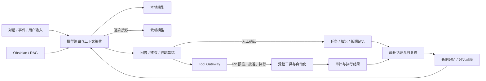

# Jarvis OS

> 本地优先、桌面优先的个人 AI 成长操作系统：让对话、知识、记忆、目标与工具执行形成可追踪、可确认、可持续演进的个人闭环。

[](https://github.com/Lyb-L-dev/jarvis-os/actions/workflows/ci.yml)


Jarvis OS 不只是一个聊天界面。它围绕个人长期成长构建了一套完整的 AI 应用架构：模型路由决定任务在哪里执行，知识与记忆为回答提供上下文，工具网关控制系统动作，审批中心守住付费调用与高风险操作的边界，评测与审计则让每次迭代都能够被验证。

当前状态：**个人项目，持续开发中**。主流程可运行，部分 v2/v3 能力通过 Feature Flag 渐进启用；默认配置优先保证本地执行、隐私与可回退性。

## 为什么做 Jarvis OS

通用 AI 助手通常会遇到三个问题：上下文难以长期积累、多个能力彼此割裂、自动化越强越难控制。

Jarvis OS 尝试给出一套工程化答案：

- **本地优先**：对话、记忆、知识索引和业务数据默认保存在本机；Ollama 模型可离线运行。
- **人在回路**：长期记忆写入、知识归档、付费模型调用和高风险工具执行都需要明确确认。
- **模块化组合**：模型路由、RAG、记忆、Agent、工具与业务模块通过稳定契约连接，可独立替换和迭代。
- **结果可验证**：记录模型来源、性能、Token、引用与执行审计，并使用固定评测集和回归测试验收。
- **持续成长闭环**：对话可以沉淀为记忆、知识或任务，任务执行结果又进入复盘与后续规划。

## 核心闭环



## 已实现能力

### AI 对话与多模型路由

- FastAPI 流式对话 API 与 Next.js 对话工作台，支持停止生成、部分结果保存、重新生成、会话搜索与长对话摘要。
- 统一接入 Ollama、本地轻量模型及可选云端模型；云端调用需要逐次确认，失败时可回退本地模型。
- 记录模型来源、首字耗时、生成速度、Token、错误和用户反馈，支持本地与云端模型的固定评测集对比。
- v3 对话工作台提供聚合接口与 SSE 事件流基座，逐步将页面操作收敛到“对话即界面”。

### RAG、长期记忆与记忆网络

- PostgreSQL + pgvector 本地语义索引，融合关键词与向量排序；索引不可用时自动回退。
- Obsidian Knowledge Bridge 仅访问指定 `Jarvis/` 子目录，回答展示可追溯的知识来源。
- 记忆采用“候选 → 人工确认 → 生效”流程，未确认内容不会参与回答。
- 实体、关系、事件与时间线组成记忆网络，支持多跳检索并与向量召回融合。
- 敏感凭据检测、云端逐项授权、内容哈希、幂等写入和冲突保护共同约束记忆与知识流转。

### 工具调用与受控自动化

- Tool Gateway 统一处理工具 Schema、Agent 白名单、R0–R3 风险分级、幂等与审计。
- Approval Center 对付费模型和工具动作提供统一审批；R2 操作遵循“预览 → 批准 → 执行”。
- n8n 运行在独立容器与 internal 网络中，仅通过本机签名入口访问；自动化离线不影响核心功能。
- Browser Worker 使用全新非持久上下文读取公开招聘页面，不登录、不复用 Cookie、不提交表单。
- Computer-use 当前开放至阶段 3：允许在沙箱内经确认修改，真实外部账号操作仍未开放。

### 个人成长工作台

- **成长中心**：长期目标、里程碑、任务、计时、每日计划与基于真实完成记录的周复盘。
- **English Coach**：中英文对话、分级纠错、语音转写、错题本与间隔复习。
- **情报中心**：RSS/Atom 与手动来源采集、三层去重、主题筛选、每日晨报及来源追踪。
- **投资助手**：资产与交易记录、持仓重算、投资理由版本、事实快照复盘；不自动交易或预测价格。
- **职业机会雷达**：只读研究公开招聘页，保存结构化岗位证据并使用本地规则匹配个人档案。
- **桌面与平板伴生端**：Windows 通知、离线语音、系统托盘、开机自启与 USB 反向隧道平板终端。

### 数据保护与工程质量

- PostgreSQL 定时生成本地恢复点，保存 SHA-256、结构版本与清单，并在独立临时数据库中验证可恢复性。
- 支持不含 API Key 的业务数据 JSON 导出；危险的覆盖恢复不在 Web 页面提供快捷入口。
- CI、单元测试、API 契约测试、PostgreSQL 集成测试、Playwright 验证、视觉基线与 Prompt/策略评测。
- 源码密钥扫描、依赖漏洞审计、安全预检，以及可创建并精确清理的无隐私演示数据。

## 技术架构

| 层级 | 主要技术 | 职责 |
| --- | --- | --- |
| Web | Next.js 16、React 19、TypeScript、Tailwind CSS 4 | 指挥中心、聊天与各业务工作台 |
| API | FastAPI、Pydantic、SQLAlchemy、Alembic | 版本化 API、业务规则、流式事件与审计 |
| AI | Ollama、Qwen、DeepSeek、LangGraph、Mem0 | 模型路由、工作流、记忆实验与本地推理 |
| Data | PostgreSQL 17、pgvector | 业务数据、向量检索、记忆网络与执行记录 |
| Automation | Tool Gateway、n8n、Browser Worker | 风险分级、审批与隔离的工具执行 |
| Companion | Python、Windows 通知、Piper/System TTS | 桌面提醒、语音与托盘常驻能力 |

```text
apps/
  api/              FastAPI、数据库、Agent 与模型服务
  web/              Next.js Web 应用
  desktop/          Windows 后台提醒与语音组件
  browser-worker/   隔离的只读浏览器研究进程
evals/              模型、Prompt、记忆与视觉评测集
infra/              PostgreSQL、pgvector 与 n8n 基础设施
scripts/            安装、启动、备份、安全检查和验收脚本
docs/               架构、PRD、迁移计划与 Sprint 记录
```

## 快速开始

### 环境要求

- Windows 10/11（当前主要验证平台）
- Python 3.12+
- Node.js 20+
- Docker Desktop
- 可选：Ollama（本地模型）、Obsidian（知识桥接）、Android ADB（平板终端）

### 一键安装与启动

```powershell
git clone https://github.com/Lyb-L-dev/jarvis-os.git
cd jarvis-os
Copy-Item .env.example .env
.\scripts\setup.ps1
.\scripts\start.ps1
```

日常使用也可以直接双击根目录的 `启动 Jarvis.cmd`；停止服务可双击 `停止 Jarvis.cmd`。

启动后访问：

- Web：<http://127.0.0.1:3000>
- API 文档：<http://127.0.0.1:8000/docs>

首次运行前请检查 `.env`。默认配置不要求填写云端 API Key；如需启用 DeepSeek 等付费模型，请自行填写密钥并保留逐次授权策略。**不要提交 `.env`，也不要把真实密钥粘贴到 Issue、日志或聊天记录中。**

更完整的安装、语音、平板、备份和故障恢复说明见[使用与恢复指南](docs/USER_GUIDE.md)。

### 手动启动

```powershell
# 1. PostgreSQL + pgvector
docker compose -f infra/docker-compose.yml up -d

# 2. API
python -m venv .venv
.\.venv\Scripts\python.exe -m pip install -e "apps/api[dev]"
.\.venv\Scripts\python.exe -m app

# 3. Web（新终端）
npm --prefix apps/web install
npm --prefix apps/web run dev
```

### 基础验证

```powershell
# 后端测试与前端检查
.\scripts\check.ps1

# 安全预检
.\scripts\security-check.ps1

# 依赖审计
.\scripts\dependency-audit.ps1
```

部分实验能力默认关闭。请阅读 `.env.example` 中对应 Feature Flag 的说明，并完成相关迁移或依赖安装后再启用。

## 安全与隐私边界

Jarvis OS 将外部内容、模型输出和工具参数都视为不可信输入。

- API、PostgreSQL、Browser Worker 与自动化入口默认只监听回环地址，避免直接暴露到局域网或公网。
- 云端模型不会自动获得全部记忆或 Obsidian 内容；付费调用和敏感上下文需要单独授权。
- 网页中的 Prompt Injection 只能作为风险信号记录，不能扩大 Agent 或工具权限。
- 密码、API Key、验证码、证件号、银行卡号和私钥禁止进入长期记忆。
- 投资模块不自动交易，不生成仓位或价格预测；浏览器研究不登录、不下载、不填表、不投递。
- OpenClaw 等宿主级自动化在满足隔离、权限、审计与回滚门槛前保持禁用。

该项目仍处于个人开发阶段，不应直接作为多用户公网服务部署。若需要远程访问，请额外配置身份认证、HTTPS、密钥管理与网络隔离。

## 演进状态

| 方向 | 状态 |
| --- | --- |
| 本地对话、成长、知识、提醒等主流程 | 可运行 |
| PostgreSQL + pgvector 与备份恢复 | 已验收 |
| v2 Router、Prompt Registry、Tool Gateway | 已实现，按 Feature Flag 渐进启用 |
| v3 对话工作台与 SSE | 基座已完成，持续收敛 |
| v3 记忆网络 | 数据模型、多跳检索与评测集已落地 |
| 真实外部账号写入与高风险自动化 | 未开放 |

近期变更见 [GitHub Commits](https://github.com/Lyb-L-dev/jarvis-os/commits/main/)，详细迁移计划见 [v2 架构迁移计划](docs/JARVIS_OS_V2_ARCHITECTURE_MIGRATION_PLAN.md) 与 [v3 计划](docs/JARVIS_OS_V3_PLAN.md)。

## 文档导航

- [架构总览](docs/ARCHITECTURE.md)
- [技术设计](docs/TECHNICAL_DESIGN.md)
- [数据库 ER 模型](docs/DATABASE_ER.md)
- [产品需求文档](docs/Jarvis_OS_v1.1_PRD.md)
- [使用与恢复指南](docs/USER_GUIDE.md)
- [发布验收报告](docs/RELEASE_ACCEPTANCE.md)
- [无隐私演示与视频脚本](docs/DEMO_GUIDE.md)
- [历史 Sprint 文档](docs/)

## 项目说明

Jarvis OS 是一个面向个人真实使用场景的自研项目，重点探索本地 AI、长期记忆、个人知识管理、人在回路的 Agent 系统与可验证的软件迭代。目前主要针对单用户 Windows 环境开发，不承诺生产级 SLA。

欢迎通过 Issue 提交问题或交流设计思路。涉及隐私数据、密钥或本机路径的信息请先脱敏。
