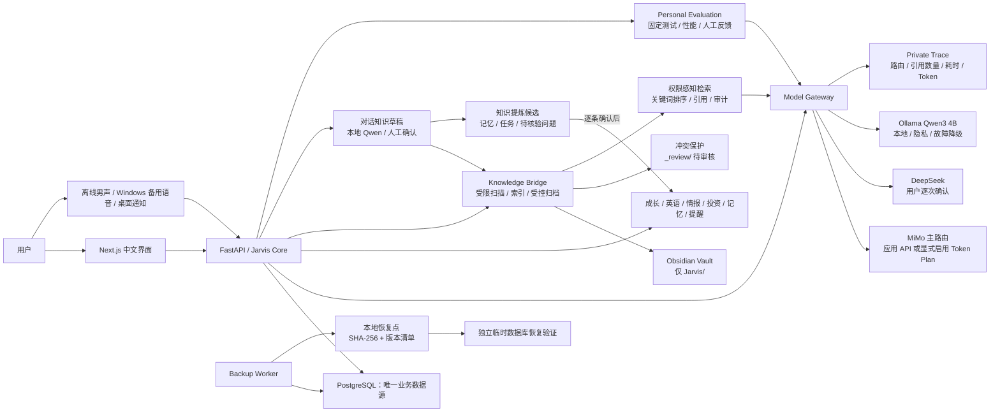
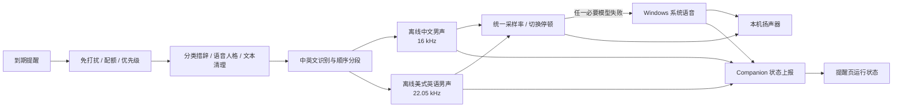
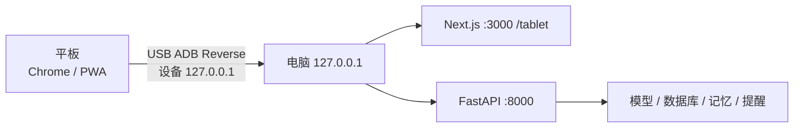
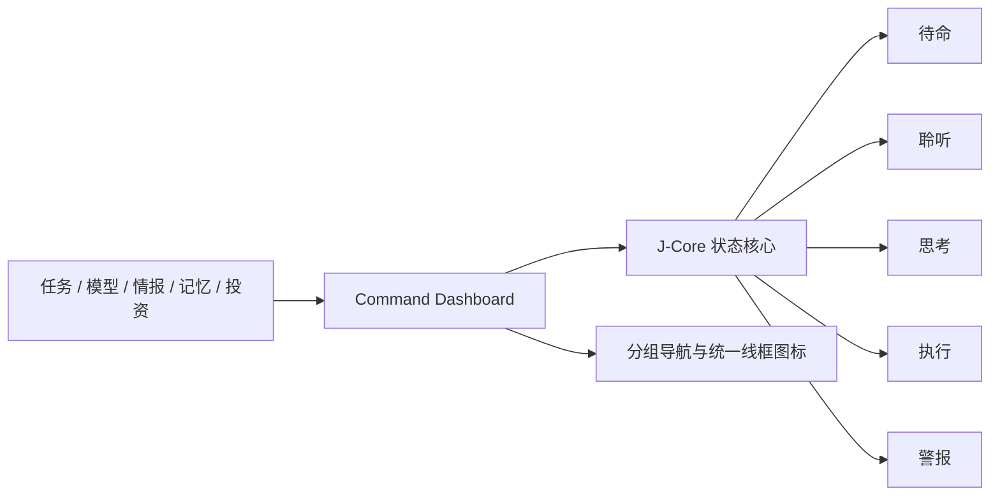
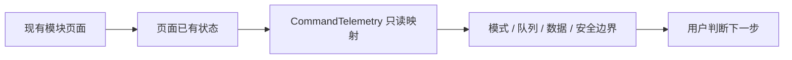
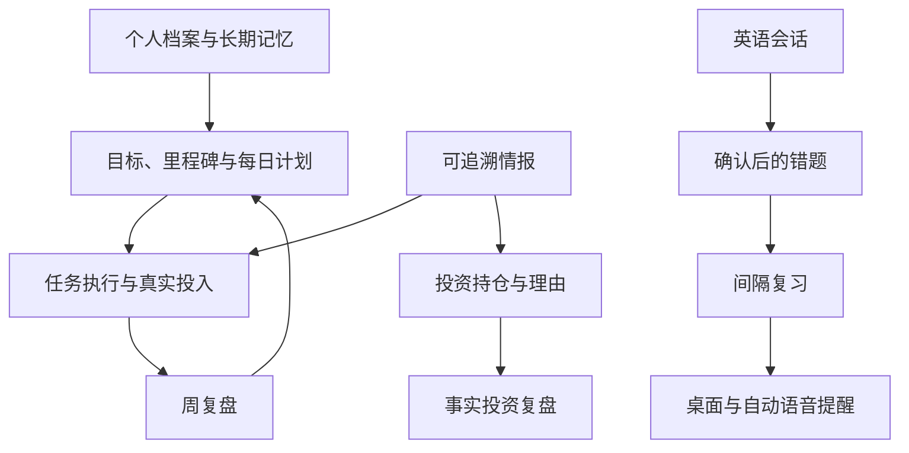
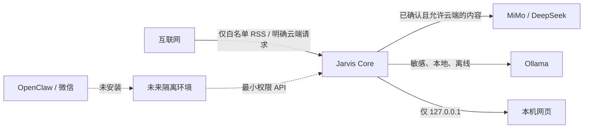

# Jarvis OS v1.1 架构总览

## 当前可运行架构

## 主动语音链路

- `auto` 默认优先离线双语男声，所需模型或运行时不可用时才使用 Windows 语音；
- `local_neural` 和 `windows` 允许在提醒页显式选择；
- 语音人格只改变播报文本与语速，不改变提醒原文和数据库记录；
- 中文、英文和中英混合文本不调用 LLM，而是由本地字符级规则分段；
- 本地合成不发送提醒内容到互联网；
- 两个模型固定使用 CPU，因此不会与本地 Qwen 争用 独立显卡 的显存。

## 平板专用终端

- 电脑网页和 API 仍只监听 `127.0.0.1`；
- ADB 只反向转发 `tcp:3000` 与 `tcp:8000`，没有 Windows 入站端口；
- 平板只承担显示、触控和可选浏览器语音转写，AI 运算仍在电脑；
- 连接脚本不安装 APK、不执行 Root、不访问平板文件；
- Android Platform Tools 必须由用户接受 Google SDK 许可后安装，并校验 Google
  数字签名；
- 断开脚本精确删除两个 Jarvis 端口映射，不清理其他应用的 ADB 规则。

## 交互与视觉层

- J-Core、网页图标和导航图形全部由本地 SVG / CSS 构成，不依赖外部视觉服务；
- 总览聚合现有只读接口，单个业务模块失败不会阻塞其他模块；
- 首次读取映射为“思考”，手动同步映射为“执行”，核心异常映射为“警报”；
- 状态预览只影响视觉反馈，不触发模型调用或业务写入；
- 动画遵守系统的减少动态效果设置；
- 视觉层不改变模型路由、数据库或安全权限。

### 模块遥测

- 遥测组件不直接请求 API，只展示父页面已经取得的数据；
- Chat 遥测映射生成状态、模型路线、消息上下文和隐私/知识边界；
- 业务模块使用同一组件展示各自的当前视图、关键队列与安全状态；
- 遥测不执行动作、不调用模型、不改变数据库，因此不是新的权限入口。

## 个人闭环

## 安全边界

- API 与网页只监听本机回环地址；
- DeepSeek 不自动产生费用，实际调用必须逐次确认；
- Token Plan 采用专用地址与 `api-key` 鉴权，且必须通过本机配置显式启用；
- 当前启用决定不改变小米套餐规则，仍存在服务暂停或密钥封禁风险；
- API Key 只保存在本机 `.env`，不进入数据库导出、长期记忆或源码；
- Obsidian 仅允许访问已验证 Vault 下的 `Jarvis/`，禁止 `.obsidian`、链接和越界路径；
- 记忆与每日情报可以自动归档；周复盘、英语和投资知识必须手动确认；
- 归档以来源唯一键和内容哈希保证幂等，用户修改冲突进入 `_review/` 而不覆盖原文件；
- 本地模型可使用所有已启用笔记，云端模型只能使用逐篇明确授权的笔记；
- 检索上下文视为不可信数据，回答保存来源引用，审计不重复保存查询正文或笔记摘录；
- 对话沉淀只能手动触发，草稿固定走本地 Qwen，确认后才进入 `Conversations/`；
- 草稿提炼同样固定走本地 Qwen，候选在人工确认前不进入记忆或任务；
- 已确认记忆默认禁止云端使用；待核验问题只创建核验任务，不作为事实进入回答；
- 草稿修改会撤销未接受候选，已接受结果及其来源链接继续保留；
- 模型执行追踪不复制提问、回答或笔记正文，只记录结构化性能与步骤元数据；
- 个人评测只使用固定非私人测试题，不自动改变正式路由或人工确认规则；
- DeepSeek 评测与正式调用一样必须逐次确认费用，失败时不自动降级；
- 网页不提供覆盖恢复按钮；
- OpenClaw 不属于当前运行依赖，也没有主机权限。

---

## v2 迁移状态（2026-08-06，迁移路线图 Sprint 0-6 完成）

本文档为 v1.1 架构总览；迁移路线图（Sprint 0-6）已在 v1 生产路径上渐进落地，
全部合入 `dev`（`main` 保持发布基线）。以下为本轮新增/改造的组件，权威细节见
`docs/MIGRATION_SPRINT_1..6.md` 与各 ADR：

```mermaid
flowchart TB
    subgraph v2["v2 新增/改造（Feature Flag 灰度，默认关）"]
        REPO["db/repositories + uow.py<br/>唯一数据出口"]
        ENUM["db/enums.py + CHECK 约束<br/>AgentApproval/Memory/ToolExecution/AgentRun"]
        CKPT["db/checkpoint.py<br/>checkpointer 下沉（H2）"]
        PROMPT["services/prompts/**<br/>24 模板 + 版本注册表（flag 灰度）"]
        ROUTER2["Router v2 阶段 1 一致性校验<br/>Policy 审计读取点"]
        REG["Agent Registry<br/>effective_tools 派生视图 + R1-R5 对账"]
        MROUTE["后台模型调用统一走 ModelRouter"]
        CU3["Computer-use 阶段 3<br/>沙箱确认后修改（R2）"]
        BACKUP2["backup.ps1 vault 归档 + backup-drill.ps1"]
        FE["前端 lib/api/** 领域模块 + generated.ts<br/>四巨型组件拆分"]
    end
    CORE["Jarvis Core API（FastAPI）"] --> REPO
    CORE --> ENUM
    CORE --> CKPT
    CORE --> PROMPT
    CORE --> ROUTER2
    CORE --> REG
    CORE --> MROUTE
    CORE --> CU3
    CORE --> BACKUP2
    CORE --> FE
```

要点：

- **数据层**：Repository/UoW 为新增边界（未强制迁移全部 service，渐进推进）；
  状态枚举四层统一（DB CHECK + Pydantic + TS union，AgentRun 命名联合为遗留项）；
- **AI 层**：Prompt 注册表、Router 一致性校验、workflow 走 AgentSpec 均默认关
  （`v2_prompt_registry_enabled` / `v2_router_enforcement_enabled` / `v2_policy_enforcement_enabled`），
  开即逐字等价或仅审计；
- **工具层**：Computer-use 阶段 3 已启用（`computer_use_stage=3`，R2 预览-批准-执行 +
  沙箱备份 + 可回滚）；n8n 测试账号工作流为环境门控（`available=False`）；
- **前端**：`lib/api.ts` 为兼容层（372 导出冻结），领域实现在 `lib/api/**`；
  四巨型组件已拆至 ≤289 行/文件；
- **迁移**：`20260608_0030`（状态 CHECK）、`20260608_0031`（HNSW ANN）已落库未应用，
  应用流程见 `docs/MIGRATION_SPRINT_1.md §5`。
