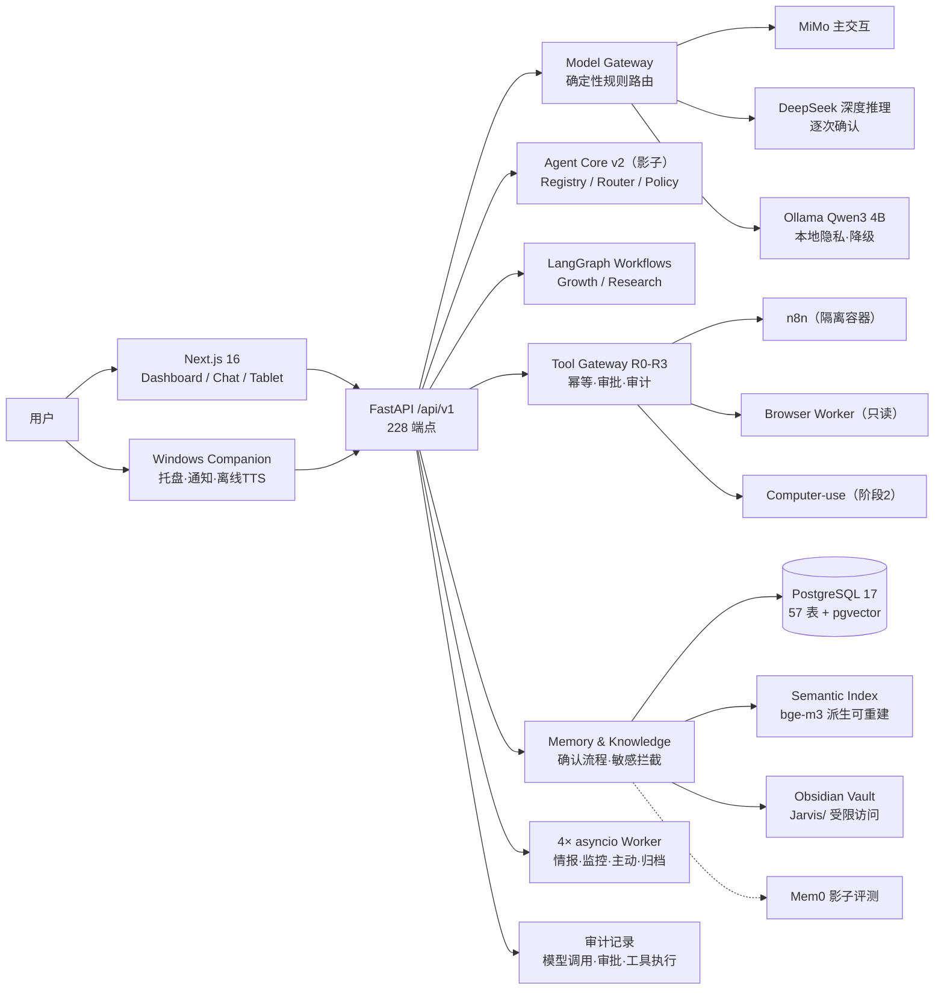

# CURRENT_PROJECT_AUDIT.md — Jarvis OS 当前项目审计报告

- **文档类型**：Phase 1 项目审计（技术负责人产出）
- **日期**：2026-08-06
- **审计基线**：Sprint 37 已完成（受控 Computer-use 阶段 2：只读查看 + 计划预览）
- **审计方式**：真实目录扫描 + 4 路并行子系统深度审查（AI/Agent、数据存储、前端/API、基础设施）
- **结论**：这是一个**安全设计水准远超同类的个人 AI 系统**，但处于"v2 蓝图已落地为影子代码、尚未接生产管线"的过渡态。工程化层（无版本控制、无 CI）与架构层（契约脱节、巨型组件）是主要负债。

---

## 1. 项目目录结构

### 1.1 当前目录树（已剔除 node_modules/.venv/.next/__pycache__/.data 等运行时目录）

```text
e:\贾维斯\
├── 启动 Jarvis.cmd / 停止 Jarvis.cmd / 连接|断开 Jarvis 平板.cmd / 配置 Jarvis 职业雷达.cmd
│       ← Windows 一键入口，委托 scripts/*.ps1
├── .env / .env.example            ← 全部运行配置（模型密钥、Feature Flag、阈值）
├── README.md                      ← 产品总览 + Sprint 1-37 交付记录索引
├── apps/
│   ├── api/                       ← FastAPI 后端（唯一决策中心）
│   │   ├── app/
│   │   │   ├── main.py            ← FastAPI 入口 + 4 个 asyncio 后台 worker 生命周期
│   │   │   ├── core/config.py     ← Settings（pydantic-settings，.env 加载 + 14 个 v2_* 开关）
│   │   │   ├── db/                ← SQLAlchemy 2.0 async + 22 个模型文件（57 张表）
│   │   │   │   └── models/        ← agent/chat/english/growth/intelligence/investment/...
│   │   │   ├── api/               ← 23 个路由文件，228 个端点，/api/v1 前缀
│   │   │   │   └── routes/        ← chat/growth/investment/intelligence/english/knowledge/...
│   │   │   ├── schemas/           ← 约 210 个 Pydantic 模型（Create/Update/Response 三件套）
│   │   │   └── services/          ← 34 个服务模块 + 2 个内包子系统
│   │   │       ├── model_gateway/ ← Model Gateway（provider/execution/routing）
│   │   │       └── agent_core/    ← v2 Agent Core（contracts/registry/routing/policy/runtime/catalog）
│   │   ├── migrations/versions/   ← 29 个 Alembic 线性迁移
│   │   └── tests/                 ← 40 个测试文件 / 203 个测试函数
│   ├── web/                       ← Next.js 16 前端（2.6 万行 TS）
│   │   └── src/
│   │       ├── app/               ← 23 个页面（含平板专用 /tablet）
│   │       ├── components/        ← 64 个组件（含 8 个 600+ 行巨型组件）
│   │       ├── lib/api.ts         ← 5,372 行 API 客户端（195 次 fetch / 200 个导出函数）
│   │       └── app/globals.css    ← 22,901 行手写 CSS
│   ├── desktop/                   ← Windows 后台提醒 + 语音 Companion（980 行 Python）
│   │   └── src/jarvis_desktop/    ← companion/tray/windows/voice_persona/tts
│   └── browser-worker/            ← 隔离只读岗位研究 Worker（663 行 Node，HMAC 签名）
├── infra/
│   ├── docker-compose.yml         ← postgres(pgvector) + n8n(internal 网络) + n8n-ingress
│   ├── n8n/                       ← ingress(HMAC 代理) + bootstrap + 3 个无副作用 workflow
│   └── ollama/                    ← JarvisMemory.Modelfile（Mem0 影子模型别名）
├── scripts/                       ← 33 个 PowerShell/Node/Python 脚本
│       ├── start.ps1 / stop.ps1 / check.ps1   ← 启动/停止/质量门禁
│       ├── backup.ps1 / restore-backup.ps1 / verify-backup.ps1
│       ├── setup*.ps1             ← n8n/browser-worker/mem0/voice/tablet 引导
│       └── verify_*.cjs ×12       ← Playwright 端到端验收脚本
├── docs/
│   ├── adr/                       ← 11 个已 Accepted 的架构决策记录（0001-0011）
│   ├── SPRINT_1.md … SPRINT_37.md ← 37 篇 Sprint 交付记录
│   ├── ARCHITECTURE.md            ← v1.1 架构总览（mermaid）
│   ├── TECHNICAL_DESIGN.md        ← v1.1 技术设计（534 行）
│   ├── DATABASE_ER.md             ← 数据库 ER 图（800 行）
│   └── JARVIS_OS_V2_ARCHITECTURE_MIGRATION_PLAN.md ← v2 迁移蓝图（核心约束文档）
├── evals/                         ← 3 个评测集（prompt_policy / memory_shadow / personal_benchmark）
└── artifacts/ .data/ .runtime/ backups/  ← 运行产物（浏览器配置 / 沙箱 / 备份）
```

### 1.2 目录用途解释

| 目录 | 用途 | 归属 |
|---|---|---|
| `apps/api` | FastAPI 后端：模型路由、Agent、记忆、知识、全部业务领域 | Backend / AI / Memory |
| `apps/web` | Next.js Dashboard + Chat + 平板终端 | Frontend |
| `apps/desktop` | Windows 托盘、桌面通知、离线 TTS | Desktop |
| `apps/browser-worker` | 隔离只读浏览器研究（岗位雷达） | Automation |
| `infra/` | Docker 基础设施（PG/n8n）、n8n 工作流定义 | Infra |
| `scripts/` | Windows 运维脚本（启动/备份/验收） | Infra/QA |
| `docs/` | PRD、ADR、Sprint 记录、架构文档 | Tech Lead |
| `evals/` | 提示词策略、记忆影子、个人模型基准评测集 | QA/AI |
| `.data/` | 运行时数据（沙箱、n8n/browser 密钥、Mem0 影子库） | 运行时（gitignore） |

---

## 2. 技术栈分析

### 2.1 Frontend（apps/web）

| 维度 | 现状 |
|---|---|
| 框架 | Next.js **16.1.0**（App Router，React 19.2） |
| 样式 | Tailwind **v4.1.0**（`@tailwindcss/postcss`，无 tailwind.config.js）+ 22,901 行手写 `globals.css` |
| UI 库 | shadcn/ui 仅落地 3 个组件（button/card/tooltip），其余表单/弹窗全手写 |
| 状态管理 | **纯 useState/useEffect**，无 zustand/redux/tanstack-query（0 命中） |
| API 通信 | 手写 fetch 封装集中于 `lib/api.ts`（5,372 行 / 200 函数 / 195 处 fetch）；SSE 手写流式解析；无缓存层（全部 `cache:"no-store"`） |
| 图表/动画 | echarts v6 / globe.gl / maplibre-gl；motion v12 |

### 2.2 Backend（apps/api）

| 维度 | 现状 |
|---|---|
| 框架 | FastAPI（uvicorn，Windows SelectorEventLoop 特判）+ Python 3.12 |
| 数据库 | PostgreSQL 17 + pgvector（生产，Alembic 29 迁移）；SQLite 内存库（测试） |
| ORM | SQLAlchemy 2.0 async，22 个模型文件 / 57 张表 |
| 服务结构 | 34 个平铺服务 + 2 个内包子系统（`model_gateway/`、`agent_core/`） |
| 后台任务 | 4 个 asyncio worker（情报简报/监控/主动建议/知识归档），asyncio.Event 优雅停止 |
| 工作流 | LangGraph（research/growth 两图），`interrupt()` 人类在环 + PostgreSQL Checkpointer |

### 2.3 AI

| 维度 | 现状 |
|---|---|
| 模型调用 | OpenAI 兼容 Provider 单类三实例（MiMo / DeepSeek / Ollama），`model_gateway/` |
| 路由 | 确定性规则路由（本地敏感→Qwen；复杂/连续失败→DeepSeek 需确认；默认 MiMo）+ 运行时故障降级 |
| Agent 实现 | 双轨：Direct Runtime（无独立 Agent，chat.py 直连）；LangGraph Workflow（research/growth） |
| Agent Registry | `agent_core/` 已实现（6 个 AgentSpec）但仅影子模式使用，workflow 不经过 Registry |
| Prompt 管理 | **全部硬编码在服务内**，无集中注册表、无版本化、无 A/B |
| 深度推理门禁 | DeepSeek 逐次确认（客户端布尔 + 服务端 409）；English Coach 完全禁 DeepSeek |

### 2.4 Storage

| 维度 | 现状 |
|---|---|
| 主库 | PostgreSQL（唯一业务事实源） |
| 向量 | pgvector 内嵌（`semantic_index_entries.embedding` Vector(1024)），派生可重建索引 |
| Cache | 无 Redis；n8n/Mem0 即使离线核心功能可用（架构约束） |
| 备份 | pg_dump 自定义格式 + SHA256 + manifest(alembic_version) + staging 库恢复验证，30 份轮转 |

---

## 3. 已实现功能清单

### Frontend ✅
- [x] Chat UI（流式 SSE、停止生成、自动保存、重新生成、会话搜索）
- [x] Command Dashboard（J-Core 状态核心、真实数据聚合）
- [x] 全部业务模块页面：成长/英语/情报/投资/记忆/知识/监控/职业/评测/审批/通知/成本/上下文/人格/主动/计算机
- [x] 平板专用 `/tablet` 全屏终端（ADB 反向隧道）
- [x] 设置页（模型/备份/导出/数据保护/语音）
- [x] 审批中心（工具动作 + DeepSeek 授权统一展示）

### Backend ✅
- [x] 版本化 API（/api/v1，228 端点，23 路由文件）
- [x] 单用户系统（`current_user` 伪鉴权：取第一条 User）
- [x] 对话/消息/模型调用审计持久化
- [x] 备份/恢复/导出/校验全链路
- [x] 4 个后台 asyncio worker

### AI ✅ / ⚠️
- [x] 三模型统一 Gateway + 故障降级 + DeepSeek 逐次确认
- [x] LangGraph Growth 规划工作流（暂停/恢复/DeepSeek 确认节点）
- [x] LangGraph Research 研究工作流（来源/引用/归档边界）
- [x] Tool Gateway R0-R3 风险分级 + 幂等 + 参数哈希 + 事件审计
- [x] 本地语义记忆（pgvector + bge-m3）+ 混合检索
- [x] Mem0 影子评测（严格隔离，不进入权威记忆）
- ⚠️ Intent Router / Policy Router 仅影子模式（`v2_policy_enforcement_enabled` 无实现入口）
- ⚠️ Agent Registry 半使用（workflow 不经过它）

### Memory ✅
- [x] 长期记忆中心（候选确认/手动添加/搜索/编辑/停用/删除）
- [x] 敏感信息拦截（密钥/证件/银行卡/私钥不进记忆）
- [x] 语义索引重建/增量同步/哈希校验
- [x] Obsidian Knowledge Bridge（受限扫描/归档/冲突保护/混合检索/来源引用）

### Automation ⚠️
- [x] n8n 隔离 Provider（HMAC 签名入口、internal 网络、3 个无副作用 workflow）
- [x] 只读 Browser Research（7 层隔离：白名单/DNS 校验/robots/一次性上下文/注入信号）
- [x] Windows Companion（托盘/通知/离线双语 TTS 三层降级）
- ⚠️ Computer-use 处于阶段 2（只读 + 计划预览，尚未开放确认后修改）
- ⚠️ 真实外部账号动作（日历写入/邮件发送）仍未开放

---

## 4. 当前系统架构



---

## 5. 技术债务分析

> 等级说明：**Critical**（必须尽快处理，威胁升级目标）；**High**（升级前需处理）；**Medium**（可并行顺带处理）；**Low**（观察项）。

### 🔴 Critical

| # | 债务 | 证据 | 影响 |
|---|---|---|---|
| C1 | **无版本控制** | 根目录无 `.git`（`git rev-parse` 失败），但有 `.gitignore`/`.env.example` | 全部源码无历史/无 diff/无回滚。**多 Agent 并行开发的死穴**——没有分支机制就无法安全并行，任何破坏性改动无法撤销 |
| C2 | **API 契约三处手写、零共享** | TS 接口(api.ts) + Pydantic schema(210 类) + SQLAlchemy 模型 人工同步；路径硬编码 195 处 | 改一个字段/路径静默损坏另两层，无编译期拦截。Agent 并行时契约冲突率极高 |
| C3 | **Agent Core 契约层与持久层脱节** | `agent_core/contracts.py` 的 ApprovalStatus(approved/rejected/consumed) 与 `db/models/` 的裸字符串 status 互不关联；`grep AgentRun(` 仅契约定义处命中 | 审批状态机双份语义；审计可追溯性失真。**核心升级目标（Agent Run Ledger）当前不成立** |
| C4 | **巨型前端单体** | `investment-center.tsx` 1,876 行 / `english-coach.tsx` 1,457 / `chat-workspace.tsx` 1,389 / `growth-center.tsx` 1,182；`globals.css` 22,901 行；`api.ts` 5,372 行 | 一个文件 = 一个领域，无法隔离并行、无法测试、冲突合并噩梦 |
| C5 | **postgres 端口暴露公网接口** | `infra/docker-compose.yml:16` `"5432:5432"`（未绑 127.0.0.1）+ 弱口令 `jarvis_dev_only` | 唯一暴露面最大的容器；与其余全部 loopback 服务形成反差。一键修复：`127.0.0.1:5432:5432` |

### 🟠 High

| # | 债务 | 证据 | 影响 |
|---|---|---|---|
| H1 | **无 Repository 层 + Service 内裸 commit** | 25 个 service 直接操作 AsyncSession；`knowledge_retrieval.py:431` 检索函数内部 commit | 跨 service 事务边界失控、部分提交风险；Agent 并行改同一事务链必冲突 |
| H2 | **workflow 反向耦合** | `research_workflow.py:31` 从 `growth_workflow` import `WorkflowCheckpointerProvider` | 两个"独立 Agent"无法独立部署/测试；checkpointer 应下沉 `db/` |
| H3 | **双 Router 并存** | 真实 `ModelRouter`（model_gateway）vs 影子 `RouterV2`（agent_core）；`v2_policy_enforcement_enabled` 无任何代码读取点 | "影子"决策不参与执行，前端体验随 flag 波动；升级路线不清 |
| H4 | **Prompt 硬编码 + 假版本号** | 10+ 处系统 prompt 内联各服务；`prompt_version` 仅声明无内容存储 | 无法变更追踪/回归测试/A-B；**AI 升级的核心痛点** |
| H5 | **AgentSpec 白名单双维护** | `catalog.py` vs `tool_catalog.py` 手工同步，无交叉校验 | Agent 扩展时白名单漂移；运行时靠 tool_gateway 兜底 |
| H6 | **迁移与模型漂移 + 多 schema 来源** | 测试用 `create_all`，生产用 Alembic，0022 后新表 PK/FK 未用命名约定；Mem0 自带 pgvector 集合 + SQLite history | 三套 schema 无单一事实；约束名不一致 |
| H7 | **pgvector 无 ANN 索引** | `semantic_index_entries.embedding` 无 HNSW/IVFFlat，全表 cosine 扫描 | 记忆/知识增长后检索退化 |
| H8 | **当前用户伪鉴权重复定义 20 处** | `grep "def current_user"` → 20 处；全部 `select(User).order_by(created_at).limit(1)` | DRY 违规；多用户假设是隐患 |
| H9 | **后台 worker 硬编码取第一个 User + 静默吞异常** | `knowledge_archive.py:1117` 等 | 多用户架构假设被打破 |
| H10 | **无 CI/pre-commit/格式化** | 无 `.github/`、无 husky/lefthook、无 prettier；质量门禁仅 `check.ps1` 手动触发 | Agent 并行时代码风格漂移、回归无自动拦截 |

### 🟡 Medium

| # | 债务 | 证据 |
|---|---|---|
| M1 | `httpx2>=2.9,<3` 疑似错误依赖 | `pyproject.toml:31`（PyPI `httpx2` 是非官方占位包；正确依赖 `httpx` 已在第 16 行）——**供应链风险** |
| M2 | 后台模型调用绕过 ModelRouter | `knowledge_capture/insights/conversation_summary/memory_engines` 硬编码 ollama `ResolvedRoute` |
| M3 | Ollama 未版本化隐式依赖 | 不在 compose，浮动 tag `bge-m3:latest`；preflight 只检查存在不自动安装 |
| M4 | `.env.example` 与 config 漂移 | config 有 `proactive_*/computer_use_stage` 但 .env.example 缺失；`OPENCLAW_*` 过时注释 |
| M5 | 4-5 个死 Feature Flag | `v2_agent_core_enabled`/`v2_policy_enforcement_enabled`/`v2_shadow_runs_enabled`/`v2_mem0_chat_shadow_enabled` 无读取点 |
| M6 | Mem0 同步阻塞 + 全局单例 + to_thread | `memory_engines.py:214-302`，与 SelectorEventLoop 混用 |
| M7 | 意图检测纯正则关键词 | `routing.py:197`，高误判面 |
| M8 | 巨型后端 service | `intelligence.py` 1,267 行 / `research_workflow.py` 1,092 / `growth_workflow.py` 916 / `tool_gateway.py` 669 |
| M9 | 测试基座 SQLite，pgvector 零覆盖 | `test_semantic_memory.py` 显式断言语义路径不激活；`test_growth_workflow_postgres` 默认 skip |
| M10 | `[module]` 死路由 + `providerLabel` 等重复工具函数 | `app/[module]/page.tsx` 是 Sprint 2-7 遗留 |
| M11 | browser-worker 跨包借用依赖 | `server.cjs:10` `require("../web/node_modules/playwright")`，无独立 package.json |
| M12 | TTS 模型下载无 SHA256 校验 | `install-voice.ps1:36-40` |
| M13 | `models/__init__.py` 集中 re-export 全部 57 表 | 任何 import 触发整包导入 |

### 🟢 Low
- 错误消息中英混杂、无结构化错误码；
- `current_user` 未来多用户隐患（H8 关联）；
- `.env` 权限检查仅 Warning 不 Fail（security-check.ps1）；
- `restore-backup.ps1` DDL 非事务性（有安全备份兜底）；
- `.runtime/*.log` 无 size 上限；
- dashboard 首屏一次并发 10 个请求（无缓存层直接后果）。

---

## 6. 审计结论

### 6.1 子系统成熟度矩阵

| 子系统 | 成熟度 | 一句话评价 |
|---|---|---|
| Model Gateway | ★★★★☆ | provider 抽象 + 确定性路由 + 降级 + 审批，架构清晰 |
| Tool Gateway | ★★★★★ | R0-R3 + 幂等 + 参数哈希 + 事件审计 + 沙箱，**全项目最扎实** |
| LangGraph Workflow | ★★★★☆ | interrupt/Command/checkpoint 质量高，但 checkpointer 反向耦合 |
| Agent Core | ★★☆☆☆ | Registry/Router/Policy 完整但仅影子使用，契约层脱节 |
| 数据/存储 | ★★★☆☆ | 迁移链完整、安全模型内建，但无 Repository、事务所有权混乱 |
| 前端 | ★★☆☆☆ | 技术栈极新，但巨型组件 + 巨型 CSS + 零共享类型 |
| 基础设施 | ★★★☆☆ | 安全纵深设计出色（HMAC/内部网络/只读浏览器），但缺 git/CI |
| 文档体系 | ★★★★★ | 11 ADR + 37 Sprint + v2 迁移蓝图，决策可追溯，**全项目最佳** |

### 6.2 关键战略判断（影响后续所有设计）

1. **已有 v2 蓝图 ≠ 已接入生产**：`JARVIS_OS_V2_ARCHITECTURE_MIGRATION_PLAN.md` 是高质量约束文档，Sprint 23-37 已交付大部分影子实现。**升级任务不是"从零设计目标架构"，而是"把已落地的影子代码接入生产管线"**——这比 Rewrite 安全得多，也符合 Migration 原则。
2. **最大的障碍不是代码，是工程化**：无 git、无 CI、无 pre-commit。**在修复这三个之前，任何多 Agent 并行开发都是空中楼阁**。Phase 5 的并行策略必须以此为第一前提。
3. **安全设计是核心资产，不可破坏**：R3 永不自动化、DeepSeek 逐次确认、English 禁 DeepSeek、沙箱写入、HMAC 签名——这些边界是多 Agent 开发时**任何 Agent 都不得修改的禁区**（见 FILE_OWNERSHIP.md 与各 Agent 的 Forbidden 清单）。
4. **双轨（v1 生产 + v2 影子）是迁移的安全网**：Feature Flag 机制本身设计良好（`config.py:53-66`），是"渐进升级不推翻重写"的现成底座，应保留并强化，而不是清理。

### 6.3 升级优先级建议（对应 MIGRATION_ROADMAP.md）

```text
P0  建立工程地基：git 初始化 + 首次提交 + 分支规范 + CI/check.ps1 门禁 + postgres 端口修复
P1  确立并行护栏：FILE_OWNERSHIP.md + 契约冻结 + 测试基线快照
P2  后端架构迁移：Repository/事务边界 + checkpointer 下沉 + 契约层打通 + 状态枚举
P3  AI 能力落地：Prompt 集中管理 + Intent/Policy Router 接生产 + workflow 走 Registry
P4  前端渐进重构：拆分巨型组件 + api.ts 模块化 + 共享类型生成 + 缓存层
P5  Memory/Tool 深化：pgvector ANN 索引 + PG 集成测试 + 后台模型调用统一路由
P6  自动化扩展：Computer-use 阶段 3 + 真实外部账号（保持 R2 审批）
```
