# Jarvis OS 数据库 ER 模型

## 1. Sprint 1–16 已实现实体

```mermaid
erDiagram
    USERS ||--o| USER_PROFILES : has
    USERS ||--o| USER_PREFERENCES : has
    USERS ||--o{ ONBOARDING_SESSIONS : starts
    USERS ||--o{ CHAT_CONVERSATIONS : owns
    CHAT_CONVERSATIONS ||--o{ CHAT_MESSAGES : contains
    CHAT_CONVERSATIONS ||--o{ MODEL_CALL_LOGS : records
    CHAT_MESSAGES ||--o| MODEL_CALL_LOGS : produces
    USERS ||--o{ EVALUATION_RUNS : evaluates
    USERS ||--o{ MEMORIES : owns
    MEMORIES ||--o{ MEMORY_REVISIONS : changes
    USERS ||--o{ GOALS : owns
    GOALS ||--o{ MILESTONES : contains
    GOALS ||--o{ GROWTH_TASKS : organizes
    MILESTONES ||--o{ GROWTH_TASKS : breaks_down
    USERS ||--o{ GROWTH_TASKS : owns
    GROWTH_TASKS ||--o{ TASK_EVENTS : records
    USERS ||--o{ DAILY_PLANS : confirms
    USERS ||--o{ WEEKLY_REVIEWS : reviews
    USERS ||--o| NOTIFICATION_PREFERENCES : configures
    USERS ||--o{ SCHEDULED_JOBS : schedules
    USERS ||--o{ NOTIFICATIONS : receives
    USERS ||--o{ COMPANION_DEVICES : connects
    GROWTH_TASKS ||--o{ SCHEDULED_JOBS : reminds
    SCHEDULED_JOBS ||--o| NOTIFICATIONS : creates
    NOTIFICATIONS ||--o{ DELIVERY_ATTEMPTS : records
    USERS ||--o{ ENGLISH_SESSIONS : practices
    ENGLISH_SESSIONS ||--o{ ENGLISH_MESSAGES : contains
    USERS ||--o{ ENGLISH_MISTAKES : owns
    ENGLISH_MISTAKES ||--o{ ENGLISH_REVIEWS : schedules
    USERS ||--o{ ENGLISH_REVIEWS : completes
    USERS ||--o{ NEWS_SOURCES : configures
    NEWS_SOURCES ||--o{ NEWS_ITEMS : publishes
    USERS ||--o{ NEWS_ITEMS : owns
    NEWS_ITEMS ||--o{ NEWS_ITEM_LINKS : relates
    USERS ||--o{ DAILY_BRIEFS : receives
    NEWS_ITEMS ||--o{ INTEREST_FEEDBACK : learns
    USERS ||--o{ ASSETS : owns
    ASSETS ||--o| PORTFOLIO_POSITIONS : has
    ASSETS ||--o{ INVESTMENT_TRANSACTIONS : records
    ASSETS ||--o{ INVESTMENT_THESES : explains
    ASSETS ||--o{ INVESTMENT_REVIEWS : reviews
    INVESTMENT_THESES ||--o{ INVESTMENT_REVIEWS : assessed_by
    USERS ||--o| KNOWLEDGE_VAULT_CONFIGS : configures
    KNOWLEDGE_VAULT_CONFIGS ||--o{ KNOWLEDGE_DOCUMENTS : indexes
    KNOWLEDGE_VAULT_CONFIGS ||--o{ KNOWLEDGE_SYNC_LOGS : logs
    KNOWLEDGE_VAULT_CONFIGS ||--o{ KNOWLEDGE_ARCHIVE_RECORDS : archives
    KNOWLEDGE_VAULT_CONFIGS ||--o{ KNOWLEDGE_RETRIEVAL_LOGS : retrieves
    USERS ||--o{ KNOWLEDGE_CAPTURE_DRAFTS : reviews
    CHAT_CONVERSATIONS ||--o{ KNOWLEDGE_CAPTURE_DRAFTS : captures
    USERS ||--o{ KNOWLEDGE_INSIGHT_CANDIDATES : confirms
    KNOWLEDGE_CAPTURE_DRAFTS ||--o{ KNOWLEDGE_INSIGHT_CANDIDATES : distills

    USERS {
        uuid id PK
        varchar name
        varchar timezone
        timestamptz onboarding_completed_at
        timestamptz created_at
        timestamptz updated_at
    }

    USER_PROFILES {
        uuid id PK
        uuid user_id FK,UK
        varchar education_level
        varchar major
        json career_goals
        json current_skills
        json weaknesses
        int daily_available_minutes
        json extra
        timestamptz created_at
        timestamptz updated_at
    }

    USER_PREFERENCES {
        uuid id PK
        uuid user_id FK,UK
        json information_interests
        json notification_settings
        json privacy_settings
        json model_preferences
        timestamptz created_at
        timestamptz updated_at
    }

    ONBOARDING_SESSIONS {
        uuid id PK
        uuid user_id FK
        varchar status
        int current_step
        json answers
        timestamptz created_at
        timestamptz updated_at
    }

    CHAT_CONVERSATIONS {
        uuid id PK
        uuid user_id FK
        varchar title
          varchar model_mode
          timestamptz last_message_at
          timestamptz archived_at
          text summary
          uuid summary_through_message_id
          timestamptz summary_updated_at
          timestamptz created_at
        timestamptz updated_at
    }

    CHAT_MESSAGES {
        uuid id PK
        uuid conversation_id FK
        varchar role
        text content
        varchar status
        varchar provider
        varchar model
        int prompt_tokens
        int completion_tokens
        int latency_ms
        json metadata
        timestamptz created_at
        timestamptz updated_at
    }

    MODEL_CALL_LOGS {
        uuid id PK
        uuid user_id FK
        uuid conversation_id FK
        uuid assistant_message_id FK,UK
        varchar requested_mode
        varchar requested_provider
        varchar provider_used
        varchar model_used
        varchar route_reason
        varchar fallback_reason
        boolean user_confirmed
        boolean success
        int latency_ms
        int prompt_tokens
        int completion_tokens
        int total_tokens
        int first_token_ms
        float tokens_per_second
        int knowledge_reference_count
        varchar error_type
        varchar error_message
        varchar feedback_rating
        boolean task_completed
        timestamptz feedback_at
        timestamptz created_at
        timestamptz updated_at
    }

    EVALUATION_RUNS {
        uuid id PK
        uuid user_id FK
        varchar case_id
        int case_version
        varchar category
        varchar provider
        varchar model
        varchar status
        int latency_ms
        int first_token_ms
        float tokens_per_second
        int prompt_tokens
        int completion_tokens
        int total_tokens
        float score
        json checks
        text response_text
        varchar error_type
        varchar feedback_rating
        boolean paid_call_confirmed
        timestamptz created_at
        timestamptz updated_at
    }

    MEMORIES {
        uuid id PK
        uuid user_id FK
        varchar memory_type
        text content
        varchar fingerprint
        varchar source_type
        uuid source_conversation_id FK
        uuid source_message_id FK
        decimal confidence
        int importance
        varchar status
        boolean user_confirmed
        boolean cloud_allowed
        timestamptz expires_at
        timestamptz last_used_at
        timestamptz deleted_at
        json metadata
        timestamptz created_at
        timestamptz updated_at
    }

    MEMORY_REVISIONS {
        uuid id PK
        uuid memory_id FK
        text previous_content
        text new_content
        varchar reason
        timestamptz created_at
    }

    GOALS {
        uuid id PK
        uuid user_id FK
        varchar title
        text description
        varchar area
        varchar status
        date target_date
        timestamptz completed_at
        timestamptz deleted_at
    }

    MILESTONES {
        uuid id PK
        uuid goal_id FK
        varchar title
        varchar status
        int order_index
        date target_date
        timestamptz completed_at
        timestamptz deleted_at
    }

    GROWTH_TASKS {
        uuid id PK
        uuid user_id FK
        uuid goal_id FK
        uuid milestone_id FK
        varchar title
        varchar area
        varchar status
        int priority
        date planned_date
        timestamptz due_at
        timestamptz reminder_at
        int estimated_minutes
        int actual_minutes
        text blocker_reason
        text completion_evidence
        timestamptz deleted_at
    }

    TASK_EVENTS {
        uuid id PK
        uuid task_id FK
        varchar event_type
        varchar from_status
        varchar to_status
        int minutes
        text note
        timestamptz created_at
    }

    DAILY_PLANS {
        uuid id PK
        uuid user_id FK
        date plan_date
        varchar status
        int capacity_minutes
        json task_ids
        timestamptz confirmed_at
    }

    WEEKLY_REVIEWS {
        uuid id PK
        uuid user_id FK
        date week_start
        date week_end
        varchar status
        json snapshot
        text summary
        text user_note
    }

    NOTIFICATION_PREFERENCES {
        uuid id PK
        uuid user_id FK,UK
        boolean desktop_enabled
        boolean voice_enabled
        boolean quiet_enabled
        int quiet_start_minutes
        int quiet_end_minutes
        int max_daily_notifications
        int max_hourly_voice
        int default_snooze_minutes
        int voice_rate
        int voice_volume
        boolean sensitive_voice_enabled
        timestamptz paused_until
    }

    SCHEDULED_JOBS {
        uuid id PK
        uuid user_id FK
        uuid task_id FK
        varchar job_type
        varchar status
        timestamptz scheduled_for
        json payload
        json channels
        varchar idempotency_key UK
    }

    NOTIFICATIONS {
        uuid id PK
        uuid user_id FK
        uuid scheduled_job_id FK,UK
        uuid task_id FK
        varchar title
        text message
        varchar category
        int priority
        varchar status
        json requested_channels
        json claimed_channels
        boolean sensitive
        timestamptz available_at
        timestamptz claimed_at
        varchar claimed_by
        timestamptz delivered_at
        int snooze_count
        int attempt_count
        text error_message
    }

    DELIVERY_ATTEMPTS {
        uuid id PK
        uuid notification_id FK
        varchar channel
        varchar device_id
        boolean success
        text error_message
        timestamptz created_at
    }

    COMPANION_DEVICES {
        uuid id PK
        uuid user_id FK
        varchar device_id UK
        varchar display_name
        varchar platform
        json capabilities
        timestamptz last_seen_at
        text last_error
    }

    ENGLISH_SESSIONS {
        uuid id PK
        uuid user_id FK
        varchar session_type
        varchar topic
        varchar correction_mode
        varchar level
        varchar processing_mode
        varchar status
        text summary
        int message_count
        int mistake_count
        timestamptz completed_at
        timestamptz deleted_at
    }

    ENGLISH_MESSAGES {
        uuid id PK
        uuid session_id FK
        varchar role
        text content
        int sequence_number
        varchar input_mode
        boolean transcript_edited
        json correction_ids
        varchar requested_provider
        varchar provider_used
        varchar model_used
        varchar fallback_reason
        int latency_ms
        timestamptz created_at
    }

    ENGLISH_MISTAKES {
        uuid id PK
        uuid user_id FK
        uuid source_session_id FK
        uuid source_message_id FK
        varchar fingerprint
        text original_text
        text corrected_text
        varchar category
        text explanation
        text context
        json contexts
        varchar cefr
        int occurrence_count
        varchar status
        int interval_days
        timestamptz first_seen_at
        timestamptz last_seen_at
        timestamptz next_review_at
        timestamptz deleted_at
    }

    ENGLISH_REVIEWS {
        uuid id PK
        uuid user_id FK
        uuid mistake_id FK
        timestamptz scheduled_for
        varchar status
        text prompt
        text expected_answer
        text submitted_answer
        varchar result
        timestamptz answered_at
        timestamptz next_review_at
    }

    NEWS_SOURCES {
        uuid id PK
        uuid user_id FK
        varchar name
        text feed_url
        text site_url
        varchar source_type
        varchar default_category
        int trust_score
        boolean enabled
        boolean is_default
        timestamptz last_success_at
        text last_error
        int consecutive_failures
        timestamptz deleted_at
    }

    NEWS_ITEMS {
        uuid id PK
        uuid user_id FK
        uuid source_id FK
        uuid duplicate_of_id FK
        varchar source_name
        varchar title
        text canonical_url
        varchar url_fingerprint UK
        varchar content_fingerprint
        timestamptz published_at
        text source_excerpt
        text summary
        text analysis_text
        text suggestion_text
        varchar category
        float relevance_score
        varchar status
        boolean investment_related
        boolean portfolio_related
        varchar requested_provider
        varchar provider_used
        varchar model_used
        timestamptz deleted_at
    }

    NEWS_ITEM_LINKS {
        uuid id PK
        uuid user_id FK
        uuid news_item_id FK
        varchar link_type
        uuid linked_id
        text relationship_note
        timestamptz created_at
    }

    DAILY_BRIEFS {
        uuid id PK
        uuid user_id FK
        date brief_date
        varchar status
        text overview
        json item_ids
        int item_count
        varchar processing_mode
        varchar provider_used
        boolean reminder_scheduled
        timestamptz generated_at
    }

    INTEREST_FEEDBACK {
        uuid id PK
        uuid user_id FK
        uuid news_item_id FK
        varchar action
        varchar category
        float weight_delta
        timestamptz created_at
    }

    ASSETS {
        uuid id PK
        uuid user_id FK
        varchar name
        varchar symbol
        varchar market
        varchar asset_type
        varchar currency
        numeric latest_price
        date latest_price_date
        text notes
        timestamptz deleted_at
        timestamptz created_at
        timestamptz updated_at
    }

    PORTFOLIO_POSITIONS {
        uuid id PK
        uuid user_id FK
        uuid asset_id FK,UK
        numeric quantity
        numeric average_cost
        numeric cost_basis
        numeric realized_pnl
        numeric dividend_income
        numeric target_allocation
        varchar risk_level
        date opened_on
        date closed_on
        timestamptz deleted_at
        timestamptz created_at
        timestamptz updated_at
    }

    INVESTMENT_TRANSACTIONS {
        uuid id PK
        uuid user_id FK
        uuid asset_id FK
        varchar transaction_type
        date transaction_date
        numeric quantity
        numeric unit_price
        numeric cash_amount
        numeric fees
        varchar currency
        text reason
        text notes
        numeric calculated_amount
        numeric realized_pnl
        numeric quantity_after
        numeric average_cost_after
        numeric cost_basis_after
        timestamptz deleted_at
        timestamptz created_at
        timestamptz updated_at
    }

    INVESTMENT_THESES {
        uuid id PK
        uuid user_id FK
        uuid asset_id FK
        varchar title
        text original_reason
        text current_view
        json key_assumptions
        json watch_events
        json invalidation_conditions
        varchar risk_level
        varchar status
        boolean is_current
        boolean cloud_allowed
        timestamptz deleted_at
        timestamptz created_at
        timestamptz updated_at
    }

    INVESTMENT_REVIEWS {
        uuid id PK
        uuid user_id FK
        uuid asset_id FK
        uuid thesis_id FK
        varchar review_type
        date period_start
        date period_end
        varchar status
        varchar thesis_assessment
        text summary
        json risks
        json questions
        text user_note
        json snapshot
        varchar generated_by
        text disclaimer
        timestamptz deleted_at
        timestamptz created_at
        timestamptz updated_at
    }

    KNOWLEDGE_VAULT_CONFIGS {
        uuid id PK
        uuid user_id FK,UK
        text vault_path
        varchar root_folder
        varchar status
        timestamptz last_scanned_at
        text last_error
        timestamptz created_at
        timestamptz updated_at
    }

    KNOWLEDGE_DOCUMENTS {
        uuid id PK
        uuid user_id FK
        uuid vault_config_id FK
        varchar relative_path
        varchar title
        varchar document_type
        text content
        varchar content_hash
        timestamptz file_modified_at
        int size_bytes
        json source_metadata
        boolean retrieval_enabled
        boolean cloud_allowed
        timestamptz scanned_at
        timestamptz deleted_at
    }

    KNOWLEDGE_SYNC_LOGS {
        uuid id PK
        uuid user_id FK
        uuid vault_config_id FK
        varchar action
        varchar status
        varchar relative_path
        int items_processed
        text detail
        timestamptz created_at
    }

    KNOWLEDGE_ARCHIVE_RECORDS {
        uuid id PK
        uuid user_id FK
        uuid vault_config_id FK
        varchar source_type
        uuid source_id
        varchar source_hash
        varchar target_relative_path
        varchar review_relative_path
        varchar written_content_hash
        varchar status
        timestamptz last_archived_at
        timestamptz last_checked_at
        text last_error
        timestamptz created_at
        timestamptz updated_at
    }

    KNOWLEDGE_RETRIEVAL_LOGS {
        uuid id PK
        uuid user_id FK
        uuid conversation_id FK
        uuid user_message_id FK
        uuid assistant_message_id FK
        varchar provider
        varchar query_hash
        json document_ids
        int result_count
        int total_chars
        boolean cloud_only
        timestamptz created_at
    }

    KNOWLEDGE_CAPTURE_DRAFTS {
        uuid id PK
        uuid user_id FK
        uuid conversation_id FK
        uuid source_through_message_id FK
        varchar title
        text content
        varchar status
        int message_count
        boolean cloud_allowed
        varchar target_relative_path
        timestamptz archived_at
        timestamptz insights_extracted_at
        timestamptz created_at
        timestamptz updated_at
    }

    KNOWLEDGE_INSIGHT_CANDIDATES {
        uuid id PK
        uuid user_id FK
        uuid capture_id FK
        varchar candidate_type
        varchar source_title
        varchar title
        text content
        text rationale
        varchar fingerprint
        varchar status
        uuid memory_id FK
        uuid task_id FK
        timestamptz accepted_at
        timestamptz ignored_at
        timestamptz created_at
        timestamptz updated_at
    }
```

## 2. 目标完整模型

```mermaid
erDiagram
    USERS ||--o| USER_PROFILES : has
    USERS ||--o| USER_PREFERENCES : has
    USERS ||--o{ CONVERSATIONS : owns
    CONVERSATIONS ||--o{ MESSAGES : contains
    MESSAGES ||--o{ MODEL_CALLS : produces
    MESSAGES ||--o{ TOOL_CALLS : triggers
    USERS ||--o{ EVALUATION_RUNS : evaluates

    USERS ||--o{ MEMORIES : owns
    MEMORIES ||--o{ MEMORY_REVISIONS : changes

    USERS ||--o{ GOALS : owns
    GOALS ||--o{ MILESTONES : contains
    MILESTONES ||--o{ TASKS : contains
    TASKS ||--o{ TASK_EVENTS : records

    USERS ||--o{ ENGLISH_SESSIONS : practices
    ENGLISH_SESSIONS ||--o{ ENGLISH_MISTAKES : finds
    ENGLISH_MISTAKES ||--o{ ENGLISH_REVIEWS : schedules

    USERS ||--o{ NEWS_SOURCES : configures
    NEWS_SOURCES ||--o{ NEWS_ITEMS : publishes
    NEWS_ITEMS ||--o{ NEWS_ITEM_LINKS : relates
    USERS ||--o{ DAILY_BRIEFS : receives

    USERS ||--o{ ASSETS : owns
    ASSETS ||--o{ PORTFOLIO_POSITIONS : identifies
    ASSETS ||--o{ INVESTMENT_TRANSACTIONS : traded_as
    USERS ||--o{ INVESTMENT_TRANSACTIONS : records
    ASSETS ||--o{ INVESTMENT_THESES : explains
    ASSETS ||--o{ INVESTMENT_REVIEWS : reviews
    INVESTMENT_THESES ||--o{ INVESTMENT_REVIEWS : assessed_by
    NEWS_ITEMS ||--o{ NEWS_ITEM_LINKS : links
    ASSETS ||--o{ NEWS_ITEM_LINKS : affects

    USERS ||--o| KNOWLEDGE_VAULT_CONFIGS : configures
    KNOWLEDGE_VAULT_CONFIGS ||--o{ KNOWLEDGE_DOCUMENTS : indexes
    KNOWLEDGE_VAULT_CONFIGS ||--o{ KNOWLEDGE_SYNC_LOGS : logs
    KNOWLEDGE_VAULT_CONFIGS ||--o{ KNOWLEDGE_ARCHIVE_RECORDS : archives
    KNOWLEDGE_VAULT_CONFIGS ||--o{ KNOWLEDGE_RETRIEVAL_LOGS : retrieves
    USERS ||--o{ KNOWLEDGE_CAPTURE_DRAFTS : reviews
    CONVERSATIONS ||--o{ KNOWLEDGE_CAPTURE_DRAFTS : captures
    USERS ||--o{ KNOWLEDGE_INSIGHT_CANDIDATES : confirms
    KNOWLEDGE_CAPTURE_DRAFTS ||--o{ KNOWLEDGE_INSIGHT_CANDIDATES : distills

    USERS ||--o{ SCHEDULED_JOBS : owns
    SCHEDULED_JOBS ||--o{ NOTIFICATIONS : creates
    NOTIFICATIONS ||--o{ DELIVERY_ATTEMPTS : delivers
```



## 3. 设计规则

- UUID 作为主键；
- 时间戳使用带时区类型；
- JSON 只存储需要灵活扩展的偏好和元数据；
- 需要筛选、统计、约束的数据使用明确字段；
- 所有用户数据包含 `user_id`；
- 记忆已使用 `deleted_at` 软删除；交易、任务等重要实体按相同规则实现；
- 模型调用只记录用量、性能、结构化步骤和反馈，不复制正文或保存密钥；
- 投资金额使用定点数值，不使用浮点数；
- 资产代码必须与市场共同确定唯一性；
- 新闻与资产为多对多关系；
- 持仓由有效交易历史按时间顺序重算，不把界面输入直接当作最终持仓状态；
- 没有汇率来源时按币种分别汇总，不生成跨币种总资产；
- 缺少手动最新价格时市值与浮动收益为空，不伪造实时行情；
- 新投资理由替代旧版本时保留原始理由和历史版本；
- 通知使用幂等键阻止重复投递。
- 英语纠错先待用户确认；错题指纹负责同类聚合，复习提醒使用独立幂等键。
- 情报保留来源事实和模型整理的边界；URL、正文与近似标题共同去重。
- 知识提炼候选按草稿与内容指纹去重，只有人工接受后才关联记忆或任务。

## 4. 迁移顺序

1. Sprint 1：用户、档案、偏好、首次启动；
2. Sprint 2：会话、消息、模型调用、工具调用；
3. Sprint 3：记忆、目标、里程碑、任务、复盘；
4. Sprint 4：调度、通知、设备状态；
5. Sprint 5：英语会话、错误、复习；
6. Sprint 6：信息源、新闻、日报；
7. Sprint 7：资产、持仓、交易、投资理由；
8. Sprint 12–16：Vault、知识索引、受控归档、权限检索、对话草稿与提炼候选。
9. Sprint 17：个人测试运行、首字速度、生成速度与隐私化执行反馈。
