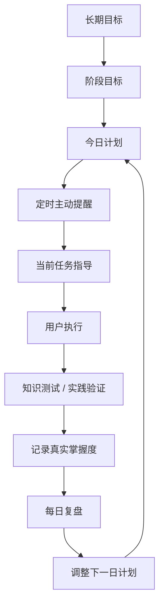

# Jarvis OS 未来愿景原始记录

> 原始记录日期：2026-08-15  
> 2026-08-29：增补「自适应日程与学习教练」方向、开源复用清单，并重排未来工作优先级（见文末）。  
> 约束：除标注「已确认方向」的条目外，本文件不代表已经确定的产品方案、版本范围、架构决策或开发承诺。

## 个人成长导师与管家

用户希望 Jarvis 不只是一个回答问题或执行单次任务的工具，而是长期陪伴自己的个人成长导师，并具有管家式的持续服务能力。

期望包括：

- Jarvis 能够逐步了解用户；
- 根据用户的情况制定学习路线；
- 帮助用户判断和调整学习方向；
- 持续推动用户获得提升，而不是只完成一次性问答；
- 以更接近个人管家的方式提供长期、连贯的陪伴与协助；
- 绘制"知识图象"，帮助用户更直观、更系统地理解知识。

## 自适应日程与学习教练

> 增补日期：2026-08-29  
> 状态：**已确认的未来方向**（所有者指定），是「个人成长导师与管家」愿景的第一个具体化载体。尚未进入版本计划；具体规格、数据契约与阶段拆分待 V4 Stable 发布后冻结。

### 功能定位

Jarvis 不只是传统的待办事项、日历或定时提醒工具，而是一个能够主动管理用户「目标 → 计划 → 执行 → 反馈 → 调整」全过程的个人执行教练。

用户只需要告诉 Jarvis：

- 我的长期目标是什么
- 我目前处于什么水平
- 我每天大概有哪些可用时间
- 我有哪些固定活动和生活安排

Jarvis 负责把长期目标逐步拆解为阶段目标、每日任务和当前行动，并在合适的时间主动提醒用户执行。

系统的核心原则是：

用户不需要每天重新思考"我现在应该做什么"，Jarvis 应该在正确的时间告诉用户：现在最值得做什么，以及具体应该怎么做。

### 核心交互

例如用户已经设置：

- 07:00 起床
- 07:15–09:00 健身
- 09:30–11:30 学习
- 13:00–15:00 项目实践
- 15:30–17:00 求职 / 面试
- 19:00–20:30 长期积累
- 23:30 睡觉

Jarvis 不应该只在 09:30 弹出"该学习了。"，而应该结合用户当前进度生成具有上下文的通知：

```text
Jarvis · 上午学习
09:30–11:30
今日核心：HTTP 请求、异常与 Retry
目标：理解 timeout、exception、retry 的关系，
并能够解释 CrowdSpark 中相关代码为什么这样设计。
```

点击通知后进入「当前任务」页面。

### 当前任务页面

用户点击通知后，不进入复杂 Dashboard，而是优先展示"现在应该做什么？"：

- **今日主题**：HTTP 请求失败与重试机制
- **为什么今天学习它**：这是理解 API 调用、Crawler、LLM API 和分布式服务通信的重要基础，同时 CrowdSpark 中存在真实 HTTP 请求与错误处理代码，可以直接进行实践。
- **今天需要掌握**：Request / Response、HTTP Status Code、Timeout、Exception、Retry、Exponential Backoff 基础概念
- **推荐学习资源**：Jarvis 根据学习目标提供少量、高质量、免费的学习资源，优先顺序为：① 官方文档 ② 高质量教程 ③ 项目真实代码 ④ Jarvis 自己的解释与示例；避免一次性提供大量链接。
- **今日实践**：打开 CrowdSpark 的 `crawler/crowdspark/http.py`，找到 HTTP 请求、timeout、exception 和 retry 相关代码，尝试回答：
  1. 请求失败后程序会发生什么？
  2. 为什么这里需要捕获异常？
  3. 为什么不能无限 retry？
  4. 如果目标网站一直不可用会发生什么？

### 学习验收

学习完成标准不是"用户看完课程"，而是用户是否能够理解、解释和应用知识。一个学习模块结束后，Jarvis 自动进入验收模式：

- **Level 1 · 基础理解**：什么是 HTTP timeout？
- **Level 2 · 原理理解**：timeout 和服务器返回 HTTP 500 有什么区别？
- **Level 3 · 实际应用**：如果 CrowdSpark 请求 Indiegogo 时连续发生 timeout，你认为程序应该怎么处理？
- **Level 4 · 面试追问**：为什么不能无限重试？你会如何设计 retry strategy？

Jarvis 根据回答判定：🟢 已掌握 / 🟡 基本理解但不稳定 / 🔴 尚未掌握，而不是简单记录"课程完成"。

### 学习进度模型

Jarvis 为每个知识模块维护真实掌握状态，例如：

- Python Basics 72%、HTTP / API 61%、Exception Handling 80%
- Retry Strategy 42%、SQL 65%、Docker 38%
- LLM Basics 55%、RAG 20%、Agent / Tool Calling 15%

进度不能只通过用户点击"完成"增长，主要依据：

- 问题回答质量
- 实际代码任务
- 项目实践
- 面试模拟表现
- 间隔复习结果

### 自适应计划

Jarvis 每天生成计划时读取：长期目标 + 当前能力 + 历史学习记录 + 最近错误 + 项目进度 + 可用时间 + 昨日完成情况，然后决定今天应该学习什么。

例如昨天 Retry Strategy 40% 🔴、HTTP Status Code 85% 🟢，那么第二天不应该机械进入新章节，而是安排：

- 09:30–10:00 复习 Retry
- 10:00–11:00 在真实项目中寻找 Retry 实现
- 11:00–11:30 面试式追问

掌握以后再进入下一知识模块。因此学习路径不是固定课程表，而是一个动态系统。

### 主动桌面提醒

```text
09:25  🧠 上午学习即将开始
       今天：HTTP Retry & Exception，预计 2 小时
       [查看任务]

13:00  🔨 项目实践
       上午 Retry 掌握度不足，下午将在 CrowdSpark 中进行真实故障实验。
       [开始实践]

15:30  💼 求职时间
       今天练习：用 2 分钟解释 CrowdSpark 的 HTTP Reliability 设计。
       [开始]

20:20  🧠 今日验收
       4 道题，大约 15 分钟。看看今天到底学会了多少。
       [开始验收]
```

通知的价值不是"提醒时间到了"，而是直接告诉用户：现在做什么 + 为什么做 + 下一步是什么。

### 状态差时的降级机制

Jarvis 不应该因为用户某一天没有完成计划，就把所有任务不断堆积到第二天。如果检测到用户没有执行当天计划，可以自动切换为 Minimum Day：

- 25 分钟核心学习
- 25 分钟项目实践
- 1 个求职动作

目标不是补偿失败，而是避免连续断档。第二天重新根据真实状态规划。

### 每日反馈闭环



Jarvis 因此会随着使用时间增加而越来越了解：用户会什么、不会什么、容易在哪里失败、什么时间学习效率最高、哪种学习方式效果最好、哪些知识需要复习、当前最值得做什么。

### 最终产品体验

最终目标不是让用户拥有一个更加复杂的 Todo List，而是让用户早上打开电脑以后，不需要面对"今天我要干什么？""先学 Python 还是 RAG？""这个项目下一步干什么？""我是不是应该投简历？"这些决策。

Jarvis 应该能够主动告诉用户：现在是 09:30，今天最重要的事情是理解 HTTP Retry；我已经为你准备好了学习材料、项目代码位置和练习；先完成第一个 25 分钟任务，完成以后我会检查你是否真正理解，再决定下一步。

因此 Jarvis 的核心价值不是帮助用户记录计划，而是帮助用户把长期目标持续转化为此刻可以立即执行的下一步行动，并通过反馈不断修正路径。

### 与现有能力的复用关系

| 新能力 | 复用的既有资产 |
| --- | --- |
| 每日计划、任务、计时 | 成长中心（长期目标、里程碑、任务、每日计划、周复盘） |
| 主动提醒 | V3-3 会话级主动智能（静默时段、去重、反馈回流）、V4-5 通知深链 / 快速窗口 / 托盘 |
| 验收对话 | V3-4a 本地语音闭环 + V3 对话工作台 |
| 掌握度与错题 | English Coach 已验证的分级纠错、错题本与间隔复习模式（泛化到通用知识领域） |
| 学习资源与实践定位 | 记忆网络、知识检索与 Obsidian 知识桥接 |

不新建第二套计划账本或第二套对话事实源；PostgreSQL 仍是唯一事实源。

### 实施边界（沿用既有安全纪律）

1. 教练身份不扩大权限：涉及写入、外部副作用的动作仍走既有 Draft Review / R2 审批语义，R3 永不提供执行入口；
2. 验收出题与判分属于模型调用：Prompt 必须进入集中管理并版本化（复用 V2 Prompt Registry 方向），云端调用遵守逐次授权，English Coach 禁用 DeepSeek 的既有约束继续生效；
3. 学习资源抓取（服务端请求 URL）：仅允许 http/https；发请求前校验 host，拒绝 localhost、环回、私有与保留地址；来源设白名单与频率上限；
4. 主动提醒遵守 V3-3 既有纪律：静默时段、每日上限、同来源同类型去重；通知中不出现 R2/R3 审批、付费确认或任意工具执行按钮；
5. 掌握度百分比必须有可解释口径（各证据来源权重、样本量），先小样本校准再展示，不允许"点击完成"直接涨进度。

## 不重复造轮子：开源复用清单（2026-08-29 调研）

> 明确要求：开发前先找轮子，未调研不允许自研。本节是各阶段开工前的调研记录处，随调研持续补充。以下许可证均已核对仓库 LICENSE；引入前如版本或维护状态变化，以仓库现状为准。

### 直接引库（算法层，禁止自研）

| 轮子 | 解决什么 | 许可证 | 用法 |
| --- | --- | --- | --- |
| [py-fsrs](https://github.com/open-spaced-repetition/py-fsrs)（PyPI `fsrs`，Python 3.10+） | 间隔复习调度。FSRS 是 Anki 现行算法：提供 Scheduler、Card、ReviewLog（可 JSON 序列化）、retrievability（当前可回忆概率）与个人参数优化器 | MIT | P1 错题本与间隔复习直接依赖；追求性能可换 [fsrs-rs-python](https://github.com/open-spaced-repetition/fsrs-rs-python)（Rust 核心，模型从 2GB 降到 1MB） |
| [pyBKT](https://github.com/CAHLR/pyBKT)（CAHLR） | 掌握度模型。从答题序列估计认知掌握度，支持个体化、遗忘、题目难度、多技能等 BKT 变体，C++ 后端，附[示例仓库](https://github.com/CAHLR/pyBKT-examples) | MIT | P1 掌握度算法层候选：先与"规则口径"并行影子对比，校准后再决定展示口径 |

关键点：FSRS 的 retrievability（"现在还记得的概率"）本身就是掌握度的一个证据来源，不要再造第二套记忆衰减公式。

### 设计参考（平台类，借鉴设计，不整体引入）

[DeepTutor](https://github.com/HKUDS/DeepTutor)（HKUDS，Apache-2.0，37.8k star）：FastAPI 后端 + Next.js 16 前端，与本项目几乎同栈。值得"抄作业"的设计：

- **Mastery Path**：学习计划流 + 分类型掌握度硬门控（未达标不放行下一环节）——正是本方向"验收未过不进入下一模块"的现成范式；
- **出题 → 题库 → 错题回流**：quiz 生成物沉淀为 Question Bank，错题再进复习——对应"今日验收 → 错题本 → 间隔复习"闭环；
- **三层记忆**（L1 原始轨迹 / L2 精选事实 / L3 综合摘要 + Memory Graph）——与 Jarvis 记忆网络对照借鉴，但其记忆层不得替代 PG 唯一事实源。

不整体引入的原因：它是独立产品（自带用户、知识库与会话体系），整体嵌入会与 Jarvis 的单用户模型、审批语义和 PG 事实源冲突；按 Apache-2.0 借鉴设计与局部代码（保留版权声明并标注改动）是合规的。

### 互操作与候选（待验证）

- [genanki](https://github.com/kerrickstaley/genanki)（MIT）：把错题本 / 复习卡导出为 Anki `.apkg`，作为可选互操作出口；
- 二次调研入口：[ai-tutor 主题页](https://github.com/topics/ai-tutor)、[awesome-ai-llm4education](https://github.com/GeminiLight/awesome-ai-llm4education)（LLM 教育研究论文集）；
- 自适应日程引擎：未发现可直接嵌入的同栈轮子。日程生成复用既有 LangGraph Orchestrator 与 V3-3 主动智能，调度思想参考 FSRS"按记忆状态排期"；learn-anything（学习路线 / 知识地图）等候选待验证后补入。

### 复用决策规则

1. 算法类（调度、知识追踪、检索）优先引库；本节清单未覆盖的部分才允许自研；
2. 许可证红线：只引入 MIT / BSD / Apache-2.0；AGPL 组件（如 Anki 本体）只做数据级互操作（导出文件），不复制其代码；
3. 平台类项目不整体引入，只按许可证借鉴设计与局部实现，保留版权声明并标注改动；
4. 任何新依赖进入 `apps/api` 前过 `dependency-audit.ps1` 与 SBOM 流程，锁定版本并记录引入理由；
5. 引入的库若与安全边界冲突（需外发数据、绑定云服务、要求网络权限），一律不引入。

## 后续需要统一澄清的概念

以下内容后续规划时再统一优化：

- "了解用户"具体包含哪些信息、依据和边界；
- 学习路线如何制定、验证、调整和衡量效果；
- "持续提升"由哪些反馈和阶段成果证明；
- "管家"应主动到什么程度，以及如何继续遵守人在环和权限边界；
- "知识图象"是指知识图谱、可视化知识地图，还是两者结合。

2026-08-29 因「自适应日程与学习教练」新增：

- 掌握度百分比的计算口径：回答质量、实践、间隔复习、面试模拟各占多少权重，样本量不足时如何展示置信范围；
- 验收判分由本地模型还是云端模型执行，判分错误的申诉与纠偏路径；
- 每日计划生成可读取的数据边界：是否包含投资、求职等敏感领域的状态；
- 「当前任务页面」的形态：复用 V3-4b 双翼面板、独立全屏页，还是快速窗口扩展；
- 与 English Coach 的关系：泛化统一为一个验收体系，还是长期并存两套；
- 学习资源推荐的来源白名单、更新频率与失效处理。

## 未来方向工作优先级（2026-08-29 重排）

### P0 · 关闭在途发布门禁（范围不变，只收尾）

1. 提交当前 V4 在途改动（约 43 个文件 + `apps/desktop-shell/`），重建干净 worktree 的 Release Manifest——这是 V4 Stable 门禁的硬前提；
2. V3-4b 灰度观察收口 → V3-5 收尾（全量回归、性能复采、死 Flag 清理、发布清单）；
3. V4 Stable 门禁：先完成代码签名与生产更新公钥，再在最终签名包上跑 24 小时待机与 168 小时观察（观察绑定精确安装器哈希，签名后重包会使旧观察失效），最后干净 Windows 11 矩阵 → 发布。

理由：新功能的三个关键载体——上下文通知（V4-5 通知深链）、每日主动提醒（托盘/常驻/开机自启）、验收对话（V3-4a 语音 + V3-3 主动智能）——全部依赖 V3/V4 既有交付稳定落地；且这些工作完成度已在 90% 以上，先关门禁边际成本最低。代码签名证书采购是外部依赖，应尽早启动。观察窗口期间可并行做学习教练的纯设计工作（数据模型草稿、验收判分口径、资源白名单草案），不写生产代码。

### P1 · 学习教练阶段一：掌握度模型与验收闭环

> 状态（2026-08-29）：V5-1 后端已实现、Flag 默认关闭，契约与证据见 [V5 计划](./JARVIS_OS_V5_LEARNING_COACH_PLAN.md) 与 [V5 交付记录](./JARVIS_OS_V5_DELIVERY_LOG.md)。

- 知识模块与掌握度的数据模型（PG 迁移 + 真实掌握状态，唯一事实源）；
- 验收模式：分级提问（基础理解 → 原理 → 实际应用 → 面试追问）、🟢🟡🔴 判定、错题回流间隔复习；
- 泛化 English Coach 已验证的模式，先服务「学习 / 求职」主线领域；
- 前置：Prompt 集中管理落地（验收出题与判分需要版本化 Prompt）。

### P2 · 阶段二：自适应日程

- 固定作息与可用时间建模；
- 每日计划生成（长期目标 + 当前能力 + 历史记录 + 最近错误 + 项目进度 + 可用时间 + 昨日完成）；
- Minimum Day 降级机制（目标是不断档，不是补偿失败）；
- 复用成长中心每日计划 / 任务 / 计时，不新建第二套账本。

### P3 · 阶段三：上下文通知与当前任务页

- 通知携带上下文（今日核心 / 目标 / 预计时长），深链进入当前任务页；
- 当前任务页面：今日主题 / 为什么 / 要掌握 / 资源 / 今日实践；
- 资源推荐遵循实施边界第 3 条（SSRF 防护 + 来源白名单）。

### P4 · 阶段四：反馈闭环与复盘

- 每日复盘 → 自动调整下一日计划；
- 效率模式挖掘（时段 / 方式效果）反哺计划生成；
- 与「个人成长导师与管家」「知识图象」等愿景概念统一梳理。

### 排序原则

1. **先关闭在途门禁，再开新方向**：单人开发，并行多线是 2026-08-06 项目审计确认过的风险源；V4 计划本身也明确"不接受以冻结业务缺陷换取安装包进度"。
2. **新方向内部按"先建掌握度资产、再建日程引擎、最后接通知界面"排序**：掌握度数据是自适应计划（P2）与上下文通知（P3）的共同输入，没有它后两者只是普通课程表。
3. **技术债不单列阶段，在触碰对应阶段时一并处理**：P1 前置 Prompt 管理；P3 前置资源抓取安全边界；P4 的复盘性能依赖 pgvector ANN 索引。
4. **每阶段开工前先做轮子调研并补入「开源复用清单」**：清单未覆盖且无合适现成实现的部分才自研；引入依赖必须过许可证红线与依赖审计。
