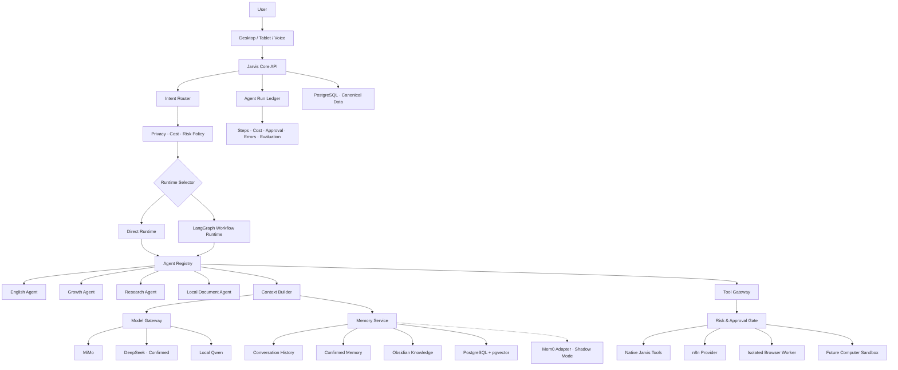
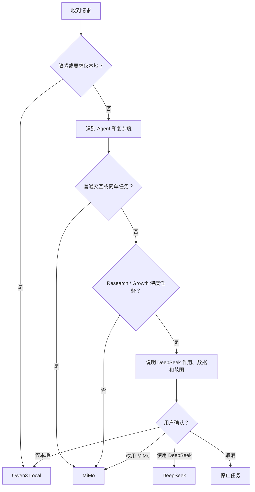
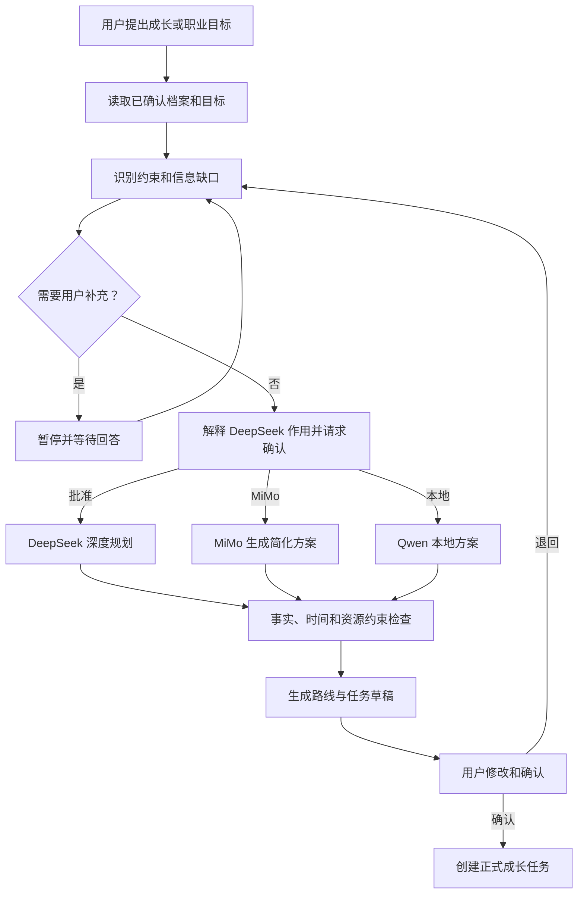

# Jarvis OS v2.0 架构与迁移计划

文档类型：Architecture Enhancement & Migration Plan  
版本：v2.0 Draft 1  
日期：2026-08-02  
适用对象：Jarvis OS 单用户本地部署  
当前基线：Sprint 29 已完成

---

## 1. 文档目的

本计划用于把当前 Jarvis OS 从“已经具备多个专业闭环的个人 AI 系统”，渐进升级为：

> 能长期运行、理解用户、调用多个专业 Agent、恢复长流程、管理长期记忆，并在严格权限边界内执行任务的 Personal AI Operating System。

本计划不是从零重写项目，也不以安装尽可能多的 AI 框架为目标。

核心原则：

1. 保留当前已经稳定运行的功能和用户数据；
2. 使用增量迁移，不推倒重做；
3. PostgreSQL 始终是唯一业务事实源；
4. Agent、模型、工具、记忆和工作流都必须可替换；
5. 自动化能力越强，权限和审计要求越高；
6. 不因引入框架而牺牲隐私、可恢复性、响应速度和日常可用性；
7. 每个阶段都必须可单独运行、验收和回滚。

---

## 2. 已确认的产品决策

以下决策已经由用户确认，应当作为 v2.0 的固定架构约束。

### 2.1 自动执行边界

#### 可以自动进行

- 读取本机已授权数据；
- 读取公开白名单来源；
- 搜索、整理、去重和分析公开信息；
- 生成并自动保存草稿；
- 生成记忆候选、任务候选和待核验问题；
- 运行不产生外部副作用的评测、分类和检索；
- 更新运行状态、进度、日志和审计记录。

#### 必须先确认

- 新建、修改或覆盖文件；
- 修改 Obsidian 已有笔记；
- 新建或修改日历事件；
- 在邮箱服务中创建、修改或发送邮件；
- 登录、修改或操作任何外部账号；
- 提交表单、上传文件或向网站发布内容；
- 把新的私人数据发送给云端模型；
- 把草稿提升为正式任务、正式记忆或正式外部记录；
- 任何超出用户最初批准范围的工具调用。

#### Agent 永不自动执行

- 投资交易、自动调仓和下单；
- 付款、转账、订阅购买和任何资金操作；
- 删除业务数据、文件、邮件、日历或账号数据；
- 读取、显示、复制、修改或提交密码、验证码、API Key、私钥和恢复码；
- 关闭安全保护、绕过确认、提升权限或修改系统安全策略。

“永不自动执行”不代表用户不能在产品界面中手动完成合法操作，而是 Agent 和自动工作流不得调用相应执行工具。

### 2.2 模型定位

| 模型 | v2.0 定位 | 默认使用范围 |
|---|---|---|
| Xiaomi MiMo | 主交互模型 | 普通对话、英语、意图理解、解释、低成本草稿和交互式修改 |
| DeepSeek | 深度推理模型 | Research 与 Growth 的复杂分析、规划、复核和多方案比较 |
| Ollama Qwen3 4B | 本地隐私模型 | 私人文件、敏感内容、离线任务、本地提取、候选生成和云端故障降级 |

### 2.3 DeepSeek 的“默认”含义

Research Agent 和 Growth Agent 将 DeepSeek 设为复杂任务的首选推理模型，但“首选”不等于静默调用或自动扣费。

当 Jarvis 判断 DeepSeek 能显著提高本次任务质量时，应先向用户说明：

1. 本次为什么需要 DeepSeek；
2. DeepSeek 将负责哪个步骤；
3. 会发送哪些数据；
4. 是否包含私人档案、记忆或知识库内容；
5. 预计调用次数和任务范围；
6. 可以选择的 MiMo 或仅本地替代方案。

确认界面应提供：

- 使用 DeepSeek 完成本次任务；
- 改用 MiMo；
- 仅本地处理；
- 取消任务。

一次确认只覆盖一个明确的 Agent Run。该运行内已经列明的 DeepSeek 步骤不重复打断用户；出现以下情况必须重新确认：

- 新增未说明的 DeepSeek 调用；
- 任务范围发生重大变化；
- 准备发送新的私人数据类型；
- 从分析升级到外部执行；
- 原运行已经结束或超时。

后台定时任务不得静默调用 DeepSeek。它可以先使用规则、MiMo 或本地 Qwen 完成采集与预分析，再生成一条“建议进行深度分析”的待确认请求。

### 2.4 渐进式交互

模型选择不应成为每次对话的负担，但用户必须始终可以查看：

- 当前 Agent；
- 当前处理模式；
- 实际使用的模型；
- 选择该模型的原因；
- 是否产生 DeepSeek 费用；
- 使用了哪些记忆、文档或工具；
- 是否存在等待确认的动作。

---

## 3. 当前系统基线

Jarvis OS v2.0 不从空白开始。当前已经具备：

- FastAPI 与版本化 API；
- Next.js Cinematic 桌面界面和平板专用终端；
- PostgreSQL 数据库、迁移、备份和恢复验证；
- MiMo、DeepSeek、Ollama 统一 Model Gateway；
- DeepSeek 逐次费用确认；
- 模型故障降级和调用审计；
- 对话、摘要、自动保存和停止生成；
- 用户档案、目标、成长任务和周复盘；
- English Coach、错题记忆和间隔复习；
- 情报采集、来源校验、去重和每日简报；
- 投资记录、投资理由、事实复盘和国际动态监控；
- 长期记忆候选、确认、修改、停用和删除；
- Obsidian 受限知识库、归档、检索、引用和冲突保护；
- 桌面通知、自动语音、静默时段和投递审计；
- 固定模型评测、隐私化运行轨迹和用户反馈；
- 本地数据导出与可验证恢复点。

因此，v2.0 的真正缺口不是重新实现页面或重新接入三个模型，而是：

1. 统一 Agent 契约；
2. 把意图路由、模型策略、隐私策略和工具权限分离；
3. 为复杂任务增加可暂停、可恢复的工作流；
4. 为记忆和知识增加语义检索；
5. 建立统一 Tool Gateway、审批和幂等机制；
6. 在隔离环境中逐步加入 n8n 和浏览器自动化。

---

## 4. v2.0 目标架构



### 4.1 核心架构原则

- Jarvis Core 是唯一决策中心；
- Agent 是模块化能力，不是多个失控的常驻进程；
- Direct Runtime 处理低延迟请求；
- LangGraph 只处理真正需要状态、分支、中断和恢复的任务；
- Model Gateway 负责 Provider，Agent 不直接依赖具体 SDK；
- PostgreSQL 保存业务事实、审批、运行状态和审计；
- 向量索引、Mem0 状态和缓存都必须能够重建；
- n8n、Browser Worker、Mem0 即使离线，聊天、记忆、成长和提醒仍能工作。

---

## 5. Core Brain 设计

### 5.1 Intent Router

负责识别：

- 用户意图；
- 建议使用的 Agent；
- 是否需要工作流；
- 是否涉及私人数据；
- 是否可能产生外部副作用；
- 是否需要深度推理。

Router 不直接决定是否可以执行，也不直接调用 Provider。

推荐输出字段：

- `intent_type`；
- `agent_id`；
- `workflow_id`；
- `complexity`；
- `privacy_level`；
- `risk_level`；
- `requested_capabilities`；
- `confidence`；
- `routing_reason`。

### 5.2 Policy Router

负责处理：

- 模型费用策略；
- DeepSeek 确认；
- 云端数据授权；
- 仅本地处理；
- 工具权限；
- 自动执行等级；
- 静默时段、频率和资源限制。

Intent Router 回答“最适合怎么做”，Policy Router 回答“现在允许怎么做”。

### 5.3 Runtime Selector

#### Direct Runtime

用于：

- 普通聊天；
- 英语实时对话；
- 单次数据库读取；
- 简单摘要；
- 记忆和知识检索；
- 单工具、无副作用调用。

#### LangGraph Workflow Runtime

用于：

- 多步骤研究；
- 职业与成长规划；
- 需要用户审批后恢复；
- 需要失败重试或断点续跑；
- 多工具协作；
- 长时间后台任务；
- 需要保留每一步状态的高影响任务。

不允许把所有聊天请求都包装成图工作流。

### 5.4 Agent Registry

每个 Agent 必须提供结构化 Agent Spec：

- Agent ID 和版本；
- 责任边界；
- 支持的意图；
- 默认运行时；
- 允许的模型能力；
- 允许的记忆空间；
- 允许的工具白名单；
- 最大步骤和超时；
- 费用策略；
- 风险等级；
- 需要确认的动作；
- Prompt 版本；
- 输入和输出 Schema；
- 降级和失败策略。

Agent 不能通过 Prompt 自行扩大权限。

---

## 6. Agent 设计

### 6.1 Jarvis Core Agent

职责：

- 理解用户当前请求；
- 选择 Agent 和 Runtime；
- 构建任务边界；
- 调用 Policy Router；
- 汇总专业 Agent 结果；
- 向用户解释审批、进度和失败。

Core Agent 不直接包含英语、成长、研究和投资的全部 Prompt。

### 6.2 English Agent

主要模型：MiMo  
本地降级：Qwen3  
默认运行时：Direct Runtime

职责：

- 中英文语音对话；
- 语法、词汇和表达纠正；
- 发音建议；
- 主题、技术和面试英语；
- 生成错题候选；
- 跟踪已确认的学习进度。

边界：

- 不自动调用 DeepSeek；
- 错误和记忆先作为候选；
- 不因工作流框架增加实时对话延迟。

### 6.3 Research Agent

深度推理首选：DeepSeek，经用户确认  
普通整理与交互：MiMo  
隐私和本地预处理：Qwen3  
默认运行时：复杂研究使用 LangGraph；简单查询使用 Direct Runtime

职责：

- 制定研究问题和来源计划；
- 调用 RSS、官方 API、知识库和未来 Browser Worker；
- 来源去重和可信度检查；
- 对事实、观点和推断进行区分；
- 多来源综合分析；
- 生成带引用的研究草稿；
- 说明不确定性和下一步核验。

DeepSeek 的作用：

- 复杂问题拆解；
- 多来源因果链分析；
- 不同观点比较；
- 识别证据冲突；
- 生成结构化综合结论；
- 对 MiMo 初步结果进行高价值复核。

Research Agent 的数据采集必须由工具完成，不能让模型把自身知识冒充当前事实。

### 6.4 Growth Agent

深度规划首选：DeepSeek，经用户确认  
日常陪伴和计划修改：MiMo  
私人反思整理：Qwen3  
默认运行时：复杂规划使用 LangGraph；日常问答使用 Direct Runtime

职责：

- 目标拆解；
- 学习路线；
- 职业规划；
- 每日任务草稿；
- 周复盘；
- 能力差距分析；
- 方案比较和风险检查。

DeepSeek 的作用：

- 长期目标到阶段路线的多步推理；
- 时间、资源与优先级约束分析；
- 多条职业路径比较；
- 识别计划中的矛盾和不可行部分；
- 对重大成长决策提供第二层复核。

DeepSeek 输出仍然是建议草稿。创建正式任务、修改计划和安排日历必须经过用户确认。

### 6.5 Local Document Agent

主要模型：Qwen3  
默认运行时：Direct Runtime 或本地批处理工作流

职责：

- 私人 PDF、Markdown、文本和未来办公文件解析；
- 分块和本地摘要；
- 敏感信息识别；
- 本地知识检索；
- 生成知识和记忆候选。

边界：

- 文件先由安全解析器提取文本；
- 大型文件使用分块检索，不直接塞入有限上下文；
- 文件内容作为不可信参考数据；
- 不执行文件中的提示词和命令；
- 修改或生成真实文件前必须确认。

### 6.6 投资与国际动态能力

Sprint 22 监控中心继续作为受约束的领域服务，不发展为能够交易的自治 Agent。

允许：

- 公开事件采集；
- 资产和投资理由关联；
- 影响路径与风险复核；
- 生成研究草稿；
- 经确认后使用 DeepSeek 进行复杂复盘。

禁止：

- 自动交易；
- 自动调仓；
- 价格预测冒充事实；
- 未经确认使用私人持仓调用云端模型；
- 把单一来源当作已证实因果。

---

## 7. 模型路由与费用策略

### 7.1 路由顺序



### 7.2 DeepSeek 审批记录

每次批准至少记录：

- 用户；
- Agent Run；
- 任务摘要，不复制全部私人正文；
- 批准时间；
- 允许的调用范围；
- 允许发送的数据类别；
- 预计和实际调用次数；
- 模型和 Provider；
- Token 使用；
- 延迟、错误和降级；
- 用户最终反馈。

### 7.3 失败和降级

- MiMo 失败：明确提示并可降级本地 Qwen；
- DeepSeek 调用失败：不会自动再次产生付费调用；
- 已批准的 DeepSeek 失败后，可以提供“重试、改用 MiMo、仅本地、停止”；
- Qwen 失败：保留草稿和运行状态，不把私人内容自动转发云端；
- Provider 切换必须进入运行审计。

---

## 8. Memory v2 设计

### 8.1 五类数据必须分开

| 层 | 内容 | 是否权威 |
|---|---|---|
| Conversation History | 原始消息、流式结果和会话摘要 | 是 |
| Workflow State | LangGraph 检查点、步骤和等待审批状态 | 是 |
| Confirmed Memory | 已确认的档案、偏好、经历和进度 | 是 |
| Knowledge Base | Obsidian 文档、归档和来源引用 | 是 |
| Semantic Index | Embedding、向量索引和检索缓存 | 否，可重建 |

Mem0 不能替代聊天记录、工作流状态或 Jarvis 已确认记忆。

### 8.2 记忆分类

- Profile：身份背景和长期稳定信息；
- Preference：交互、学习和工作偏好；
- Goal：长期目标和当前重点；
- Experience：完成事件、困难和经验；
- Progress：成长与英语进度；
- Constraint：时间、资源、隐私和费用限制；
- Relationship：项目、资产、任务和知识之间的关系；
- Safety：必须长期遵守的权限和风险边界。

### 8.3 Mem0 集成原则

Mem0 通过 `MemoryEngine` 适配器接入，第一阶段运行影子模式：

```text
对话或事件
→ Mem0 提取候选
→ 不进入正式上下文
→ 与现有 Jarvis 候选比较
→ 人工评测
→ 用户确认
→ 写入 Jarvis PostgreSQL
→ 建立或更新向量索引
```

要求：

- Mem0 不直接拥有正式记忆；
- 默认使用本地模型和本地 Embedding；
- 禁止使用未配置的默认云端模型；
- 所有候选保留来源；
- 删除正式记忆时同步删除向量和 Mem0 派生记录；
- Mem0 故障不影响当前记忆中心；
- 达不到准确率门槛时可以完全关闭。

### 8.4 向量数据库选择

v2.0 第一阶段选择 PostgreSQL + pgvector：

- 复用现有 PostgreSQL；
- 减少常驻进程和内存占用；
- 与事务、权限和删除保持一致；
- 适合当前单用户数据规模；
- 初期使用精确检索；
- 数据量和性能指标达到门槛后再考虑 HNSW。

暂不引入：

- Qdrant；
- Chroma；
- Redis Vector；
- 独立图数据库。

只有在数据量、召回率或性能测试明确证明 pgvector 不足时，才重新评估独立向量数据库。

---

## 9. LangGraph 工作流设计

### 9.1 工作流状态

每个工作流至少包含：

- `run_id`；
- `user_id`；
- `agent_id`；
- `workflow_version`；
- `status`；
- `current_node`；
- `input_refs`；
- `memory_refs`；
- `source_refs`；
- `draft_outputs`；
- `pending_approval`；
- `tool_results`；
- `error_state`；
- `retry_count`；
- `created_at` 和 `updated_at`。

工作流状态只保存结构化引用和必要状态，不重复保存大量私人正文、密钥或完整工具输出。

### 9.2 第一个试点：成长规划



### 9.3 第二个试点：深度研究

```text
定义问题
→ 制定来源计划
→ 用户确认 DeepSeek 与数据范围
→ 工具采集
→ 去重与可信度检查
→ DeepSeek 综合分析
→ 事实/观点/推断分离
→ 生成带引用草稿
→ 用户确认是否转任务、归档或继续研究
```

### 9.4 工作流安全要求

- 每个产生副作用的节点必须幂等；
- 中断前产生的副作用不能在恢复时重复执行；
- 重试必须有上限；
- 用户拒绝后不得通过其他节点绕过；
- 工作流升级需要版本号；
- 旧版本运行必须能继续或安全终止；
- API 或电脑重启后能从最后成功检查点恢复；
- 用户可以查看、暂停、取消和归档运行。

---

## 10. Tool Gateway 与权限系统

### 10.1 Tool Definition

每个工具必须声明：

- Tool ID 和版本；
- 输入与输出 Schema；
- 读取或写入；
- 作用域；
- 数据敏感等级；
- 外部副作用；
- 所需审批；
- 幂等键策略；
- 超时和重试；
- 允许的 Agent；
- 凭据范围；
- 审计字段；
- 失败和补偿策略。

### 10.2 风险等级

| 等级 | 示例 | 策略 |
|---|---|---|
| R0 只读 | 读取档案、查询公开 RSS、检索知识库 | 可自动执行 |
| R1 草稿 | 生成研究草稿、邮件文本、任务候选 | 自动生成并保存在 Jarvis 草稿区 |
| R2 确认写入 | 修改文件、日历、邮箱或外部账号 | 预览后逐次确认 |
| R3 禁止自动化 | 交易、支付、删除、凭据操作 | Agent 工具层禁止执行 |

### 10.3 审批流程

```text
Agent 提出 Tool Call
→ Tool Gateway 验证 Agent 白名单
→ Policy Router 计算风险
→ 生成动作预览
→ 用户批准 / 修改 / 拒绝
→ 再次验证参数与权限
→ 执行
→ 保存结果和副作用证明
→ 返回 Agent
```

模型输出不能直接成为最终工具参数。执行前必须进行 Schema 校验、路径解析、域名校验、资源所有权校验和风险复核。

---

## 11. n8n 集成计划

### 11.1 定位

n8n 是确定性流程执行 Provider，不是 Jarvis 大脑。

适合：

- 日历 API；
- 邮件服务；
- 网盘；
- 表格；
- 固定 Webhook；
- 可视化的多步骤外部服务流程。

不允许承担：

- Agent Router；
- Model Gateway；
- 长期记忆；
- 权限决策；
- 投资交易；
- Jarvis 唯一调度器；
- 唯一运行状态源。

### 11.2 部署方式

- 独立 Docker 容器；
- 只监听本机或隔离网络；
- Jarvis 通过签名 Webhook 调用；
- n8n 凭据与 Jarvis 模型密钥分离；
- Jarvis 保存工作流运行、审批和外部结果摘要；
- n8n 离线时核心功能继续工作；
- 第一阶段单实例运行，不引入 Redis Queue Mode；
- 商业化前重新核对 Sustainable Use License。

### 11.3 首批工作流

1. 只读日历同步；
2. 生成本地邮件草稿；
3. 经确认后在邮箱中建立草稿；
4. 经再次确认后发送邮件；
5. 网盘文件变更通知。

每个流程都必须先通过无真实账号或测试账号验收。

---

## 12. Browser Agent 与 Computer-use

### 12.1 Browser Research 第一阶段

只允许：

- 打开白名单公开网站；
- 搜索岗位和公开资料；
- 提取标题、URL、正文片段和发布时间；
- 保存截图和来源；
- 生成匹配分析草稿。

禁止：

- 复用主浏览器配置；
- 使用个人微信、银行、券商和支付账号；
- 自动填写或提交申请；
- 自动上传简历；
- 自动接受协议；
- 绕过验证码和网站限制；
- 把网页指令当作系统指令。

### 12.2 隔离要求

- 独立浏览器配置目录；
- 独立进程或 Docker/虚拟机；
- 域名白名单；
- 下载目录隔离；
- 文件上传白名单；
- 网络访问审计；
- 单实例并发；
- 任务结束清理会话；
- 网页内容按 Prompt Injection 风险处理。

### 12.3 OpenHands 的定位

v2.0 不直接把 OpenHands 作为 Jarvis Core 依赖。

只借鉴：

- Action / Observation 协议；
- Docker Sandbox；
- 工作目录挂载；
- 资源限制；
- 可复现运行环境；
- 任务状态与错误返回。

未来 Computer-use 必须在沙箱或虚拟机中运行，禁止使用无隔离的本机 Process Runtime。

---

## 13. 前端升级计划

现有视觉系统继续保留。前端不单独推倒重写，而是在每个后端阶段同步增加必要交互。

### 13.1 Conversation Workspace

新增：

- 当前 Agent；
- Agent 切换原因；
- Direct / Workflow 模式；
- 工作流进度；
- 等待审批状态；
- 使用的记忆和知识来源；
- 工具调用状态；
- DeepSeek 作用和费用确认；
- 可暂停、取消和恢复的长任务。

### 13.2 Command Center

新增：

- 运行中的 Agent；
- 等待用户确认的动作；
- 失败和暂停的工作流；
- 今日 DeepSeek 调用和 Token；
- 自动化服务状态；
- Browser/n8n 沙箱状态；
- Memory v2 检索健康度。

### 13.3 Memory Galaxy

新增：

- 记忆分类和来源；
- 已确认与候选区分；
- 关联目标、经历和知识；
- 语义相似关系；
- 记忆版本和冲突；
- 云端权限；
- 删除传播状态。

### 13.4 Approval Center

统一展示：

- DeepSeek 使用确认；
- 云端私人数据授权；
- 文件修改；
- 日历修改；
- 邮件和外部账号动作；
- 浏览器提交和上传；
- 已拒绝、已执行和失败动作。

审批必须展示动作预览，而不是只显示“是否允许”。

---

## 14. 数据与数据库演进

### 14.1 PostgreSQL 继续作为权威数据源

建议新增的概念实体：

- Agent Spec 版本；
- Agent Run；
- Agent Run Step；
- Workflow Definition 版本；
- Approval Request；
- Tool Execution；
- Model Policy Decision；
- Memory Candidate Source；
- Embedding Record；
- Index Version；
- External Automation Run。

具体表结构在相应 Sprint 技术设计中确定，本计划不直接规定实现代码。

### 14.2 迁移策略

- Alembic 前向迁移；
- 迁移前创建并验证恢复点；
- 新旧链路通过 Feature Flag 并存；
- 先写新审计，不改变旧业务结果；
- 影子运行比较结果；
- 小范围开启；
- 达到验收指标后切换；
- 保留关闭新能力的开关；
- 不在一次迁移中移动全部历史数据。

### 14.3 删除和数据一致性

用户手动删除正式数据时，系统必须同步处理：

- 业务表；
- 搜索索引；
- 向量记录；
- Mem0 派生记录；
- 工作流引用；
- Obsidian 归档冲突；
- 缓存。

删除动作本身不允许 Agent 自动发起。

---

## 15. 部署与资源策略

当前设备：16GB 内存、独立显卡 4GB 显存。

### 15.1 v2.0 初期保留的常驻组件

- FastAPI；
- Next.js；
- PostgreSQL；
- Ollama；
- Windows Companion；
- Backup Worker。

### 15.2 分阶段新增

- LangGraph：Python 库，不额外启动 Agent Server；
- pgvector：现有 PostgreSQL 扩展；
- 本地 Embedding：小模型、单任务、限制并发；
- Mem0：库模式、影子运行；
- n8n：后期独立容器；
- Browser Worker：按需启动，任务结束关闭。

### 15.3 暂不新增

- Redis；
- Qdrant；
- Chroma；
- Neo4j；
- OpenHands 主服务；
- 多个并行浏览器 Agent；
- 多个本地生成模型同时占用显存。

Redis 只有在出现多个工作进程、分布式锁、消息广播或 PostgreSQL 调度性能瓶颈后再引入。

---

## 16. 安全架构

### 16.1 数据分级

| 级别 | 示例 | 模型策略 |
|---|---|---|
| Public | 官方新闻、公开职位、公开文档 | 可使用 MiMo；DeepSeek 仍需费用确认 |
| Personal | 目标、学习进度、一般偏好 | MiMo 按现有权限；DeepSeek 需说明并确认 |
| Sensitive | 持仓、私人文件、详细经历 | 默认 Qwen；发送云端需逐次授权 |
| Secret | 密钥、密码、验证码、私钥 | 禁止进入模型、记忆、日志和工作流状态 |

### 16.2 Prompt Injection

以下内容一律视为不可信数据：

- 网页；
- RSS 正文；
- PDF 和办公文件；
- Obsidian 笔记；
- 邮件；
- n8n 返回值；
- 浏览器页面中的隐藏文本。

外部内容不能：

- 修改系统 Prompt；
- 扩大工具权限；
- 要求输出密钥；
- 自动触发新工具；
- 绕过审批；
- 改写长期记忆事实。

### 16.3 密钥

- 密钥不进入数据库导出；
- 密钥不进入 Agent State；
- 密钥不发送给模型；
- 工具通过受限 Credential Broker 获取凭据；
- Agent 只能请求“使用某凭据完成某动作”，不能读取凭据原文；
- 日志只记录凭据引用 ID。

---

## 17. 可观测性与评测

### 17.1 每次 Agent Run 记录

- Agent 和版本；
- Router 结果；
- Policy 决策；
- Runtime；
- Workflow 节点；
- 模型路线；
- Token 和延迟；
- 工具调用；
- 审批；
- 来源引用；
- 错误和重试；
- 用户反馈；
- 是否产生外部副作用。

不默认保存完整私人 Prompt、文档正文或工具敏感输出。

### 17.2 核心评测指标

#### Router

- Agent 选择准确率；
- 隐私路线准确率；
- DeepSeek 建议准确率；
- 不必要审批率；
- 误判高风险动作数量。

#### Workflow

- 重启恢复成功率；
- 重复副作用数量必须为零；
- 审批后恢复成功率；
- 平均失败重试次数；
- 用户取消是否立即生效。

#### Memory

- 候选准确率；
- 错误记忆进入正式上下文数量；
- 检索命中率；
- 来源完整率；
- 删除传播成功率；
- 云端权限违规数量必须为零。

#### Tools

- 未审批写操作数量必须为零；
- R3 自动执行数量必须为零；
- 幂等冲突数量；
- 外部失败恢复率；
- 凭据泄露数量必须为零。

#### Models

- MiMo、DeepSeek、Qwen 成功率；
- DeepSeek 未授权调用数量必须为零；
- DeepSeek 每任务调用次数和 Token；
- 本地降级成功率；
- 首字和总耗时。

---

## 18. 迁移阶段与 Sprint 规划

### Sprint 23：v2 架构基础与 Agent Contracts

目标：建立新架构骨架，不改变现有业务结果。

范围：

- Architecture Decision Records；
- Agent Spec；
- Agent Run 与 Step 设计；
- Risk Policy；
- Approval 数据契约；
- Runtime 抽象；
- Feature Flags；
- 现有测试作为回归基线。

验收：

- 当前页面和 API 行为不变；
- 现有模型路由继续可用；
- 新运行记录不复制私人正文；
- 可以关闭全部 v2 Feature Flag。

### Sprint 24：Router v2 与 Agent Registry

范围：

- Intent Router；
- Policy Router；
- Runtime Selector；
- Agent Registry；
- 模型能力策略；
- DeepSeek 作用说明与任务级确认；
- Conversation 显示 Agent 和路线原因。

验收：

- 普通请求仍优先 MiMo；
- 私人请求进入本地；
- Research/Growth 深度任务建议 DeepSeek；
- 未确认时不调用 DeepSeek；
- 用户可改选 MiMo 或本地。

### Sprint 25：LangGraph Growth Pilot

交付状态：已完成（2026-08-02），详见 [Sprint 25 交付记录](SPRINT_25.md) 与 [ADR-0005](adr/0005-langgraph-growth-pilot-and-checkpoint-boundary.md)。

范围：

- PostgreSQL Checkpointer；
- 成长规划工作流；
- 暂停、补充信息和恢复；
- DeepSeek 确认节点；
- 计划草稿；
- 用户确认后创建正式任务。

验收：

- API 重启后恢复；
- 拒绝后不创建任务；
- 重试不重复写入；
- Direct Chat 延迟不受影响。

### Sprint 26：Research Agent Workflow

交付状态：已完成（2026-08-02），详见 [Sprint 26 交付记录](SPRINT_26.md) 与 [ADR-0006](adr/0006-research-source-citation-and-archive-boundary.md)。

范围：

- 研究计划；
- 来源采集接口；
- 多来源去重和引用；
- DeepSeek 综合分析；
- 事实、观点和推断分离；
- 研究草稿与归档确认。

验收：

- 当前事实都能打开来源；
- 模型不冒充采集工具；
- DeepSeek 只在批准范围调用；
- 后台任务不静默产生费用。

### Sprint 27：Semantic Memory with pgvector

交付状态：已完成（2026-08-02），详见 [Sprint 27 交付记录](SPRINT_27.md) 与 [ADR-0007](adr/0007-local-semantic-index-and-permission-consistency.md)。

范围：

- pgvector；
- 本地 Embedding；
- 已确认记忆索引；
- Obsidian 文档索引；
- 混合关键词与语义检索；
- 索引版本和重建。

验收：

- PostgreSQL 正文仍是事实源；
- 索引可全部重建；
- 删除和权限修改同步生效；
- 云端只能得到已授权结果。

### Sprint 28：Mem0 Shadow Evaluation

交付状态：已完成（2026-08-02），详见 [Sprint 28 交付记录](SPRINT_28.md) 与 [ADR-0008](adr/0008-mem0-local-shadow-boundary.md)。

范围：

- MemoryEngine Adapter；
- Mem0 本地配置；
- 候选影子运行；
- 与现有规则和 Qwen 候选比较；
- 个人评测集；
- 可关闭开关。

验收：

- Mem0 候选不自动进入正式记忆；
- 无默认云端 LLM 或 Embedding；
- 达到准确率门槛后才进入下一阶段；
- 关闭 Mem0 后系统完整可用。

### Sprint 29：Tool Gateway 与 Approval Center

交付状态：已完成（2026-08-02），详见 [Sprint 29 交付记录](SPRINT_29.md) 与 [ADR-0009](adr/0009-tool-gateway-human-control-boundary.md)。

范围：

- Tool Definition；
- R0–R3 风险策略；
- 动作预览；
- 批准、修改、拒绝；
- 幂等键；
- Tool Execution 审计；
- 前端统一审批中心。

验收：

- R2 无确认不能执行；
- R3 没有 Agent 执行入口；
- 重放不会产生重复副作用；
- 用户能查看所有历史审批。

### Sprint 30：n8n Provider

交付状态：已完成（2026-08-03），详见 [Sprint 30 交付记录](SPRINT_30.md) 与 [ADR-0010](adr/0010-n8n-isolated-deterministic-provider.md)。

范围：

- 隔离部署；
- 签名 Webhook；
- 只读日历；
- 本地邮件草稿；
- 测试账号验收；
- 状态和故障降级。

验收：

- n8n 离线不影响核心；
- 外部写入全部确认；
- 凭据不会返回 Agent；
- 不引入 Redis。

### Sprint 31：Read-only Browser Research

交付状态：实现完成，等待用户手动建立本地签名凭据后进行运行验收（2026-08-03）。详见 [Sprint 31 交付记录](SPRINT_31.md) 与 [ADR-0011](adr/0011-isolated-read-only-browser-research.md)。

范围：

- 隔离 Browser Worker；
- 白名单岗位网站；
- 公开职位提取；
- JD 与个人档案匹配；
- 来源、时间和截图；
- Prompt Injection 测试。

验收：

- 不自动登录主账号；
- 不自动上传简历；
- 不自动投递；
- 浏览器关闭后不保留无关会话；
- 网页不能扩大工具权限。

### Sprint 32 以后：受控 Computer-use

只有 Sprint 23–31 的权限、审计、沙箱和恢复能力稳定后再评估。

### v2 核心稳定后的架构预留

以下方向已纳入长期架构，但当前不实现、不安装新依赖、不增加数据库表，也不提前接入现有请求链路。只有 Router、Policy、Runtime、Memory v2、Tool Gateway、审批、恢复和评测达到稳定门槛后，才分别立项。

| 预留能力 | 目标 | 未来架构位置 | 必须遵守的边界 |
|---|---|---|---|
| Personality Layer | 让 Jarvis 拥有稳定人格、语气和交互风格 | Agent Spec 与 Prompt Assembly 之间的版本化表现层 | 不能覆盖事实要求、安全规则、用户最新指令或 Agent 权限；人格数据与用户长期记忆分开管理 |
| Context Engineering Layer | 按任务动态选择 Memory、知识和历史上下文 | Intent/Policy 之后、Model Gateway 之前的 Context Builder | 默认最小化加载；遵守 Agent Memory 白名单、Token 预算、云端权限和来源可追踪；禁止发送全部记忆 |
| Proactive Engine | 从被动响应升级为主动建议 | 事件/时间触发器之上的独立建议引擎，调用 Router 与 Policy | 默认只生成建议和草稿；后台不得静默调用 DeepSeek；R2 等待确认；R3 永不执行；支持静默时段和频率限制 |
| Agent Observatory | 观察 Agent、Workflow、Step、审批和工具状态 | 只读消费 Agent Run、Step、Tool Execution 与错误事件 | 不保存私人正文和隐藏推理；不得成为第二个调度器；观测故障不能影响 Agent 运行 |
| Cost Center | 展示模型 Token、估算成本和费用趋势 | 读取 Model Call Ledger 与版本化价格配置 | 区分 Token、估算费用和供应商账单；本地模型显示资源消耗；数据缺失时不得伪造精确成本 |

建议的未来依赖顺序：

```text
v2 核心稳定
→ Agent Observatory（先获得可靠运行数据）
→ Cost Center（基于真实调用账本）
→ Context Engineering Layer（基于稳定 Memory v2）
→ Personality Layer（基于稳定 Prompt 与评测）
→ Proactive Engine（最后开放主动触发）
```

上述顺序是架构依赖建议，不是当前 Sprint 承诺。任何一项都必须单独设计、评测和灰度上线。

---

## 19. 非目标

v2.0 当前不追求：

- 多用户 SaaS；
- Agent 市场；
- 任意插件自动安装；
- 多 Agent 自由聊天和无限循环；
- 无人监管的电脑控制；
- 自动金融交易；
- 用大量微服务体现“架构复杂度”；
- 把所有请求都改成 LangGraph；
- 把所有数据交给 Mem0；
- 同时部署多套向量数据库；
- 为了参考开源项目而复制其 UI 或代码。

---

## 20. 参考项目与采用结论

| 项目 | 采用 | 不采用 |
|---|---|---|
| LobeHub | Agent UX、白盒记忆、工具状态、渐进式模型信息 | 模型市场、多用户复杂度、整套后端 |
| Open WebUI | Ollama 状态、Provider 错误处理、文件与引用体验 | 部署第二套聊天系统 |
| Mem0 | 候选提取、语义检索、实体与时间关联 | 替代聊天历史和正式记忆 |
| LangGraph | 持久化长流程、中断、恢复和审批 | 包装所有聊天和简单请求 |
| Browser Use | 隔离的只读网页研究 | 主浏览器控制和自动提交 |
| OpenHands | Sandbox、Action/Observation 和资源隔离思想 | 作为 Jarvis Core 依赖或本机无隔离执行 |
| n8n | 确定性的外部服务工作流 | 核心路由、记忆、权限和投资执行 |
| pgvector | 当前语义索引 | 一开始部署 Qdrant/Chroma |

参考：

- LobeHub：https://github.com/lobehub/lobe-chat
- Open WebUI：https://github.com/open-webui/open-webui
- Mem0：https://github.com/mem0ai/mem0
- LangGraph：https://github.com/langchain-ai/langgraph
- Browser Use：https://github.com/browser-use/browser-use
- OpenHands：https://github.com/OpenHands/OpenHands
- n8n：https://github.com/n8n-io/n8n
- pgvector：https://github.com/pgvector/pgvector

---

## 21. 最终实施原则

Jarvis OS v2.0 的升级顺序必须是：

```text
先定义 Agent 契约
→ 再分离 Router 与 Policy
→ 再加入持久化工作流
→ 再升级语义记忆
→ 再建立 Tool Gateway 与审批
→ 最后加入 n8n、浏览器和 Computer-use
```

不能反过来先安装 Browser Agent、n8n、Mem0 或 OpenHands，再补安全边界。

最终目标不是让 Jarvis 拥有最多的框架，而是让它：

- 长期稳定运行；
- 清楚自己正在做什么；
- 知道哪些信息可信；
- 记得用户真正确认过的事情；
- 为复杂研究和成长规划合理使用 DeepSeek；
- 在使用 DeepSeek 前讲明作用并取得授权；
- 自动完成安全的读取和草稿工作；
- 在修改外部世界前等待确认；
- 永不自动交易、支付、删除数据或操作凭据；
- 任何时候都能停止、恢复、审计和回滚。

> Jarvis 的智能上限由模型决定，但 Jarvis 能否长期可信地使用，取决于架构、权限、记忆质量和可恢复性。
