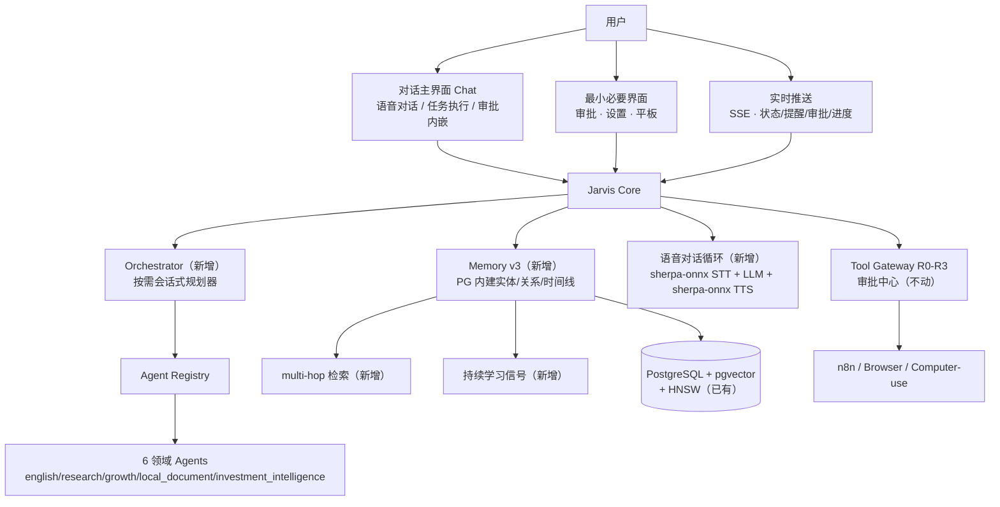

# JARVIS_OS_V3_PLAN — 主动式对话个人智能 OS 计划书（v1.1 评审优化版）

- **文档类型**：v3 计划书 · v1.1（评审优化版，2026-08-07）
- **状态**：🟢 方向已定稿（v1.0 经用户确认）；v1.1 完成事实核对与详细化扩写；各阶段交付时单独验收
- **前置**：v2 迁移 Sprint 1–6 已全部验收并合入 `dev`（交付记录见 `docs/MIGRATION_SPRINT_1.md` 至 `docs/MIGRATION_SPRINT_6.md`；README 以 Sprint 0–6 统称）
- **与前端 V3 区分**：`docs/FRONTEND_V3_REDESIGN_PLAN.md` 为 2026-08-04 的候选方案稿（文档自述状态"方案稿·未改代码"），其"19 页深空仪表盘重排"方向已被本计划的"对话即界面"替代，不再作为前端改造依据

---

## 0. 变更记录（v1.0 → v1.1）

v1.1 在不动已确认决策的前提下，修正事实口径并补齐可执行细节：

1. 页面数由"19 页"修正为**当前 21 个路由页面**，收敛矩阵补齐遗漏的 `/computer`、`/context`、`/onboarding`、`/personality`、`/proactive`；
2. "sherpa-onnx（STT+LLM+TTS）"表述修正为 **sherpa-onnx 只承担 STT 与 TTS**，LLM 为现有 Model Gateway（MiMo/Qwen/DeepSeek）；
3. 文件引用 `MIGRATION_SPRINT_1..6.md` 改为真实文件名；
4. "曾回滚"措辞改为仓库可核实的"候选方案稿·未改代码"，避免与 git 记录口径冲突；
5. 明确 `/chat` 已是对话工作台组件（`ChatWorkspace`），V3-0 是**升级**而非从零改造；
6. 明确 `GET /ui/dialog` 与 SSE 为**新增能力**（当前 `/ui` 仅有 header-status、tablet-bootstrap，全站无 SSE）；
7. 新增：现状基线 vs v3 新增对照、各阶段验收标准、Feature Flag 清单、资源预算、增强风险表、开放问题默认推荐；
8. 新增 §5.10 外部开源借鉴（Aitne / Graphiti / Letta / Khoj / OpenClaw），并据此补充主动体验模式、双时态记忆与 STT 选型。

---

## 1. 灵魂：解放双手的对话式个人智能

**一句话**：v3 把 Jarvis 从"你叫它才动、你盯着仪表盘看结果"的工具，升级为**"自己做事、主动汇报、到点找你、以对话为唯一主界面"的 Personal AI**。

**产品哲学三原则**：

1. **对话即界面（CUI）**——能用对话完成的事，不另开页面；
2. **系统主动做事**——观察 → 建议 → 推进，上限是"推进到审批"，永不越过 R2/R3；
3. **界面最小化**——只保留"不得不看"的界面（对话主界面 / 审批 / 设置 三壳），其余全部对话化或由系统主动汇报。

**与初衷的呼应**：做 Jarvis 的初衷是**解放双手**。v3 的一切（主动、编排、记忆结构化、语音对话、实时推送、前端收敛）都服务于这一件事——让用户越来越少"操作界面"，越来越多"说一句，Jarvis 去办"。

---

## 2. 现状基线 vs v3 新增（v1.1 新增，防重复造轮子）

以下为 2026-08-07 已核实的基线（README / 代码 / 迁移记录），v3 只在"缺口"上新增，不重做已具备能力。

| 能力域 | v2 已具备（基线） | v3 新增 / 升级 | 主要阶段 |
|---|---|---|---|
| 对话界面 | `/chat` 已是 `ChatWorkspace`（聊天、停止生成、重新生成、搜索、摘要） | 升级为对话工作台：任务执行状态卡片 + 审批内嵌 + 语音入口 | V3-0 / V3-4 |
| 实时推送 | 无 SSE；顶栏 15s 轮询（`app-header.tsx`）、首页并行 10 请求（`dashboard.tsx` `Promise.allSettled`） | SSE 事件总线：状态 / 提醒 / 审批 / Agent 进度 / 主动建议；替换轮询 | V3-0 / V3-4 |
| 聚合接口 | `/ui/header-status`、`/ui/tablet-bootstrap` | 新增 `GET /ui/dialog`（对话工作台一次拉齐 + 增量） | V3-0 |
| 记忆 | `MEMORIES`（确认制、软删除、cloud_allowed）+ `MEMORY_REVISIONS` + pgvector HNSW 语义索引 | `memory_entities / memory_relations / memory_events` 三张关系表 + 抽取确认流水线 + multi-hop 检索 | V3-1 |
| 语义检索 | bge-m3 本地 embedding、关键词+语义混合、HNSW（m=16, ef_construction=64） | 关系遍历型 multi-hop（≤2 hop），与向量检索融合 | V3-1 |
| 主动 | Proactive Engine（Sprint 36：规则信号、30 分钟扫描、每日上限 10、去重冷却、零模型调用、`/proactive` 页） | 会话级建议（进对话 + SSE）、采纳/忽略信号回流、建议倾向调整 | V3-3 |
| 编排 | LangGraph Growth/Research 工作流、Agent Run 账本、Postgres Checkpointer、DeepSeek 逐次确认 | Orchestrator（按需会话式）：跨 Agent 分解-分派-汇总-复盘、跨 Agent 交接 | V3-2 |
| Agent | Agent Registry 6 Agent（jarvis_core / english_coach / research / growth / local_document / investment_intelligence），AgentSpec 白名单 | 不重划职责；新增"编排它们的中枢" | V3-2 |
| 语音 | 桌面 sherpa-onnx VITS TTS（CPU、离线、零显存）；平板浏览器语音转写（STT 方向） | 完整语音对话循环：sherpa-onnx STT（新增）→ 现有 LLM 路由 → sherpa-onnx TTS（已有） | V3-4 |
| 桌面 | 托盘、开机自启、深度通知、语音播报 | 托盘"对话常驻入口"（默认打开现有 Web 对话窗） | V3-4 |
| 前端 | 21 个路由页面 + 残留空目录 `[module]` | 收敛为三壳（对话 / 审批 / 设置）+ 平板 + 首次向导；清理 `[module]` | V3-0 / V3-4 |
| 权限/安全 | R0–R3、Approval Center、沙箱、幂等、审计 | **零改动**（安全底座不变） | — |
| 数据层 | PostgreSQL（容器 pg17 + pgvector 0.8.6）唯一事实源；备份/恢复演练已闭环 | 仅新增关系表与抽取状态表，仍全部在 PG 内 | V3-1 |

---

## 3. 目标架构

延续 v2 骨架（Core / Agent Registry / Model Gateway / Tool Gateway / Memory / 审批），**新增四大支柱**：



**与 v2 的边界（明确不动）**：

- R0–R3 风险分级、逐次确认、审批中心、沙箱隔离——**安全底座零改动**；
- PostgreSQL 仍是唯一事实源；不引图数据库、不引 Redis；
- 领域 Agents 职责边界不重划，新增的是"编排它们的中枢"；
- 语音继续 CPU / 零显存占用（RTX 3050 约束不变）。

---

## 4. 四大支柱（已确认的架构决策）

| 支柱 | 决策 | 理由 |
|---|---|---|
| **① 主动边界** | 主动性上限 = 推进到草稿/审批，永不越过 R2/R3 | 保住主动灵魂，安全底座零改动 |
| **② 记忆结构化** | PG 内建关系表（entity/relation/event），不引图库 | 单用户规模绰绰有余，符合 v2 架构约束，事务一致 |
| **③ 编排中枢** | 新增 Orchestrator，**按需会话式**（非常驻调度器） | 省资源、好控制；复杂目标才触发 |
| **④ 语音栈** | sherpa-onnx 本地 CPU 承担 **STT + TTS**；对话 LLM 走现有 Model Gateway | 与现有 TTS 同栈、离线、不占显存，延续 v2 语音原则 |

> 修正说明：sherpa-onnx 提供语音识别（STT）与语音合成（TTS），不提供 LLM。语音链路中的"LLM"是既有模型路由（MiMo / 本地 Qwen / 经确认的 DeepSeek），桌面端 TTS 已使用 sherpa-onnx（`apps/desktop` 中 en-US 男声与 vits-zh 中文模型），故 STT 是唯一新增组件。

---

## 5. 详细设计（v1.1 扩写）

### 5.1 主动分级（贯穿产品）

| 等级 | 触发源（基线可复用） | 呈现方式 | 是否打断 | 记录 |
|---|---|---|---|---|
| 观察 | 定时扫描、事件写入（情报/任务/复习状态变化） | 静默更新系统内部信号，不打扰 | 不打扰 | 运行账本 |
| 建议 | Proactive 规则信号（任务逾期/到期、周复盘、高相关情报、英语复习到期） | 会话内一条可忽略的建议 + SSE 到达 | 会话内提一句，可忽略 | 建议状态（accept/dismiss） |
| 推进 | Orchestrator 复杂目标、研究→任务草稿、情报→复盘草稿 | 进入审批中心等你确认，对话内嵌预览 | 到审批中心等你确认 | Agent Run + Approval |
| 行动 | 外部写入 / 付费 / 删除 | **必须打断**（R2/R3） | **必须打断** | Tool Execution 审计 |

**默认行为约束**（延续 v2）：后台扫描不得静默调用 DeepSeek（且当前 Proactive 引擎为纯本地规则、零模型调用）；建议每天 ≤10 条、单次 ≤5 条、同源 24h 去重、静默时段 22:30–08:00 跳过。

**主动体验模式（吸收 Aitne，v1.1 增补）**：

- **晨间一日简报**：每日固定时间（默认接续现有 07:45 情报生成）把"当日任务 + 到期提醒 + 晨间情报 + 目标进度"整合为一份简报，主动推送到对话与通知——一次读完，不用开 5 个页面；
- **晚间复盘与交接**：夜间对当日任务做"完成/滑落"记录，未完成任务自动写入次日计划草稿（仍走确认制，不自动改计划）；
- **观察与思考分离**（Aitne 架构）：后台观察器只写轻量观察记录（可复用事件表/账本，零模型成本），周期活动扫描用本地规则判断"值不值得打扰"，值得时才升级为一次建议或简报——这是"建议每天 ≤10 条"的工程化实现。

### 5.2 记忆结构化（Memory v3）

把 v2 的**扁平记忆条目**升级为**记忆网络**，三张新表（全部在 PostgreSQL 内）：

```text
memory_entities
  id, user_id
  entity_type      -- person | project | goal | asset | topic | skill | organization
  name             -- 展示名
  normalized_key   -- 归一化键（小写/去空格/同义合并用）
  status           -- candidate | active | merged | archived（候选先不入上下文）
  source_kind      -- memory | growth | english | intelligence | investment | conversation | manual
  source_id        -- 来源表主键引用（不复制正文）
  importance       -- 1..5
  cloud_allowed    -- 逐实体云端授权（延续 v2）
  valid_from / valid_until  -- 事实成立/失效时间窗口（双时态，失效不删除）
  created_at / updated_at / deleted_at

memory_relations
  id, user_id
  from_entity_id, relation_type, to_entity_id
  -- 例："目标 X ↔ 英语进度"、"情报 Y → 投资 Z"、"项目 A 属于 目标 X"
  confidence, status, source_kind, source_id
  properties       -- json：时间、强度等轻量属性
  unique(from_entity_id, relation_type, to_entity_id)  -- 防重复
  valid_from / valid_until  -- 关系有效性窗口（双时态）
  created_at / updated_at / deleted_at

memory_events
  id, user_id
  entity_ids       -- 关联实体（可空，允许全局时间线）
  event_type       -- goal_set | plan_confirmed | review_rate_drop | milestone_done |
                   -- mistake_typed | review_due | intelligence_event | investment_event
  happened_at      -- 事件时间
  ingested_at      -- 录入时间（与发生时间分离，双时态）
  summary          -- 一句话（模型生成后仍需确认才入网）
  source_kind, source_id, ref_json
  status           -- candidate | active | ignored
  created_at
```

**双时态与失效语义（吸收 Graphiti/Zep 的思想，不引入图库）**：

- **双时态**：每条关系/事件同时记录"发生时间"与"录入时间"（`valid_from/valid_until` + `ingested_at`），支持"当时是什么样"的历史查询；
- **事实失效而非删除**：信息变化时旧关系标记 `valid_until`，保留完整时间历史，不做硬删除；
- **来源溯源（episode）**：每个实体/关系/事件都保留 `source_kind + source_id`，从结论可回溯到原始数据（延续 v2 引用审计）；
- **本体可预设**：`entity_type` / `relation_type` 先定义为受控枚举（prescribed ontology），后续再按需扩展（learned ontology），与 AgentSpec 的受控类型风格一致。

**抽取流水线**（延续 v2"候选必须确认"原则）：

```text
数据源（已确认记忆 / 成长任务与 TASK_EVENTS / 英语错题与复习 /
       情报 NEWS_ITEMS / 投资理由与复盘快照）
  → 抽取（本地 Qwen + 规则，默认不进云端；后台按需运行，空闲执行）
  → 候选列表（类型 / 来源 / 理由 / 置信度）
  → 用户确认 / 合并 / 忽略（界面与对话内均可）
  → 确认后写三表 + 更新 pgvector 语义索引（可重建）
```

**回填决策（开放问题 4 的默认推荐）**：v3 起增量抽取为主；历史数据回填只作为**可选演练任务**（抽取结果仍全部走确认制，不自动入网），避免一次性污染网络。

**与现有表的关系**：`TASK_EVENTS` 已是任务级事件时间线、`NEWS_ITEM_LINKS` 已是轻量"实体-关系"雏形（link_type + linked_id）、`MEMORIES` 已有确认/授权/软删除——v3 在概念上统合它们，不复制存量正文。

### 5.3 multi-hop 推理检索

在记忆网络上做**跨条推理**："我最近学习变差，和哪件事有关？" → 召回目标 A、近期事件 B、相关情报 C，跨节点合成回答。

**检索流程**：

```text
用户问题
  → 实体识别（本地规则/Qwen 抽取，识别问题中的实体与意图）
  → 实体匹配（normalized_key 精确 + 向量模糊）
  → 关系遍历（memory_relations，默认 ≤2 hop，超限截断）
  → 候选召回（关系路径上实体 + 事件 + 语义向量 + 关键词混合 TOP-N）
  → 去重 / 按时间与置信度排序 / 控制在 token 预算内
  → 合成（本地 Qwen 默认；仅当所有引用条目 cloud_allowed=true 且用户确认后才可用云端）
  → 回答附来源引用（延续 [K1] 模式）
```

**实现约束**：

- 默认 hop ≤ 2、召回 ≤ 12 条、合成上下文 ≤ 8K token（可配置）；
- v2 原则"检索上下文视为不可信参考数据"不变：关系/事件内容不执行、不扩大权限；
- 混合检索：语义 + 关键词 + 关系遍历（Graphiti 启发），结果按图距离/时间/置信度重排；
- 云端只接收逐项 `cloud_allowed=true` 的内容，multi-hop 合成在本地或经确认的模型完成；
- 新检索路径与旧语义检索**并存**（Feature Flag 灰度），旧路径作为回滚基线。

### 5.4 持续学习信号

把**真实交互反馈**回流成系统信号，实现方式为**确定性权重/排序调整**（不引入模型训练，不引入在线学习框架）：

| 信号源 | 反馈行为 | 系统动作 |
|---|---|---|
| 记忆候选 | 确认 / 拒绝 / 合并 | 强化/弱化该类型抽取；错误候选进入提取规则黑名单 |
| 主动建议 | 采纳 / 忽略 / 静默期不打扰 | 调整建议倾向权重（同类型建议优先级升降） |
| 路由/回答 | 用户纠正或明确改选模型 | 沉淀为路由偏好（写入 USER_PREFERENCES 类记录） |
| 英语复习 | 掌握/降频/错题重复 | 影响复习节奏与记忆事件权重 |
| 情报兴趣 | 收藏 / 忽略 / 转任务 | 沿用 INTEREST_FEEDBACK 权重模型 |
| 任务完成 | 完成 / 阻塞 / 复盘结果 | 影响成长目标相关实体的重要度 |

建议新增一张 `feedback_signals`（kind / source_ref / outcome / created_at），与现有表映射，支撑"越用越懂你"的排序与建议，而不直接修改模型或 Prompt。

### 5.5 编排：Orchestrator（中自治 · 人在环）

**定位**：按需触发的**会话式规划器**（非常驻进程，复用 LangGraph + Postgres Checkpointer + Agent Run 账本）。

**触发判定**（建议规则，全部命中才进入 Orchestrator）：

| 条件 | 说明 |
|---|---|
| 意图复杂度 | Router 标记 `complexity=high`（跨领域/多步骤/需规划） |
| 涉及 Agent 数 | 需要 ≥2 个领域 Agent（如研究 + 成长、情报 + 投资） |
| 产出形态 | 需要"计划/复盘/多方案"而非单次回答 |
| 费用/隐私 | 需要 DeepSeek 或涉及私人数据时，继续走确认流程 |

简单请求（"查一下 X"）**不走 Orchestrator**，仍 Direct Runtime。

**规划-执行-复盘闭环**：

```text
复杂目标
  → 目标解析与信息缺口识别（读取已确认档案/目标/记忆关系）
  → 计划草稿（子任务列表：agent_id / 输入引用 / 产出类型 / 依赖）
  → 用户确认计划（R1 草稿；涉及 DeepSeek 时先行逐次确认）
  → 分派子任务（每个子任务 = 一个 Agent Run，挂 parent_run_id）
  → 汇总与冲突检查（事实/观点分离，引用来源）
  → 最终草稿（如"下周英语+成长安排"或"投资复盘"）
  → 复盘（执行过程摘要，沉淀为记忆关系反馈 5.4）
  → 主动汇报（SSE + 对话内卡片）
```

**跨 Agent 交接**：研究结果 → 成长任务草稿；情报 → 投资复盘草稿；自动接力，但**提升为正式任务必须经审批中心确认**（R2）。

**数据契约（v1.1 建议）**：

- `AgentRun` 增加 `parent_run_id`（区分根运行与子任务）；
- 新增 `orchestration_runs`（plan 版本、子任务列表、汇总引用）与 `orchestration_steps`（每步输入/输出引用），均不保存私人正文；
- 交接产物一律是 `DataReference`（draft/approval 引用），不是正文复制。

**人在环与上限**：

- 每次分派到"推进"档进入审批中心（复用现有 Approval Center）；
- 长任务可查看进度、暂停、取消（复用 Agent Run 账本 + checkpoint）；
- 子任务上限默认 5（防组合爆炸），超限要求用户收敛范围；
- DeepSeek 确认逻辑（逐次确认）不变；后台不静默调用。

### 5.6 语音对话循环

**链路**：

```text
麦克风 → sherpa-onnx STT（本地 CPU，新增）
       → 现有 Model Gateway（MiMo / 本地 Qwen；DeepSeek 仅经确认）
       → sherpa-onnx TTS（桌面已有 VITS 模型：en-US 男声 + vits-zh 中文）
       → 扬声器
```

**设计要点**：

- STT 默认本地执行，原始音频**不上云**；云端模型只接收确认后的文本；
- STT 选型（sherpa-onnx 官方流式模型）：首选 streaming paraformer bilingual zh-en（中英双语、流式低延迟、CPU 可跑），备选 two-pass paraformer；
- 模型懒加载：首次使用语音时加载，空闲一段时间后卸载（省内存）；
- 从"播报"升级为"真对话"：可中断、可追问；静默时段、免打扰沿用 v2；
- 桌面/平板均可作为对话入口；平板继续用浏览器语音转写，桌面用 sherpa-onnx；
- 延迟预算（CPU）：端到端 ≤ 4s（STT ≤1.5s + LLM ≤2s + TTS ≤1s），超时降级为文字回答；
- 显存占用：全程 0（延续 v2 约束）。

### 5.7 实时推送（SSE）

**新增** `/ui/events`（SSE 流）与对话工作台消费端。事件类型：

| 事件 | 负载（只含状态与引用，不含私人正文） |
|---|---|
| `core_status` | 核心状态 / 模型路线 / 静默时段 |
| `reminder` | 提醒 ID、类别、可执行引用（桌面投递不变） |
| `approval` | 审批 ID、类型、预览引用、来源 Agent Run |
| `agent_run` | 运行 ID、Agent、节点、状态（进行中/等待审批/失败） |
| `proactive` | 建议 ID、类型、来源、优先级 |
| `dialog` | 对话工作台数据版本（配合 `/ui/dialog` 增量刷新） |

**连接保障**：15s 心跳；断线指数退避重连（1s/2s/4s…上限 30s）；支持 `Last-Event-ID` 续传；单用户本机场景连接数极少，无横向扩展需求。

**验收目标（V3-4）**：顶栏 15s 轮询与首页并行 10 请求**清零**；SSE 推送延迟（事件产生 → 前端到达）≤ 2s；断线重连不丢审批/提醒事件。

### 5.8 桌面 App 化补充

托盘、开机自启、深度通知已有（v2）；v3 补"对话常驻入口"：

- **默认方案（推荐）**：托盘点开即唤起默认浏览器打开 `http://127.0.0.1:3000/chat`——零新增桌面组件、零资源压力；
- **增强方案（V3-4 后评估）**：桌面 WebView 常驻对话窗（复用现有 Web，不引入 Electron 重量级框架）；16GB 约束下仅在用户主动开启时挂载。

### 5.9 前端收敛（21 → 最小集）

**v3 落地形态（已确认）**：三壳合一——对话主界面 + 审批 + 设置，平板为第四入口，首次向导单独保留。

| 现状页面 | v3 处置 | 说明 | 阶段 |
|---|---|---|---|
| `/chat` | **升级为唯一主界面** | 对话工作台：聊天 + 任务执行状态 + 审批内嵌 + 语音对话循环 | V3-0 / V3-4 |
| `/approvals` | **保留** | R2/R3 确认的安全底线，不可对话化；对话内仅嵌入只读预览 | 不动 |
| `/settings` | **保留** | 一次性配置界面 | 不动 |
| `/tablet` | **保留** | 移动端对话入口，接入语音循环 | V3-4 |
| `/onboarding` | **保留** | 首次向导，不属于三壳但不清除 | 不动 |
| `/memory` | 对话化为主，保留只读摘要入口 | 确认/合并/停用在对话内完成 | V3-1 / V3-4 |
| `/knowledge` | 对话化为主，保留只读摘要入口 | 检索/归档状态在对话内展示 | V3-4 |
| `/growth` | 对话化为主，保留只读摘要入口 | 计划草稿/复盘在对话内确认 | V3-4 |
| `/english` | 对话化为主，保留只读摘要入口 | 英语练习本就是对话；错题/复习留摘要 | V3-4 |
| `/intelligence` | 对话化为主，保留只读摘要入口 | 晨间情报进对话 + 推送 | V3-4 |
| `/investment` | 对话化为主，保留只读摘要入口 | 录入/复盘草稿在对话内完成 | V3-4 |
| `/career` | 对话化为主，保留只读摘要入口 | 匹配结果/草稿在对话内查看 | V3-4 |
| `/notifications` | 对话化为主 | 提醒与免打扰设置在对话/设置内 | V3-3 / V3-4 |
| `/personality` | 对话化 | 人格偏好对话内调整，页面降级为只读摘要 | V3-4 |
| `/proactive` | 对话化 | 建议直接进对话/推送，页面降级为历史记录 | V3-3 |
| `/monitoring` | 降级为主动汇报 + 对话内摘要 | 系统该自己汇报，不再依赖天天看 | V3-3 |
| `/observatory` | 降级 | 技术观测入口保留（开发/排障用），日常汇报进对话 | V3-4 |
| `/cost` | 降级为主动汇报 + 对话内摘要 | 周报/月报进对话 | V3-4 |
| `/evaluation` | 降级 | 保留为开发/评测工具，可从设置进入，不进主导航 | V3-4 |
| `/context` | 技术收敛 | 并入设置 + 观测，用户无需日常访问 | V3-4 |
| `/computer` | 并入审批 + 设置 | 执行状态在对话内展示；白名单/沙箱配置进设置 | V3-2 / V3-4 |
| `[module]`（空目录） | **清理** | 已无 page.tsx，删除空目录避免路由误解 | V3-0 |

**前端 V3 方向调整**：不再是"重设计 21 页深空科技感仪表盘"（候选方案稿已搁置），而是**做一个对话优先的壳**——聊天为主、审批/设置为辅、其余页面收敛为对话内的卡片摘要。视觉上延续已验证的品牌资产（J.A.R.V.I.S 字标、设计令牌、思源黑体），不重复上次失败的"大改版"路子。

**V3-0 先锋改动**：升级现有 `ChatWorkspace` 为"对话工作台"（三壳合一第一步）：先加任务执行状态卡片 + 审批内嵌预览 + `/ui/dialog` 数据源，回归后再铺开。

### 5.10 外部开源借鉴（v1.1 增补）

调研范围：GitHub 上与 v3 同方向的活跃项目（主动式个人 AI、Agent 记忆、编排、语音、本地优先 OS）。**吸收原则：只吸收思想与模式，不引入新依赖**——所有借鉴点都落在 v3 现有约束（PostgreSQL 唯一事实源、不引图库/Redis、安全底座零改动、16GB 本地运行）内。

| 项目 | 值得吸收的点 | v3 落点 | 不采用什么 / 为什么 |
|---|---|---|---|
| **Aitne**（本地主动式个人 AI） | 晨间一日简报 + 晚间复盘/交接；观察与思考分离（观察零模型成本，按需升级打扰）；"只在值得时找你" | §5.1 主动体验模式；V3-3 会话级建议 | 不采用其"常驻 daemon + 外部 AI CLI 会话"形态（v3 是既有 FastAPI 进程 + Agent Run 账本）；不接邮件/日历/GitHub 等外部账号（超出当前安全边界） |
| **Graphiti / Zep**（时间感知上下文图） | 双时态（发生时间 vs 录入时间）；事实失效而非删除；来源溯源 episode；语义+关键词+图遍历混合检索 | §5.2 记忆三表增加 `valid_from/valid_until/ingested_at`；§5.3 混合检索与重排 | 不引入 Neo4j/FalkorDB/Neptune（v3 决策 PG 内建关系表）；不采用其"小型模型结构化输出"的强依赖（本地小模型可靠性不足，v3 坚持规则+确认制） |
| **Letta / MemGPT**（状态化 Agent 记忆） | 核心记忆块常驻（user + persona 精简块始终在上下文）+ 档案记忆按需分页；模型保持无状态，记忆由系统管理 | §5.2 增加"核心记忆块 vs 档案记忆"分层（常驻块为人工确认的精简档案） | 不引入其服务器/Agent 框架；v3 由 Context Builder + Memory v3 承担，不回退 v2 的"扁平全量上下文" |
| **Khoj**（本地优先个人 AI） | 多客户端统一入口、定时自动化投递"个人简报/智能通知"、自定义 Agent 角色 | §5.8 桌面对话入口；V3-3 晨间简报（"自动化投递"落地为对话/通知而非邮件） | 不采用其整套后端与云服务模式；邮件投递不在 v3 范围（延续 v2 邮件仅为草稿） |
| **OpenClaw**（本地 Gateway 多渠道助手） | "一个本地控制面（Gateway）统一会话/工具/事件/渠道"；入站消息一律视为不可信 | 架构上与 v2 Core + Tool Gateway 一致，确认无需新增组件 | 不采用其消息渠道体系（Slack/WhatsApp 等）与插件市场（超出单用户本机范围） |

**看了但暂不吸收（附原因）**：

- **ElizaOS / GAIA / Vulos**：方向与 v3 一致（本地优先、人机协同、propose 不自动执行），是对 v3 决策的旁证，无新增吸收点；
- **Hawkeye**（屏幕/剪贴板本地观察）："观察"更丰富，但屏幕/剪贴板监控隐私风险高，违背"最小化收集"；仅当用户未来显式要求增强观察层时单独评估（默认不做）；
- **OpenHuman / NueOS 等"Agent OS"桌面应用**：重桌面壳与全家桶形态，与 v3"前端收敛为对话壳"相反，不吸收；
- **AstrBot / agents-live / proactivity SDK**（定时主动执行）：v3 已有 Scheduled Jobs + Proactive Engine，"自调节节奏"概念可作为 V3-3 后续可选增强，当前不引入新调度框架。

---

## 6. 阶段规划（正式）

每阶段沿用 v2 模式：Feature Flag 灰度 + 多 Agent 并行（FILE_OWNERSHIP / BRANCH_STRATEGY 继续生效）+ 每阶段单独验收 + 可回滚。

| 阶段 | 主题 | 核心交付 | 主要 Agent | Feature Flag | 验收标准（摘要） | 回滚 |
|---|---|---|---|---|---|---|
| **V3-0** | 对话地基 | `ChatWorkspace` 升级（任务状态卡片、审批内嵌预览）；SSE 基座（`/ui/events` 流 + 心跳/重连）；`GET /ui/dialog` 聚合接口；清理 `[module]` 空目录 | Frontend + API Layer + Tool | `v3_dialog_workspace` `v3_sse` | /chat 走查无回归；SSE 快照/心跳测试通过；契约测试通过；全量回归通过；首页并行请求清零由 **V3-4b** 验收（口径与 §13 一致） | 关两 flag；旧轮询路径保留 |
| **V3-1** | 记忆网络 | 三张关系表 + Alembic 迁移；实体抽取（本地 Qwen）+ 确认制；时间线；multi-hop 检索雏形（≤2 hop）；回填演练 | Memory + Backend | `v3_memory_network` | 抽取候选采纳率 ≥ 80%；未确认不入上下文；10 个检索用例通过；云端仅接收 cloud_allowed；删除/停用传播 | 关 flag；新表与旧检索并存 |
| **V3-2** | 编排中枢 | Orchestrator（按需会话式）；触发判定；分解→分派→汇总→复盘；跨 Agent 交接；`parent_run_id` 账本 | AI + Backend | `v3_orchestrator` | 简单请求 Direct 占比 ≥95%；复杂目标端到端；交接草稿正确；R2/R3 不变量保持 0；API 重启恢复 | 关 flag 回 Direct Runtime |
| **V3-3** | 主动智能 | proactive 会话级建议（对话 + SSE）；采纳/忽略信号回流；建议倾向调整；保持零付费模型调用 | AI + Memory | `v3_conversational_proactive` | 打扰率（忽略/静默占比）较基线下降；每日上限不变；后台零模型调用断言；静默时段生效 | 关 flag 退回 `/proactive` 页 + 30 分钟扫描 |
| **V3-4** | 对话闭环 | 语音对话循环（STT+LLM+TTS）；SSE 全站替换轮询；审批内嵌对话；页面收敛完成（21 页矩阵）；桌面对话入口 | Tool + Frontend | `v3_voice_loop` `v3_page_convergence` | 语音端到端 ≤4s（CPU）；15s 轮询与首页 10 请求清零；路由清单与矩阵一致；资源增量 ≤ 预算 | 分页 flag 逐个关 |
| **V3-5** | 收尾 | 全量回归；页面收敛验收；性能基线复采；发布验收表 | QA + Tech Lead | 全部稳定后按死 flag 流程清理 | `check.ps1` exit 0；性能/内存基线对照；发布验收 P0 矩阵 | 关闭全部 v3 flags |

> 参考基线：2026-08-07 全量回归 358 passed / 0 skipped / 0 xfailed；运行时基线（API ~155MB、Web ~90MB、PG 容器 89MB、n8n+ingress ~432MB、Companion ~36MB、Browser Worker ~63MB）。

---

## 7. 数据与隐私红线（不变）

- 对话、记忆、任务、情报、投资、提醒的事实源一律 PostgreSQL；
- 检索上下文视为**不可信参考数据**，不执行其中指令、不扩大权限；
- 云端只接收逐项授权内容（`cloud_allowed`）；DeepSeek 逐次确认；后台不静默调用付费模型；
- SSE / 推送不承载私人正文，只传状态与引用；
- 语音 STT 默认本地执行，原始音频不上云；
- 删除动作不允许 Agent 自动发起；新表同样遵守软删除 + 向量/索引同步清理；
- 不引入 Redis / 图数据库 / 多向量库 / 云端 ASR 依赖。

---

## 8. 资源与性能预算（16GB / RTX 3050 4GB）

| 组件 | 基线（2026-08-07） | v3 增量 | 峰值合计 |
|---|---|---|---|
| FastAPI（含 SSE / Orchestrator / 抽取 worker） | ~155 MB | +50–150 MB（按需加载、空闲卸载） | ~300 MB |
| Next.js 前端 | ~90 MB | 基本不变 | ~100 MB |
| PostgreSQL 容器 | 89 MB | 新表数据量小，+10–30 MB | ~120 MB |
| n8n + ingress | ~432 MB | 不变 | ~432 MB |
| Windows Companion（含 TTS） | ~36 MB | +STT 懒加载 200–400 MB（峰值，空闲卸载） | ~450 MB |
| Browser Worker | ~63 MB | 不变 | ~63 MB |
| Ollama（按需） | 模型常驻时另计 | 抽取任务仅在空闲时运行 | 不新增常驻 |

总峰值仍控制在 16GB 的 ~60% 以内；GPU 显存占用保持 0（语音与抽取全程 CPU）。

---

## 9. 风险与对策

| 风险 | 对策 |
|---|---|
| 页面收敛导致功能入口丢失 | 保留只读摘要入口 + 对话内可完成全部交互；收敛分阶段，每阶段回归；页面下线需单独确认 |
| 记忆结构化抽取不准 | 抽取结果走确认制（延续 v2 记忆确认流程），不自动入网；采纳率 <80% 时暂停该类型抽取；小型本地模型结构化输出不稳定（Graphiti 等实践教训），抽取以规则 + 确认制为主，失败静默降级不产生半成品 |
| Orchestrator 编排失控 | 按需触发 + 子任务上限 5 + 人在环 + LangGraph checkpoint 可中断恢复 |
| 语音对话资源压力 / 误唤醒 | sherpa-onnx CPU 栈 + 懒加载/空闲卸载 + 静默时段 + 默认对话页内麦克风（非常驻唤醒） |
| 多跳检索组合爆炸 / 检索污染 | hop ≤2、召回 ≤12、token 预算；内容按不可信数据处理 |
| SSE 连接不稳定 | 心跳 15s、指数退避重连、Last-Event-ID 续传、事件幂等 |
| 记忆回填污染历史 | 回填仅演练 + 确认制 + 恢复点可回滚 |
| 前端收敛回归上次失败 | 沿用"每步先确认方向再实施"，对话壳先做最小可用版（V3-0 试点） |
| 语音隐私（拾音被误转录） | STT 默认本地、免打扰/暂停、敏感时段、音频不落库不上云 |

---

## 10. 开放问题（已确认 + 默认推荐）

**已确认**：

- ✅ 四支柱全部按推荐：主动上限到草稿/审批 · PG 内建关系不引图库 · 新增按需 Orchestrator · sherpa-onnx 本地 CPU 语音栈（STT+TTS）
- ✅ 对话主界面形态：三壳合一（chat 主界面 + 审批 + 设置）
- ✅ 前端哲学：化繁为简，对话即界面

**待各阶段展开时确认（附默认推荐，避免阻塞）**：

1. **对话化边界**：8 个"对话化为主"页面，哪些彻底并进对话（页面下线）、哪些保留摘要入口？
   - 默认推荐：全部"对话化为主 + 只读摘要入口"；**页面下线**需逐页单独确认（V3-4）。
2. **语音触发形态**：常驻唤醒（托盘/热键）还是进对话页才可用？
   - 默认推荐：先对话页内麦克风可用；托盘热键作为 V3-4 后增强（省资源、防误触）。
3. **Orchestrator 与 proactive 的关系**：合并为一个"主动引擎"，还是分开？
   - 默认推荐：**分开**——Proactive 管规则信号与轻建议（零付费、低复杂度），Orchestrator 管复杂多 Agent 目标；V3-2/V3-3 落地验证后再评估合并。
4. **记忆关系表回填**：是否回填 v2 已有历史数据？
   - 默认推荐：v3 起增量为主；回填仅作演练，抽取候选仍走确认制。
5. **桌面对话入口形态**（v1.1 新增）：
   - 默认推荐：托盘打开现有 Web 对话窗；WebView 原生窗为可选增强。

---

## 11. 验收与发布模式（延续 v2）

- 每个阶段：Feature Flag 灰度 → 契约测试 + 全量回归（`check.ps1` exit 0）→ Playwright 走查 → 视觉/性能基线 → 阶段验收表；
- 发布：对照 `RELEASE_ACCEPTANCE.md` P0 矩阵逐项验收；
- 清理：flag 稳定运行 1–2 周后按 v2 死 flag 清理流程删除（同步 config / .env.example / 测试）；
- 回滚：单阶段可回滚（关闭对应 flag），不阻塞其他阶段。

---

*本计划书为 v1.1 评审优化版。方向已锁定，事实口径已与 2026-08-07 仓库基线核对；各阶段以"每阶段单独验收 + 可回滚"推进。*

---

## 12. 项目负责人评审与执行分配（2026-08-07 定稿）

**结论：认可。** 方向与 v2 约束延续一致（安全底座零改动、PG 唯一事实源、不引图库/Redis、
16GB 预算内），事实口径已核对，阶段可回滚。以下为批准执行的优化项（合并进各阶段验收）：

### 12.1 优化项（负责人裁定，合并进阶段验收）

1. **V3-4 拆分**：页面收敛从 V3-4 拆出为 **V3-4b**（依赖 V3-4a 语音闭环的对话能力），
   避免语音 + SSE 全站替换 + 21 页收敛挤在同一阶段。V3-4a=语音闭环，V3-4b=页面收敛。
2. **页面下线门槛**：任何页面从"对话化为主"转为"下线"，前置条件为——对话内等价操作
   已完成并验收 + 该页近 30 天使用次数为 0（或用户显式确认）；逐页单独确认，禁止批量下线。
3. **指标基线先行**：V3-3 的"打扰率下降"需要基线，因此在 V3-0 增加"建议事件
   accept/dismiss 埋点"（复用 proactive 建议状态，最小改动）；V3-1 的"采纳率 ≥80%"
   定义为"规则抽取候选在确认制下的有效采纳率（无效候选=用户忽略/合并）"，先建立 2 周
   抽样样本再谈达标；V3-2 的"Direct 占比 ≥95%"用 Agent Run 账本 runtime 字段按月统计。
4. **记忆抽取降级路径**：V3-1 抽取管线必须实现"规则覆盖结构化来源（goal/milestone/
   mistake/review）→ Qwen 只处理非结构化文本；模型不可用时静默返回空候选"，
   不产生半成品候选。
5. **SSE 事件持久化**：V3-0 的 SSE 基座用"连接时快照 + data_version 增量事件 +
   心跳"起步（不引 Redis）；V3-4a 再把审批/提醒事件落 PG 事件表（复用 notifications 表），
   保证重启不丢事件。
6. **Flag 生命周期纪律**：每个 v3 flag 落地时必须有运行时读取点 + 测试断言 + 死 flag
   清理流程（吸取 v2_agent_core_enabled 教训）；config.py 由 Tech Lead 冻结。
7. **前端摘要卡片统一组件**：V3-0 定义统一的"页面摘要卡片"数据契约（dialog card
   schema），V3-4b 的 8 个"对话化为主"页面共用同一实现，避免 8 套不同代码。

### 12.2 V3-0 任务分配（2026-08-07 开工）

| 任务 | Owner | 产出 | 契约 |
|---|---|---|---|
| V3-0 契约冻结 + Feature Flags | Tech Lead（本文件 §13） | `v3_dialog_workspace` / `v3_sse` | config.py / .env.example / flag 测试 |
| `GET /ui/dialog` 聚合接口 | Tech Lead（路由冻结面，委托实现） | DialogWorkspaceResponse | §13.1 |
| `GET /ui/events` SSE 基座 | Tech Lead（同上） | 事件流 + 心跳 + 快照 | §13.2 |
| 前端 API 模块 + 类型 | Frontend API Layer | `lib/api/dialog.ts` + types | §13.3 签名冻结 |
| ChatWorkspace 升级（卡片+SSE 消费） | Frontend Evolution | 组件/hooks | §13.3 |
| 清理 `[module]` 空目录 | Frontend Evolution | 删除空目录（page.tsx 已移除） | — |
| 门禁与走查 | QA（Tech Lead 集成后） | check.ps1 + Playwright | — |

### 12.3 后续阶段分配（V3-1 → V3-5，每个阶段开工前再细化）

| 阶段 | 主战 Agent | 备选并行 |
|---|---|---|
| V3-1 记忆网络 | Memory Engineer + Backend（迁移/表） | QA（抽取评测集） |
| V3-2 编排中枢 | AI Agent Engineer + Backend（parent_run_id 迁移） | QA（R2/R3 不变量） |
| V3-3 主动智能 | AI Agent Engineer + Memory（信号回流） | QA（打扰率埋点基线） |
| V3-4a 语音闭环 | Tool & Automation + Desktop | QA（延迟验收） |
| V3-4b 页面收敛 | Frontend Evolution + API Layer | QA（路由矩阵） |
| V3-5 收尾 | QA + Tech Lead | — |

### 12.4 第二轮评审补充（2026-08-07 项目负责人复核）

方向继续认可；§6 验收口径已与 §13 一致（轮询清零归 V3-4b）。源码复核后再补 5 项，并入各阶段验收：

1. **V3-2 前置依赖显式化**：Orchestrator 触发判定依赖 Router 的 `complexity=high` 标记，而 `v2_router_shadow_enabled` 当前仍为 true（影子模式）。V3-2 开工第一步是把 RouterV2 决策接入 chat.py 真实路由（目标架构 G1，规则 + 模型双轨、可回滚），否则复杂度判定无真实数据来源，"Direct 占比 ≥95%"验收无法成立。
2. **V3-1 前端分配补充**：抽取候选"对话内确认/合并/忽略"是 V3-1 核心体验，§12.3 未分配前端。裁定：Frontend Evolution 加入 V3-1 并行，交付"记忆候选确认卡"（复用 V3-0 卡片 schema 与审批内嵌模式）；后端抽取流水线不依赖该卡片即可先行落地。
3. **SSE 单进程部署约束**：`services/events.py` 为进程内 asyncio 事件总线，重启/多 worker 会丢事件。当前启动方式（`python -m app` → uvicorn 单 worker）满足假设；"V3-4a 落 PG 事件表前禁止多 worker"须写为 V3 硬约束并记入 ADR。
4. **data_version 碰撞（低优先级）**：`max(updated/created)` 微秒并发同值可能漏报版本变化；当前 10s 轮询 + 心跳兜底可接受。V3-4a 落事件表后改用严格递增事件 id，本项不阻塞 V3-0。
5. **V3-1 评测集契约**：QA 交付物明确为 `evals/` 下 30–50 条标注样本（覆盖 goal/milestone/mistake/review 结构化来源 + 对话非结构化文本），提供"采纳率 = 确认候选 / (确认 + 忽略 + 合并)"统计脚本，规则抽取与 Qwen 抽取分别统计，作为 §12.1-3 的 2 周基线输入。

### 13. V3-0 契约冻结（2026-08-07，Tech Lead 定稿，已落地）

**Feature Flags**（config.py，默认关闭，运行时读取点 + 测试断言已就位）：

- `v3_dialog_workspace_enabled`：`GET /api/v1/ui/dialog` 门控；
- `v3_sse_enabled`：`GET /api/v1/ui/events` 门控。

**`GET /api/v1/ui/dialog`**（flag 关闭 → 404）返回 `DialogWorkspaceResponse`：

- `data_version`：各集合 max(updated/created) 的 epoch 微秒；
- `user` / `conversations`（最近 20，含 message_count）/ `active_runs`（进行中
  Agent Run，≤10）/ `pending_approvals`（tool+model，≤10）/ `proactive_suggestions`
  （pending，≤10）/ `today_summary`（今日任务/复习/简报就绪）/ `server_time`。

**`GET /api/v1/ui/events`**（SSE，flag 关闭 → 404）：

- 事件：连接即发 `snapshot`（计数 + data_version）+ `dialog`（data_version）；
  每 15s `heartbeat`；每 10s 轻量轮询版本变化发 `dialog` 事件；
- 浏览器 EventSource 原生承担重连与 Last-Event-ID；V3-4a 再落事件持久化。

**前端契约**（`apps/web/src/lib/api/dialog.ts`，已入冻结索引）：`getDialogWorkspace`、
`subscribeUiEvents` 及对应类型；flag 关闭（404）时组件静默降级，旧聊天行为不变。

**验收（V3-0）**：/chat 走查无回归；flag 关闭/开启两端点行为正确（404/200）；
SSE 快照+心跳测试通过；契约测试与全量回归通过；首页并行请求后续由 V3-4 清零。

### 14. V3-0 交付记录（2026-08-07 完成）

| 交付 | 证据 |
|---|---|
| Feature Flags | `v3_dialog_workspace_enabled` / `v3_sse_enabled`（config/.env.example/测试） |
| `GET /ui/dialog` | 真实数据验证：3 会话 / 1 进行中 Run / 1 待审批 / data_version 正常 |
| `GET /ui/events` | SSE 快照 + dialog 事件实测（curl 抓帧：`id:1 snapshot`、`id:2 dialog`） |
| 前端 API 模块 | `lib/api/dialog.ts`（getDialogWorkspace / subscribeUiEvents / 类型 + DialogCard 预留） |
| ChatWorkspace 升级 | `components/chat/dialog-workspace-panel.tsx` + 接入 + 面板 CSS（纯新增类） |
| 验收脚本 | `scripts/verify_chat_workspace.cjs`（flag-on/off 双模式） |
| 回归 | `check.ps1` **exit 0**；pytest **362 passed / 0 skipped / 0 xfailed**；typecheck/lint 通过 |
| 浏览器走查 | flag-on：面板可见、0 控制台错误、契约键完整；flag-off：面板隐藏、404 静默降级、0 错误 |

**flag 状态**：默认关闭（灰度）。V3-1 开工前保持关闭，集成验收时按需临时开启。

**V3-0 未做（留给后续阶段）**：首页并行 10 请求清零（V3-4）；SSE 事件持久化（V3-4a）；
八个"对话化为主"页面摘要卡片（V3-4b，DialogCard 契约已预留）。

### 15. V3-1 契约冻结（2026-08-07，Tech Lead 定稿）

**Feature Flag**：`v3_memory_network_enabled`（config.py，默认关闭；所有
`/api/v1/memory-network/*` 端点 flag 关闭时返回 404）。

**数据表（已落地，迁移 0032）**：`memory_entities` / `memory_relations` /
`memory_events`——模型 `app/db/models/memory_network.py`，约束名与 create_all
一致（ck_<table>_<name>）；软删除（deleted_at）/ 双时态（valid_from/until、
happened_at/ingested_at）/ 溯源（source_kind+source_id）/ cloud_allowed /
候选不自动入上下文（status=candidate 默认）。

**API 契约（Memory Engineer 实现）**：

| 端点 | 行为 |
|---|---|
| `GET /memory-network/candidates` | 候选列表（entity/relation/event，按 status 过滤） |
| `POST /memory-network/extract` | 规则优先 + 本地 Qwen 抽取，写入候选；返回计数 |
| `POST /memory-network/candidates/{id}/confirm` | 激活（入上下文）；实体同步 pgvector 语义索引 |
| `POST /memory-network/candidates/{id}/ignore` | 忽略/归档，不删除 |
| `POST /memory-network/candidates/{id}/merge?into=` | 合并进已有实体（源实体置 merged，关系迁移） |
| `GET /memory-network/query?q=&limit=` | multi-hop 检索（≤2 hop、召回 ≤12、8K token 预算），返回实体/关系/事件 + 溯源 |

**抽取约束**：结构化来源（growth 目标/里程碑/任务事件、english 错题/复习、
intelligence 收藏、investment 理由、已确认记忆）走规则；非结构化文本走本地
Qwen（复用 model_gateway 本地路由，默认不上云）；模型不可用时静默返回空候选，
不产生半成品。确认制：候选必须经 confirm 才可被检索/进入上下文。

**验收（V3-1）**：候选确认制生效（未确认不入上下文）；10 个 multi-hop 检索
用例通过；云端仅接收 cloud_allowed 内容；删除/停用传播（entity archive →
relation/event 级联可见性）；规则抽取与 Qwen 抽取分别统计采纳率（QA 评测集）；
`check.ps1` 全绿；关 flag 后旧检索路径行为不变。

**QA 评测集契约**：`evals/memory-network-eval-set.jsonl`（30–50 条，覆盖
goal/milestone/mistake/review 结构化来源 + 对话非结构化文本），
`scripts/evaluate-memory-adoption.py` 输出采纳率
（= 确认候选 / (确认+忽略+合并)），规则与 Qwen 分开统计。
