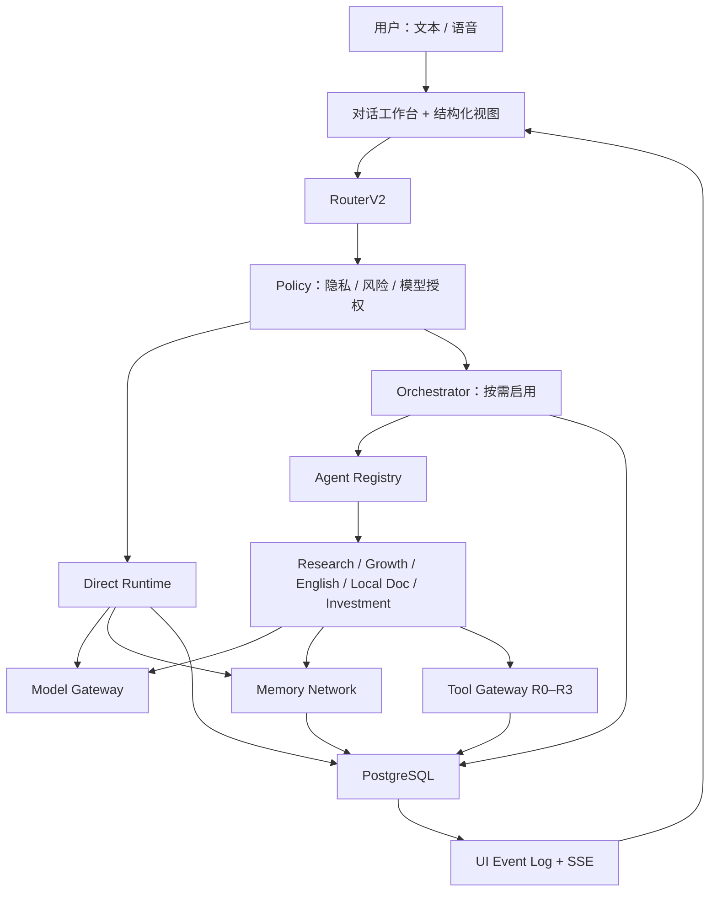
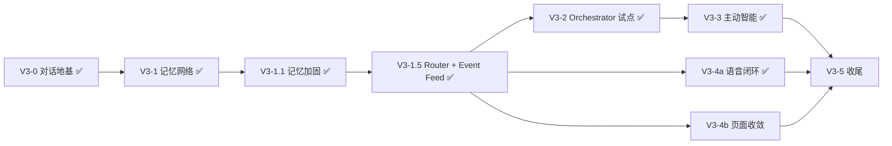

# JARVIS_OS_V3_PLAN — 主动式对话个人智能 OS 路线图

> 版本：v1.2（2026-08-09）
> 状态：执行中
> 当前进度：V3-0、V3-1、V3-1.1、V3-1.5、V3-2、V3-3、V3-4a 已交付；下一阶段先做 V3-4b 的 `/chat` 与 `/approvals` 双页高保真原型门禁
> 交付证据：[JARVIS_OS_V3_DELIVERY_LOG.md](./JARVIS_OS_V3_DELIVERY_LOG.md)

本文件只维护仍然有效的产品方向、架构约束、阶段依赖和验收标准。已完成阶段的提交、测试数字和环境记录统一进入交付日志；具体任务由 GitHub Issues 跟踪；长期架构决策记录在 `docs/adr/`。

## 0. v1.2 优化摘要

本次优化针对 V3-0/V3-1 实现复核后发现的依赖与口径问题：

1. 在 V3-1 与 V3-2 之间增加 **V3-1.1 记忆网络加固**；
2. 增加 **V3-1.5 Router 切流与事件地基**，不再把 Router 真实接管隐藏在 V3-2 内部；
3. 将 Orchestrator 收敛为按需启用的深模块，复用现有 Agent Run、Step、Approval 与 LangGraph Checkpointer；
4. 分离模型授权、草稿审阅与 R2 工具审批，避免权限语义混淆；
5. 修正 SSE 现状描述：当前支持快照、心跳和自动重连，但在 PG 事件日志落地前不承诺可靠续传；
6. 将记忆召回上限统一定义为“实体 + 关系 + 事件总计不超过 12 项”；
7. 将语音验收从笼统的“端到端 4 秒”拆分为可测量的分段延迟；
8. 解除 V3-4a 语音与 V3-4b 页面收敛之间的不必要依赖；
9. 将历史交付记录移出主计划，并把旧视觉改造计划标记为已被替代。

## 1. 产品北极星

Jarvis OS 是一个**本地优先、可持续理解用户、能够主动发现问题，并在明确授权后协助推进目标的个人 AI 操作系统**。

核心交互原则：

- **对话负责表达意图**：用户用自然语言提出目标、问题和修改意见；
- **结构化视图负责查看状态**：任务、证据、关系、进度和历史记录保持可浏览、可比较；
- **审阅与审批负责确认决定**：草稿审阅、云模型授权、外部副作用审批具有不同语义；
- **系统主动但不越权**：可以发现、提醒、生成草稿，不替用户执行 R2/R3 动作。

V3 不追求：

- 把所有聊天都包装成 LangGraph 工作流；
- 引入图数据库、Redis 或新的常驻向量数据库；
- 用一套万能卡片或万能事件表吞并全部领域模型；
- 为追求“全自动”而弱化现有安全策略；
- 一次性重写现有前后端。

## 2. 当前基线与 V3 增量

| 领域 | 已有能力 | V3 增量 |
|---|---|---|
| 对话 | FastAPI 流式聊天、Next.js ChatWorkspace、Model Gateway | 对话工作台、状态卡片、可靠事件流、页面摘要 |
| 模型 | MiMo / DeepSeek / Ollama，多模型策略与逐次授权 | RouterV2 获得可灰度回滚的真实执行权 |
| 记忆 | 已确认长期记忆、pgvector、Obsidian 知识桥接 | 关系记忆、时间线、多跳检索、候选确认制 |
| Agent | 6 个 AgentSpec、Direct / Workflow Runtime | 按需 Orchestrator 和跨 Agent 交接 |
| 工作流 | Growth / Research LangGraph、PG Checkpointer、Run/Step 账本 | 复用现有账本完成分解、恢复、汇总和复盘 |
| 工具 | Tool Gateway、R0–R3、Approval Center、n8n / Browser Worker | 对话内预览，但不改变工具安全策略 |
| 主动智能 | 规则扫描、建议记录、静默时段、每日上限 | 对话级建议、采纳/忽略反馈和个性化排序 |
| 语音 | 本地 sherpa-onnx TTS | 本地 STT、打断状态机、STT→LLM→TTS 闭环 |
| 前端 | 多个专业页面、平板聚合、PWA | 三个主要操作面 + 必要结构化视图，不强制只剩三条路由 |

## 3. 不可破坏的架构约束

1. PostgreSQL 是对话、任务、记忆、审批、运行状态和事件引用的唯一事实源；
2. 向量索引、记忆关系和 UI 事件日志不得成为绕过原始权限的第二事实源；
3. Router 只能选择 Agent Registry 中存在的 Agent，不能扩大 AgentSpec 权限；
4. Direct Runtime 是默认路径，LangGraph 只用于需要暂停、恢复或多步骤状态的任务；
5. R0–R3 分类继续遵守 ADR-0002，R3 永不提供 Agent 执行入口；
6. 模型只能提出工具请求，所有副作用继续由 Tool Gateway 仲裁；
7. DeepSeek 与扩大云端数据范围必须逐次披露和确认；
8. Run、Step、Checkpoint、事件流只保存状态和引用，不复制私人正文；
9. 新能力必须有 Feature Flag、运行时读取点、测试和回滚路径；
10. PG 可靠事件日志落地前，API 维持单 worker 部署。

相关 ADR：

- [ADR-0001：Agent 与 Runtime 分离](./adr/0001-v2-agent-runtime-boundary.md)
- [ADR-0002：自动化风险策略](./adr/0002-v2-automation-risk-policy.md)
- [ADR-0003：模型授权与最小账本](./adr/0003-v2-model-consent-and-minimal-ledger.md)
- [ADR-0009：Tool Gateway 人类控制面](./adr/0009-tool-gateway-human-control-boundary.md)
- [ADR-0012：V3 记忆网络](./adr/0012-v3-memory-network-and-retrieval-boundary.md)
- [ADR-0013：V3 按需编排](./adr/0013-v3-on-demand-orchestrator.md)
- [ADR-0014：V3 UI 事件投递](./adr/0014-v3-ui-event-delivery.md)

## 4. 目标架构



## 5. 核心模块与接口

### 5.1 RouterV2：真实切流前置

RouterV2 当前仍是影子判断。V3-1.5 完成前，Orchestrator 不得依赖它启动真实运行。

Router 的外部接口保持为一个决策入口：

```text
route(request) -> RouteDecision
```

`RouteDecision` 至少包含：

- `agent_id` 与 `agent_version`；
- `runtime`；
- `complexity`（0–10，`>=7` 定义为复杂）；
- `cross_agent_required`；
- 隐私、风险、模型选择和授权要求；
- 可向用户解释的原因与降级路线。

切流要求：

- 先在固定评测集上比较旧 ModelRouter 与 RouterV2；
- 保持 DeepSeek 409 确认语义、隐私路由和降级行为不变；
- 按请求类型灰度，不允许一次性替换全部聊天；
- Flag 关闭后立即回到旧 ModelRouter；
- Router 判断只决定路线，不直接调用模型、工具或 Runtime。

### 5.2 Orchestrator：小接口、深实现

Orchestrator 只处理需要跨 Agent 或暂停恢复的复杂目标。外部调用者不应了解内部节点、分派循环或 Checkpointer 细节。

冻结外部接口：

```text
start(goal_ref, context_refs) -> run_ref
resume(run_ref, decision_ref) -> RunStatus
cancel(run_ref) -> RunStatus
get(run_ref) -> RunView
```

触发条件必须同时满足：

1. `complexity >= 7`；
2. 预计需要至少两个 Agent，或任务明确需要暂停/恢复；
3. 用户确认编排计划预览。

执行约束：

- 子任务最多 5 个；
- 每步只能选择 Agent Registry 中的 AgentSpec；
- 权限取各 AgentSpec 与 Tool Gateway 策略交集；
- DeepSeek 授权只覆盖已披露步骤；
- 失败默认停在可恢复状态，不跨 Agent 静默绕过；
- V3-2 首个试点只实现“Research 结果 → Growth 任务草稿”。

账本策略：

- 复用 `agent_runs`、`agent_steps`、`agent_approvals` 与 PG Checkpointer；
- 为父子关系增加 `parent_run_id` 或等价引用；
- 编排计划正文放在业务草稿区，Run 只保存 `plan_ref`；
- 除非现有账本无法表达已确认的不变量，否则不新增重复的 `orchestration_runs` / `orchestration_steps` 两套账本。

### 5.3 三种确认不得混用

| 决策类型 | 含义 | 风险语义 | 是否阻断执行 |
|---|---|---|---|
| Model Consent | 允许本次运行使用 DeepSeek 或扩大云端数据范围 | 隐私/付费授权 | 是 |
| Draft Review | 审阅编排计划、研究摘要、成长任务草稿 | R1 产品审阅，不等于安全审批 | 由工作流决定 |
| Tool Approval | 确认文件、日历、邮件、浏览器等外部副作用 | R2 安全审批 | 是 |

三者可以在 Approval Center 统一展示，但必须使用不同类型、状态机和审计字段；任一种确认都不能替代另一种确认。Jarvis 内部草稿可按 R1 自动保存，写入普通文件、Obsidian、邮箱、日历或外部服务仍属于 R2。

### 5.4 Memory Network：确认制关系记忆

记忆网络的外部接口收敛为：

```text
extract_candidates(scope) -> CandidateBatch
decide(candidate_id, action) -> DecisionResult
retrieve(query, budget, for_cloud) -> MemoryContext
```

其中 `action` 支持 confirm / ignore / merge。规则抽取、本地 Qwen、PostgreSQL、语义索引属于模块内部实现，不扩散到调用方。

V3-1.1 加固项：

- 增加实体数据库级唯一约束，避免并发抽取重复；
- 将关系“当前断言”与历史有效期口径明确分离，允许关系失效后重新成立；
- 将事件与实体关联迁移为有外键和索引的关联表，或证明 JSON 方案能提供同等完整性；
- 召回总数按实体、关系、事件合计不超过 12 项；
- 8K 预算按最终渲染上下文计算，包含溯源和格式开销；
- 查询与发送云模型前都重新检查 `cloud_allowed` 和来源状态；
- 候选在 confirm 前不得进入聊天上下文；
- 归档、合并和来源停用必须传播到关系、事件和语义索引。

候选质量指标分开统计：

- **有效候选率** = `(确认 + 合并) / (确认 + 合并 + 忽略)`；
- **去重率** = `合并 / 全部已决策候选`；
- 规则抽取和 Qwen 抽取分别报告，不用单一百分比掩盖差异。

### 5.5 UI Event Feed：从轮询基座到可靠续传

当前 V3-0 能力：

- 连接时发送 snapshot 与 dialog 版本；
- 15 秒心跳；
- 每 10 秒检查 `data_version`；
- 浏览器断线后自动重连；
- 进程内事件总线仅适用于单 worker，重启会丢事件；
- 当前不承诺 `Last-Event-ID` 可靠续传。

V3-1.5 目标接口：

```text
publish(event_type, aggregate_ref, data_version) -> event_id
stream(after_event_id) -> EventStream
snapshot() -> UiSnapshot
```

生产使用 PostgreSQL 事件日志适配器，测试使用内存适配器。事件日志只保存单调递增 ID、类型、聚合引用、版本和时间，不保存私人正文；业务状态表仍是事实源。

可靠性要求：

- 状态变更与事件写入使用同一数据库事务或 Outbox；
- 服务端读取 `Last-Event-ID` 并重放仍在保留期内的事件；
- 事件过期、ID 不存在或版本冲突时回退完整 snapshot；
- 慢消费者允许丢中间通知，但必须通过版本或 snapshot 收敛到最新状态；
- 审批状态和主动建议状态变化必须产生新版本；
- PG 事件日志验收后才解除单 worker 约束。

### 5.6 主动智能与反馈

Proactive 继续负责规则信号和轻建议，Orchestrator 负责复杂、多 Agent 目标，二者不合并。

V3-3 先复用已有 suggestion 状态记录 accept / dismiss / expire，不立即新增通用 `feedback_signals` 表。只有至少两个领域消费者需要统一反馈观察时，才新增 append-only 反馈表；领域排序权重仍由领域模块维护，反馈表不成为万能偏好模型。

主动智能约束：

- 后台零付费模型调用；
- 每日上限与静默时段不变；
- 先展示建议和理由，不自动创建正式任务；
- 同类建议去重，并支持用户明确关闭该类建议。

### 5.7 本地语音闭环

语音模块采用明确状态机：

```text
idle -> listening -> transcribing -> responding -> speaking
  ^          |             |             |             |
  +----------+-------------+-------------+-- interrupted
```

约束：

- STT / TTS 默认本地 sherpa-onnx；
- 原始音频不上云、不落业务库；
- 默认由对话页麦克风启动，不做常驻唤醒；
- 模型懒加载并在空闲后卸载；
- 支持打断、取消、静默时段和设备不可用降级；
- 先完成基准 Spike，再冻结模型和最终延迟目标。

延迟按固定设备与测试语料分别验收：

- STT 结束到最终文本；
- LLM time-to-first-token；
- TTS 首段音频；
- 用户感知的首响应时间。

不再使用无法定位瓶颈的“完整回答端到端不超过 4 秒”作为唯一指标。

### 5.8 前端收敛

V3 目标是三个**主要操作面**，不是强行只保留三条路由：

1. 对话工作台；
2. 审阅与审批；
3. 设置与系统状态。

任务、记忆、知识、成长、英语、情报、投资等结构化页面可降级为只读视图或深度查看页。页面只有在满足以下条件后才能下线：

- 对话内存在等价操作并通过验收；
- 路由使用遥测已建立；
- 近 30 天没有真实使用，或用户明确确认；
- 单页单独回滚，不批量删除。

`DialogCard` 使用稳定 envelope + 按 `card_type` 区分的类型化 payload；禁止依赖无限扩张的 `meta: Record<string, unknown>` 承载核心业务字段。

V3-4a 语音和 V3-4b 页面收敛都依赖 V3-1.5 的事件/对话契约，但二者相互独立，可以并行。

## 6. 阶段路线图



| 阶段 | 核心交付 | 主要 Flag | 验收重点 | 回滚 |
|---|---|---|---|---|
| V3-0 ✅ | 对话聚合接口、SSE 基座、对话工作台 | `v3_dialog_workspace_enabled`、`v3_sse_enabled` | 契约、Flag 开关、旧聊天无回归 | 关闭两 Flag |
| V3-1 ✅ | 记忆三表、候选确认、规则/Qwen 抽取、多跳检索雏形 | `v3_memory_network_enabled` | 确认前不可检索、PG 迁移、前端候选卡 | 关闭 Flag，旧检索保留 |
| V3-1.1 ✅ | 唯一约束、关系历史、事件关联、全局召回/预算、并发测试 | 复用 `v3_memory_network_enabled` | 总召回≤12；并发不重复；历史关系可重建；PG 真库测试 | 保留旧表兼容迁移并关 Flag |
| V3-1.5 ✅ | Router 真实灰度切流、PG UI 事件日志、可靠重连 | `v2_router_enforcement_enabled`、`v3_reliable_event_feed_enabled` | 路由评测集；旧模型语义一致；重启续传；多 worker 前置满足 | Router 回旧链路；SSE 回 snapshot+polling |
| V3-2 ✅ | Orchestrator 深模块、Research→Growth 草稿试点、父子 Run | `v3_orchestrator_enabled` | 50 条简单请求误触发≤2；20 条复杂场景可恢复；R2/R3 不变量全绿 | 回 Direct Runtime |
| V3-3 ✅ | 会话级主动建议、反馈回流、去重与类别关闭 | `v3_conversational_proactive_enabled` | 后台零付费调用；静默时段；分类型采纳/忽略数据 | 回 `/proactive` 与定时扫描 |
| V3-4a ✅ | 语音 Spike、STT+LLM+TTS、打断状态机 | `v3_voice_loop_enabled` | 分段 p50/p95 延迟；CPU/内存实测；设备降级 | 关闭语音 Flag，保留文本聊天 |
| V3-4b | 先完成 `/chat` 与 `/approvals` 双页高保真原型，确认视觉方向后再逐页收敛 | `v3_page_convergence_enabled` | 原型确认门禁；对话等价操作；路由矩阵；逐页浏览器回归 | 原型隔离；分页关闭，不批量回滚 |
| V3-5 | 全量回归、性能复采、死 Flag 清理、发布清单 | 稳定后清理 | `check.ps1`；PG 真库；Playwright；资源基线 | 关闭全部 V3 Flag |

## 7. 指标与验收口径

| 领域 | 指标 | 口径 |
|---|---|---|
| Router | 专用 Agent 误路由率 | 固定标注集上错误选择 Agent / 全部样本 |
| Router | 简单请求 Orchestrator 误触发 | 50 条简单请求中最多 2 条进入编排预览，且未经确认不运行 |
| Memory | 有效候选率 | `(确认 + 合并) / 全部已决策候选`，规则/Qwen 分列 |
| Memory | 召回预算 | 实体+关系+事件总计≤12，最终渲染上下文≤8K token |
| Orchestrator | 可恢复性 | 每个暂停点执行 API 重启后可用同一 run_ref 恢复 |
| Orchestrator | 权限不变量 | R3 执行数=0；R2 未批准执行数=0；跨 Agent 不扩大权限 |
| Proactive | 建议接受率 | accept / (accept + dismiss)，按 suggestion_type 分列 |
| Proactive | 重复与打扰 | 同来源同类型去重；静默时段推送数=0；每日上限不变 |
| Voice | 分段延迟 | 固定设备、固定语料下报告 STT、LLM TTFT、TTS 首音 p50/p95 |
| 资源 | 工作集峰值 | 在定义好的场景中测量 API、Web、PG、Companion、Ollama 和浏览器总工作集，不用理论相加替代实测 |

首次采样不足时只报告样本与置信范围，不为了满足阶段目标修改统计口径。环境门控测试必须区分“通过”和“未运行”。

## 8. 资源与性能原则

- 目标设备：16GB 内存、4GB 独显；V3 默认不依赖 GPU；
- Ollama、STT 和 TTS 按需加载，不把“模型未计入”后的数字称为整机峰值；
- 每阶段复采固定场景：文本聊天、复杂编排、记忆抽取、语音首响应；
- 记录进程工作集、容器内存、CPU 峰值、事件积压和接口 p95；
- 超过设备可接受阈值时优先减少常驻模型和并发，而不是引入新基础设施。

## 9. 发布与回滚纪律

每个阶段必须完成：

1. 契约或 ADR 冻结；
2. 数据迁移与兼容路径；
3. Feature Flag 默认关闭；
4. 单元、契约、PG 集成和必要的浏览器测试；
5. Flag 开/关双路径验收；
6. 回滚演练；
7. 交付记录写入 `JARVIS_OS_V3_DELIVERY_LOG.md`；
8. 稳定观察后清理死 Flag 和旧路径。

测试数字必须标注环境，例如“PG 全集”或“默认环境，PG 用例跳过”，不在路线图中长期复制瞬时数字。

## 10. 风险与对策

| 风险 | 对策 |
|---|---|
| Router 切流改变稳定聊天行为 | 独立 V3-1.5、固定评测集、按意图灰度、单 Flag 回旧路由 |
| Orchestrator 过度触发 | 复杂度 + 多 Agent/恢复需求 + 用户确认三重门槛 |
| 多套账本产生状态冲突 | 复用 Agent Run/Step/Approval/Checkpointer，只增加父子与计划引用 |
| 记忆并发重复或历史关系丢失 | 数据库唯一约束、关系有效期模型、PG 并发与迁移测试 |
| 召回数量和 token 预算名实不符 | 使用全局数量预算和最终渲染预算，在模块接口处统一裁剪 |
| SSE 重启丢事件 | PG Outbox/事件日志、Last-Event-ID 重放、snapshot 收敛 |
| Approval Center 产生确认疲劳 | 分开 Model Consent、Draft Review、Tool Approval，不把 R1 当 R2 |
| 通用反馈表吞并领域语义 | 至少两个消费者后再建 append-only 表，领域模块保留排序权重 |
| 页面收敛导致入口丢失 | 先补等价操作和遥测，再逐页确认，保留结构化深度查看 |
| 语音延迟目标不可解释 | 先 Spike，按 STT/TTFT/TTS 分段报告 p50/p95 |

## 11. 当前下一步：V3-4b 双页原型门禁

V3-4a 已交付默认关闭的本地语音闭环，固定设备 Spike、模型与延迟目标见 [V3_VOICE_BENCHMARK.md](./V3_VOICE_BENCHMARK.md)，实现与环境门控证据见 [JARVIS_OS_V3_DELIVERY_LOG.md](./JARVIS_OS_V3_DELIVERY_LOG.md)。

V3-4b 不直接启动整站收敛。第一批只制作 `/chat` 与 `/approvals` 两个高保真原型；在用户明确确认视觉方向以前，不修改其余页面、不删除旧入口、不批量替换全局视觉。确认后按单页 Flag、等价操作清单和逐页浏览器回归推进。

V3-4a 的 `v3_voice_loop_enabled` 继续默认关闭；进入原型阶段不得顺带启用常驻麦克风、进入 V3-5，或扩大 Orchestrator 与工具权限范围。
