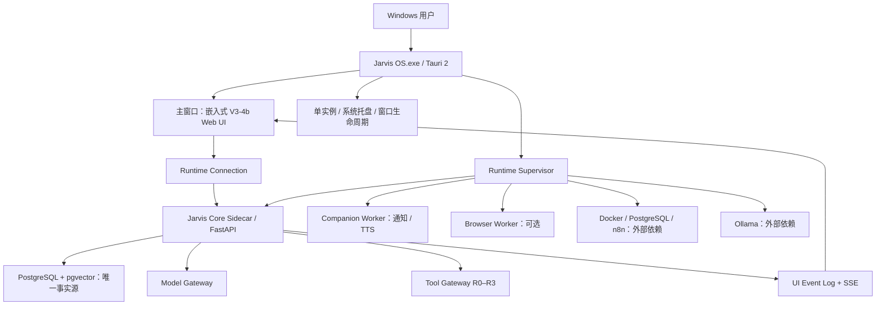
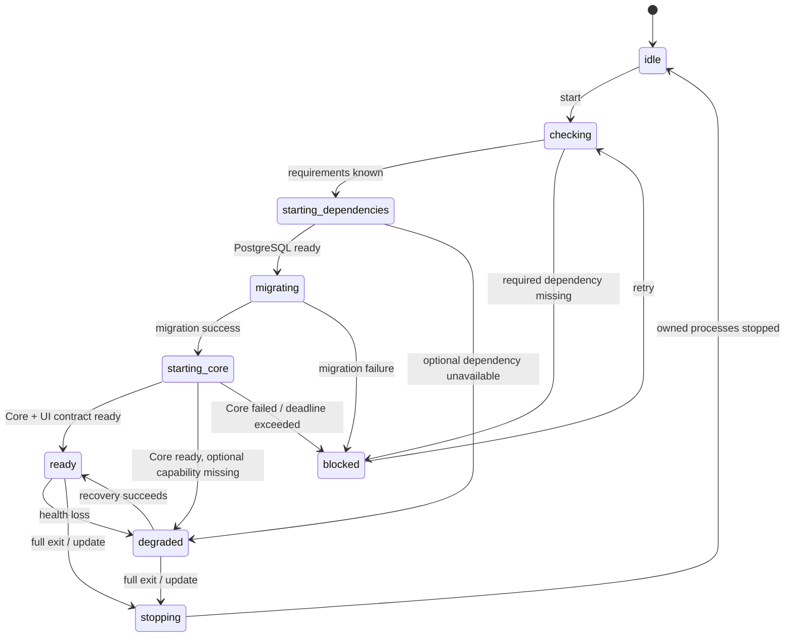
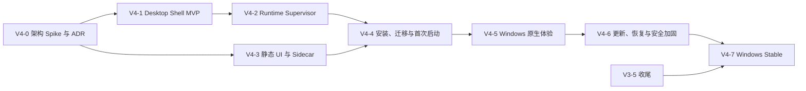

# JARVIS_OS_V4_PLAN — Windows 原生桌面 App 进化路线图

> 版本：v0.2（2026-08-12）  
> 状态：产品范围已冻结；技术选型待 V4-0 Spike 与 ADR 冻结  
> 目标平台：Windows 11 x64 优先  
> 明确不在本计划内：Android、iOS、平板专用终端改造  
> 详细产品规格：[JARVIS_OS_V4_PRD.md](./JARVIS_OS_V4_PRD.md)  
> 上一阶段：[JARVIS_OS_V3_PLAN.md](./JARVIS_OS_V3_PLAN.md)

本文定义 Jarvis OS 从“由脚本启动的本地 Web 系统”进化为“可安装、可唤醒、可恢复、可更新，并能与 Windows 有限协作的桌面 App”的产品目标、架构约束、阶段依赖和验收门槛。具体需求、交互与验收编号见 V4 PRD；具体任务仍由 GitHub Issues 跟踪；长期架构决策进入 `docs/adr/`；完成证据后续进入独立的 V4 交付日志。

---

## 0. 执行摘要

V4 不重写 Jarvis 的 AI、记忆、工具或数据层，也不把现有网页简单套进一个窗口就宣告完成。V4 的核心交付是“可靠桌面发行层 + 有限 Windows 原生体验”：

- 用户从开始菜单、桌面快捷方式或托盘启动 `Jarvis OS`；
- App 自己检查依赖、启动并监管 Jarvis 自有进程，不再要求用户理解 PowerShell、npm、Python 或端口；
- V3-4b 对话双翼工作台作为默认主窗口，保留现有业务能力与安全语义；
- 安装、升级、退出、崩溃恢复、日志、备份和卸载行为都有明确规则；
- 支持全局快捷键唤醒、快速输入窗口、通知深链、受控文件接入和按住说话；
- 提供可解释的运行状态中心，可选开机启动但默认关闭；
- PostgreSQL 仍是唯一事实源，Tauri 和 WebView 内部状态不得成为新的业务事实源；
- Docker Desktop、PostgreSQL 容器与 Ollama 在 V4 首版仍作为受检依赖，不静默捆绑或替用户安装；
- 平板和手机端保持当前状态，不进入 V4 关键路径。

首选候选方向如下；V4-0 必须用实测证据验证，并由 ADR-0015 正式冻结：

1. **Tauri 2** 作为 Desktop Shell 首选，承担 Windows 窗口、单实例、托盘、安装包和最小原生能力；
2. **Next.js / React** 继续承担全部主界面，目标是生成可嵌入 Tauri 的静态前端资产；
3. **FastAPI** 继续承担业务接口，通过受监管的本地 Sidecar 运行；
4. **Python Companion** 保留通知与本地语音实现，但在 App 模式下不再创建第二套托盘；
5. **PostgreSQL/pgvector、Ollama、可选 n8n** 保持独立运行时，不塞入 WebView 或 Rust 核心；
6. 现有 `启动 Jarvis.cmd` / `停止 Jarvis.cmd` 在 V4 稳定前作为回滚入口保留。

---

## 1. 产品北极星

V4 的用户体验目标不是“网页看起来像 App”，而是：

> 用户双击 Jarvis OS 后，只需要面对一个可解释的启动过程和一个稳定的主窗口；后台依赖、端口、进程、迁移、日志与恢复由系统负责管理，在无法自动恢复时给出准确原因和下一步。

一句话产品定位：

> 让 Jarvis 成为可安装、可唤醒、可感知运行状态、可通过通知和文件与 Windows 协作的本地个人 AI 桌面系统。

### 1.1 成功体验

正常路径：

1. 用户打开 Jarvis OS；
2. 原生启动页在 1 秒内出现，显示真实启动阶段；
3. App 检查 WebView2、Docker/PostgreSQL、FastAPI、Companion、Ollama 与可选 Provider；
4. 完成数据库迁移并启动 Jarvis Core；
5. 主窗口进入 `/chat` 对话双翼工作台；
6. 关闭窗口默认最小化到托盘，用户可显式“完全退出”；
7. 下次启动恢复窗口大小、位置、侧边栏和当前会话等纯界面状态。

日常快捷路径：

1. 用户在任意 Windows 界面按下可配置全局快捷键；
2. 快速输入窗口在前台出现，可文字输入或按住说话；
3. 普通问题直接同步到当前 Jarvis 对话；涉及写入、工具或外部副作用时仍走原审批语义；
4. Jarvis 通知可打开对应上下文或安全地“稍后提醒”，不得在通知里批准高风险动作；
5. 用户把受支持文件拖入主窗口或通过“打开方式”交给 Jarvis 时，先看到文件、用途和影响范围预览，再确认是否发送或导入。

异常路径：

- Docker 未启动：说明依赖、尝试启动、显示超时与手动修复入口；
- Ollama 不可用：允许进入降级模式并明确本地模型不可用，不伪装成全部就绪；
- 端口被占用：识别是否属于 Jarvis，禁止误杀其他进程；
- 数据库迁移失败：停止后续启动，保留日志和备份，不进入半就绪状态；
- Sidecar 崩溃：按受控策略重启，超过上限后进入可诊断的降级/阻断状态；
- 更新失败：恢复上一版二进制，不自动回滚不可逆数据库迁移。

### 1.2 V4 不追求

- 不重写为 Flutter、React Native、WinUI 或纯 Rust 前端；
- 不把 FastAPI 业务逻辑迁入 Tauri Command；
- 不让 WebView 直接读写数据库、文件系统或启动任意命令；
- 不在首版自带完整 Docker Desktop、PostgreSQL、Ollama 或模型权重安装器；
- 不在首版支持 macOS、Linux、Android、iOS 或 Microsoft Store；
- 不加入插件市场、大量新 Agent、手机同步、多用户/账号系统；
- 不重写记忆网络、向量数据库或模型路由；
- 不做持续监听唤醒词，不常驻监控屏幕、剪贴板、摄像头或任意文件；
- 不允许 Jarvis 无审批地接管电脑或执行高风险桌面操作；
- 不为了减小安装包而合并现有安全边界；
- 不用自动更新绕过备份、迁移与签名验证；
- 不用 App 化替代 V3-5 的回归、性能和死 Flag 收尾。

---

## 2. 当前基线与 V4 增量

| 领域 | 当前基线 | V4 增量 |
|---|---|---|
| 界面 | Next.js 16、React 19、V3-4b `/chat` 双翼工作台 | 嵌入 Tauri 主窗口，桌面默认入口、原生启动/错误页、窗口状态恢复 |
| 启动 | `.cmd` → PowerShell → Docker/API/Companion/Web | Runtime Supervisor 统一编排、状态机、进程所有权和失败恢复 |
| Web 运行时 | `next start`，本机 3000 端口 | 目标为静态资产嵌入；Node Server 只作为过渡适配器 |
| API | `.venv` 中运行 FastAPI/Uvicorn，固定 8000 | 可打包 Sidecar、受控端口、桌面会话认证、健康与版本契约 |
| 数据库 | Docker 中的 PostgreSQL 17 + pgvector，命名卷持久化 | 保持唯一事实源；加入依赖检查、备份前置和迁移门禁 |
| 模型 | MiMo/DeepSeek/Ollama，多模型策略 | 不改模型策略；App 只展示依赖状态和降级原因 |
| Companion | Python 托盘、通知、本地 TTS、心跳 | App 模式无重复托盘；保留通知/TTS Worker，由 Supervisor 监管 |
| 快捷交互 | 主要通过浏览器/主窗口进入 | 全局快捷键、快速输入窗口、按住说话；结果回到同一对话事实源 |
| Windows 协作 | 基础 Toast、托盘与脚本自启动 | 通知深链/安全动作、受控文件接入、运行状态中心、可选开机启动 |
| Browser Worker / n8n | 按 Flag 启用的隔离 Provider | 作为可选依赖启动，失败不得冒充核心失败 |
| 配置 | 仓库根目录 `.env`、`.data`、`.runtime` | 安装态配置/日志/运行数据迁出安装目录，密钥进入受保护存储 |
| 发布 | Git 分支、源码启动 | 版本化 Windows 安装包、升级清单、校验和、回滚与干净卸载 |

V4 可以与 V3-5 的非冲突收尾并行，但 V4 稳定版发布前必须通过完整 V3 回归。V4 不接受以冻结业务缺陷换取安装包进度。

---

## 3. 不可破坏的架构约束

1. PostgreSQL 继续作为对话、任务、记忆、审批、运行状态和事件引用的唯一事实源；
2. Tauri 只承担发行、窗口与本机运行时管理，不获得绕过 FastAPI、Tool Gateway、R0–R3 或模型授权的业务写入口；
3. WebView 不直接持有数据库凭证，不获得任意 Shell、任意文件系统或任意进程权限；
4. Tauri Command 使用显式白名单和最小 Capability，不提供 `execute(command: string)` 一类通用接口；
5. App 只终止自己创建且已验证身份的子进程；Docker Desktop、Ollama 和其他用户进程属于外部依赖，默认只观察不接管；
6. 启动、停止、重启和更新必须幂等；第二次点击启动不能产生第二套 Core、Companion 或数据库迁移；
7. 安装目录视为只读，配置、日志、缓存、备份和用户数据写入明确的用户数据目录；
8. 密钥不得写入前端包、日志、崩溃报告、Tauri 配置或发行清单；
9. 数据库升级采用向前兼容迁移；二进制回滚不得假设数据库可以自动降级；
10. 所有 V4 能力都必须存在开发态适配器、自动测试、诊断证据和回滚入口；
11. `启动 Jarvis.cmd` 在 V4-7 前保留，且其数据库、配置和业务行为与 App 模式一致；
12. V4 不改变 ADR-0001、0002、0003、0009、0012、0013、0014 定义的 Agent、审批、记忆和事件安全语义。

V4-0 需要新增 ADR-0015，冻结 Windows Desktop Shell、Runtime Supervisor、进程所有权、配置目录和发布边界。若实现需要违背现有 ADR，必须先修改 ADR，不能在代码里静默改变语义。

---

## 4. 目标架构



### 4.1 进程所有权

| 运行对象 | V4 所有权 | 允许的行为 |
|---|---|---|
| Tauri 主进程 | App 自有 | 单实例、窗口、托盘、更新、拉起 Supervisor |
| FastAPI Sidecar | App 自有 | 启动、健康检查、有限重启、优雅停止、强制回收 |
| Companion Worker | App 自有 | 启动、心跳、有限重启、优雅停止、强制回收 |
| Browser Worker | App 自有且按 Flag | 仅在启用时启动，保持现有只读隔离策略 |
| Next.js Node Server | 过渡期 App 自有 | V4-3 后删除，除非 V4-0 证明静态嵌入不可行 |
| PostgreSQL / n8n 容器 | 外部依赖、Jarvis 命名资源 | 可通过固定 Compose 清单请求启动/停止，不管理其他容器 |
| Docker Desktop | 用户/系统所有 | 可检测并发起可见启动请求，不静默安装、不强杀 |
| Ollama | 用户/系统所有 | 检测版本和健康；默认不结束用户进程 |

App 自有 Sidecar 应加入 Windows Job Object 或等价的进程组管理，避免 Tauri 崩溃后留下孤儿进程。外部依赖不得加入该 Job Object。

---

## 5. 核心模块与接口

### 5.1 Desktop Shell：窗口能力保持小接口

Desktop Shell 的外部接口只覆盖桌面体验，不承载业务动作：

```text
show_main_window()
hide_main_window()
request_exit(mode) -> ExitDecision
get_release_info() -> ReleaseInfo
```

内部实现负责：

- 单实例与第二次启动聚焦现有窗口；
- 主窗口大小、位置、最大化状态恢复；
- 关闭窗口默认隐藏到托盘，显式“完全退出”才停止 App 自有运行时；
- 托盘只保留“打开 Jarvis”“运行状态”“暂停/恢复提醒”“完全退出”等有限入口；
- 导航、对话、审批等业务动作继续通过 Web UI 和 FastAPI 完成；
- 不在 Rust 内复制通知偏好、会话状态或审批状态。

### 5.2 Runtime Supervisor：V4 的核心深模块

Runtime Supervisor 隐藏依赖发现、启动顺序、健康探测、迁移、重试、日志和关闭细节。外部接口冻结为：

```text
start(profile) -> RuntimeSnapshot
stop(reason) -> RuntimeSnapshot
restart(target) -> RuntimeSnapshot
status() -> RuntimeSnapshot
diagnostics() -> DiagnosticBundleRef
```

`RuntimeSnapshot` 至少包含：

- 总体状态：`idle | checking | starting | ready | degraded | blocked | stopping`；
- 每个运行对象的状态、版本、所有权、最近错误和恢复建议；
- 当前启动阶段、耗时、可取消性；
- Core endpoint 的引用，不直接把密钥写入持久状态；
- 发行版本、数据库 schema revision 和前端构建版本；
- 降级后仍可用的能力列表。

Supervisor 内部使用依赖图而不是散落的顺序脚本：

```text
WebView2
   └─ Desktop Shell
Docker ─ PostgreSQL ─ Migration ─ FastAPI ─ UI Ready
Ollama ───────────────────────────┘（可降级）
FastAPI ─ Companion Worker（通知/TTS 可降级）
FastAPI ─ Browser Worker（按 Flag）
Docker ─ n8n（按 Flag）
```

开发态至少存在两个真实 Adapter：

- `SourceRuntimeAdapter`：复用仓库、`.venv`、npm 和现有 Compose；
- `BundledRuntimeAdapter`：使用安装包中的静态 UI 与 Sidecar。

测试使用 In-memory/Fake Adapter 验证状态机，但 Fake 不成为生产第三条路径。

### 5.3 Runtime Connection：隔离浏览器与桌面连接方式

Web UI 只认识一个连接接口：

```text
connect() -> RuntimeConnection
```

`RuntimeConnection` 包含 Core endpoint、短生命周期桌面会话凭证、运行模式、版本与能力。实现分为：

- `BrowserRuntimeConnection`：使用现有环境配置，服务源码/PWA 回滚；
- `TauriRuntimeConnection`：通过最小 Tauri Command 获取本次启动的连接信息。

目标状态不再把桌面 API 地址永久硬编码为 `127.0.0.1:8000`。Supervisor 负责端口分配和所有权确认；FastAPI 只接受精确允许的 App Origin 与本次桌面会话凭证。V4-0 Spike 必须确认 Windows WebView2 下真实 Origin，再冻结 CORS 白名单，禁止使用 `*`。

### 5.4 Distribution Layout：安装文件与用户数据分离

建议安装态目录：

```text
%LOCALAPPDATA%\Programs\Jarvis OS\       # 安装器管理，只读二进制和静态资源
%LOCALAPPDATA%\Jarvis OS\config\        # 非敏感配置与发行通道
%LOCALAPPDATA%\Jarvis OS\data\          # App 管理的数据与导入材料
%LOCALAPPDATA%\Jarvis OS\runtime\       # PID、锁、临时端口和会话文件
%LOCALAPPDATA%\Jarvis OS\logs\          # 结构化日志
%LOCALAPPDATA%\Jarvis OS\backups\       # 更新/迁移前备份索引
```

约束：

- PostgreSQL 业务数据继续位于命名 Docker Volume，不复制为第二事实源；
- 云模型密钥优先进入 Windows Credential Manager 或 DPAPI 保护存储；
- 现有 `.env` 只允许通过一次性迁移向导导入，导入前显示字段和目标，不回显完整密钥；
- 日志默认脱敏，诊断包生成前再次过滤 Token、Cookie、Prompt 正文和私人文件内容；
- 卸载默认保留用户数据与数据库卷，删除数据必须单独确认并明确不可恢复范围。

### 5.5 Companion 收敛：只保留一套托盘

当前 Python Companion 同时承担托盘、通知、TTS 和 API 心跳。V4 按职责拆分但不重写语音实现：

- Tauri 接管唯一系统托盘、窗口和 App 退出；
- Python Companion 新增 App/Headless 模式，不创建 `pystray` 托盘；
- Windows Toast、本地 sherpa-onnx TTS、系统语音降级和投递回执继续保留；
- 提醒暂停/恢复仍调用现有 FastAPI 偏好接口，不在 Tauri 中复制规则；
- 浏览器源码模式可暂时继续使用旧托盘，直到 V4-7 决定是否彻底删除旧入口。

### 5.6 Release Manifest：统一版本事实

每个发行包生成只读清单：

```text
ReleaseInfo {
  app_version,
  git_sha,
  web_build_id,
  core_version,
  companion_version,
  database_revision,
  build_timestamp,
  channel
}
```

启动页、设置页、日志和诊断包读取同一清单，禁止各模块显示互相矛盾的版本号。

---

## 6. 打包与运行时决策

### 6.1 前端：静态嵌入是目标，Node Sidecar 只是过渡

当前 `/chat` 与 `/onboarding` 使用 Next.js 动态运行时。V4-0 必须用 Spike 验证以下迁移：

- 将 workspace 参数、Feature Flag 和首次启动选择移到客户端 Runtime Connection；
- 保持数据读取与写入通过 FastAPI 客户端进行；
- 让所有进入 Windows App 的路由通过 `output: "export"` 生成静态资产；
- 桌面构建不注册面向浏览器的 Service Worker，避免旧缓存覆盖安装包资源；
- 浏览器构建继续保留现有 PWA/源码启动能力；
- 建立 Browser 与 Desktop 两种构建产物的契约测试。

决策门槛：

- 若 Spike 能保持 `/chat`、`/onboarding`、SSE、路由导航和 Feature Flag 语义，V4-3 删除 Node Sidecar；
- 若存在无法在不破坏产品语义的前提下静态化的明确阻断，ADR-0015 可批准捆绑 Next.js Node Server，但必须记录安装包、内存、更新和安全成本；
- 不允许长期同时维护两套业务 UI。

### 6.2 Python：优先一目录 Sidecar

FastAPI 与 Companion 默认用 PyInstaller one-directory 或等价方案生成 Sidecar；V4-0 记录：

- 冷启动与热启动时间；
- 包体积、文件数和增量更新成本；
- `asyncpg`、`psycopg`、`pgvector`、`sherpa-onnx`、`mem0`、LangGraph 和 Alembic 资源完整性；
- 中文安装路径、无 Python 环境和普通用户权限下的行为；
- Windows Defender/SmartScreen 误报情况；
- 崩溃退出码、stdout/stderr 和优雅关闭行为。

除非 one-directory 存在验收阻断，不使用启动时自解压的 one-file 作为默认方案。API 与 Companion 可以共享发行资源，但保持独立进程角色和健康检查。

### 6.3 PostgreSQL、Docker 与 Ollama：依赖可见，不静默接管

V4 首版继续使用现有 PostgreSQL 17 + pgvector Docker Volume。安装器不捆绑 Docker Desktop，也不接受 Docker 许可。首次启动向导负责：

- 检测 Docker Desktop/Engine 和 Compose 版本；
- 检测 Jarvis PostgreSQL Volume 与 schema revision；
- 只使用随 App 发布的固定 Compose 清单管理 `jarvis-*` 资源；
- 在创建或升级前显示影响并执行备份；
- 检测 Ollama 与所需模型，缺失时允许选择“仅云模型”“稍后配置”或退出；
- n8n 与 Browser Worker 继续按 Feature Flag 作为可选能力。

未来若要去除 Docker 依赖，应作为 V4.x 独立 ADR 和迁移项目，不混入 V4 首版安装包。

### 6.4 Windows 安装器与 WebView2

默认发行：

- Tauri NSIS per-user `-setup.exe`，默认安装到 `%LOCALAPPDATA%`，不要求管理员权限；
- Windows 11 x64 首发；ARM64、Windows 10 与 MSI 不进入 V4 关键路径；
- 使用 WebView2 Evergreen Runtime，并在安装或首次启动时检测；
- 无网络环境是否捆绑 WebView2 Bootstrapper/Standalone Installer，由 V4-4 的包体积与离线安装测试决定；
- 开发版可暂时未签名；面向他人公开分发前必须完成 Windows 代码签名与发布者身份配置。

---

## 7. 运行时状态机



规则：

- 每个阶段有独立超时、错误码和恢复动作，不用一个“启动失败”覆盖所有原因；
- 只有 PostgreSQL、迁移、FastAPI 与前端连接契约满足时才能进入 `ready`；
- Ollama、n8n、Browser Worker、通知或语音失败按配置进入 `degraded`，不伪造 `ready`；
- 状态变化写结构化本地日志，不把完整私人业务正文复制进运行日志；
- Sidecar 重启采用有限退避窗口，超过上限停止自动重启；
- App 启动期间退出必须可取消并清理已创建的子进程；
- 完全退出只停止 App 自有进程和明确属于本次 Jarvis profile 的可选容器，不结束 Docker Desktop 或 Ollama。

---

## 8. 阶段路线图



### V4-0：架构 Spike 与决策冻结

核心交付：

- 新建 `apps/desktop-shell/` Tauri 2 最小工程；
- 验证 WebView2 加载现有 V3-4b、SSE、中文输入、麦克风权限、文件选择和外部链接；
- 验证 `/chat`、`/onboarding` 静态导出可行性；
- 打包最小 FastAPI/Companion Sidecar，覆盖关键依赖；
- 验证 Windows Job Object/进程组、单实例与端口所有权；
- 记录空壳、Node 过渡方案、静态 UI、Sidecar 的启动、内存和包体积基线；
- 新增 ADR-0015，冻结目标架构和回滚方案。

通过门槛：

- Tauri 窗口可以完成真实聊天流和 SSE；
- Sidecar 在无系统 Python/Node 的测试环境启动；
- 技术决策有实测证据，不以 Demo 成功代替发行可行性；
- 未修改 PostgreSQL、Tool Gateway 或模型授权语义。

回滚：删除隔离的 `apps/desktop-shell/`，现有 Web 启动路径不受影响。

### V4-1：Desktop Shell MVP

核心交付：

- 原生主窗口、启动页、托盘、单实例；
- 开发态加载现有 `http://127.0.0.1:3000/chat`；
- 窗口关闭、最小化到托盘、完全退出的明确语义；
- 窗口位置/大小恢复和多显示器越界修复；
- 外部链接交给默认浏览器，不在 App WebView 内任意导航；
- 开发启动命令与最小自动化 Smoke Test。

通过门槛：

- 连续启动 10 次不产生重复窗口或重复 Sidecar；
- 托盘只有一套；
- 崩溃重开能恢复到可见显示器；
- Browser/PWA 路径仍可独立运行。

回滚：App 只作为可选入口，继续使用现有 `.cmd`。

### V4-2：Runtime Supervisor 与可诊断启动

核心交付：

- 实现 Runtime Supervisor 状态机与 SourceRuntimeAdapter；
- 依赖图、健康检查、迁移门禁、启动取消和有限重启；
- 进程所有权验证、命名互斥锁、端口冲突保护；
- 原生启动进度、降级视图、修复建议和日志入口；
- 结构化日志与脱敏诊断包；
- 现有 PowerShell 逻辑收敛为 Adapter 或回滚脚本，不与 Supervisor 各自维护一套规则。

通过门槛：

- 自动化覆盖正常启动、Docker 未运行、PG 未就绪、迁移失败、端口冲突、Core 崩溃、退出中断；
- 不误杀测试夹具创建的非 Jarvis 进程；
- App 崩溃后不存在 App 自有孤儿进程；
- 失败页面能精确指出失败对象和日志位置。

回滚：切换到 SourceRuntimeAdapter/PowerShell 入口，数据库不回滚。

### V4-3：静态 UI 与 Bundled Sidecar

核心交付：

- Browser/Desktop 双构建目标；
- App 路由静态导出与 Tauri 内嵌资源；
- Runtime Connection 两个 Adapter；
- 打包 FastAPI、Alembic、Companion 和按需 Browser Worker；
- App 模式 Companion 无托盘；
- 桌面会话凭证、精确 Origin、受控本地端口和版本握手；
- Release Manifest 与兼容性检查。

通过门槛：

- 干净 Windows 测试账户无需源码、npm、Node 或系统 Python即可运行；
- V3-4b 聊天、面板、SSE、审批导航、通知和 TTS 关键路径通过；
- 前端不能调用未授权 Tauri Command；
- 关闭 App 后 App 自有 Sidecar 全部退出；
- 断开互联网后，本地 Qwen、数据库、记忆和本地页面仍按既有能力工作。

回滚：保留 Node/SourceRuntimeAdapter 一个版本周期；关闭 Bundled profile 回到源码模式。

### V4-4：安装、配置迁移与首次启动

核心交付：

- NSIS per-user 安装包、快捷方式、协议与卸载项；
- WebView2、Docker、PostgreSQL Volume、Ollama 和模型依赖检查；
- 从现有仓库安装迁移 `.env`、配置和运行偏好的向导；
- 密钥进入受保护存储，普通配置进入用户配置目录；
- 更新/迁移前数据库备份和可恢复性检查；
- 卸载默认保留数据，单独提供“导出后删除数据”流程；
- 中文用户名、中文路径、空格路径与普通用户权限测试。

通过门槛：

- 全新安装、覆盖安装、旧源码安装迁移、卸载重装四条路径通过；
- 安装器不要求管理员权限（WebView2/外部依赖另有明确提示时除外）；
- 日志、配置和数据不写入安装目录；
- 卸载不会默认删除 PostgreSQL Volume、备份或密钥；
- 导入失败可重试且不损坏原 `.env`。

回滚：卸载 App 后仍可用原源码目录启动；迁移向导在确认前不移动或删除旧文件。

### V4-5：Windows 原生体验

核心交付：

- 可配置的全局快捷键；V4-0 完成 Windows、浏览器和常用 IDE 冲突矩阵后冻结默认组合，冲突时不覆盖其他应用并引导修改；
- 轻量快速输入窗口，支持“问 Jarvis / 记录并发送”两种意图，内容进入当前或新建的标准对话；
- 快速窗口复用现有 V3-4a 本地语音闭环，采用按住说话/点击录音，不做常驻唤醒词；
- Windows 通知携带稳定对象引用，可打开对应会话、提醒或工作台上下文；通知动作仅开放“打开”“稍后提醒”等可恢复的低风险操作；
- 主窗口文件拖放和“使用 Jarvis 打开”的受控接入：V4 Stable 仅支持单个 `.md` / `.txt` 的预览与临时本地分析，自动入知识库不在本阶段；
- 桌面运行状态中心，统一展示 Core、PostgreSQL、Ollama、Companion、可选 Worker、版本和降级原因；
- 可选开机启动，默认关闭，可在设置和托盘中随时撤销；
- 快速窗口、通知和文件入口只调用既有 FastAPI/Tool Gateway 接口，不成为第二套业务逻辑。

通过门槛：

- 快捷键从任意普通桌面应用可唤起快速窗口，二次触发只聚焦现有窗口；
- 快速输入和语音转写进入同一会话事实源，失败不会丢失用户草稿；
- 通知深链能恢复正确对象；伪造或过期引用不会打开错误私人上下文；
- 通知中不存在 R2/R3 审批、付费确认或任意工具执行按钮；
- 不支持、过大、加密或损坏的文件给出原因，未经确认不读取全文、不上传、不写入知识库；
- 状态中心的“就绪/降级/阻断”与 Supervisor 事实一致；
- 关闭开机启动后不残留启动项，启动失败也不会陷入循环弹窗。

回滚：每项原生入口有独立 Feature Flag；关闭后仍可通过主窗口完成全部既有业务，不影响数据与对话。

### V4-6：更新、恢复与安全加固

核心交付：

- 签名的更新清单、校验和、Stable/Beta 渠道；
- 更新前退出 Sidecar、备份数据库、兼容性检查；
- 二进制更新失败回滚、首次启动失败回到上一版本入口；
- Capability 最小化、CSP/CORS、桌面会话认证、外部 URL 白名单；
- npm/pip/Cargo 依赖审计与发行 SBOM；
- 崩溃恢复、日志轮换、诊断包脱敏和资源泄漏测试；
- Windows Defender/SmartScreen 记录和代码签名准备。

通过门槛：

- N-1 → N 升级和 N 启动失败回退通过；
- 更新包被篡改时拒绝安装；
- 任意本地网页不能调用 Tauri 能力或未认证 FastAPI；
- 24 小时待机与多次睡眠/唤醒后无重复进程、无持续重启；
- 日志和诊断包自动扫描无已知密钥模式。

回滚：停用自动更新，使用上一版签名安装包；数据库只通过向前兼容迁移继续运行。

### V4-7：Windows Stable 收尾

核心交付：

- 全量 V3 + V4 回归；
- 冷/热启动、内存、CPU、磁盘、安装包和更新包实测报告；
- 安装、首次启动、依赖修复、备份恢复、升级和卸载用户指南；
- V4 交付日志、Release Notes、已知限制和支持矩阵；
- 清理仅用于过渡的 Node Sidecar、重复托盘和死 Feature Flag；
- 明确 `.cmd` 的最终定位：开发/恢复入口，而非默认使用入口。

Stable 门槛：

- 在一台当前开发机和至少一台干净 Windows 11 x64 测试环境完成安装、升级、卸载与恢复；
- 连续 7 天日常使用无 P0/P1 数据或启动问题；
- 用户无需终端即可完成正常启动、退出、修复和升级；
- 数据备份与恢复演练通过；
- 所有已知限制都有可见说明和处理方式。

---

## 9. 指标与验收口径

### 9.1 启动体验

| 指标 | 目标口径 |
|---|---|
| 原生首屏 | 双击后 1 秒内出现启动窗口或可测量的系统反馈 |
| 热启动 | Docker/PG 已运行时，主工作台 p50 ≤ 8 秒，p95 ≤ 15 秒 |
| 冷启动 | Docker 需启动时不先冻结硬目标；V4-0 记录基线，V4-2 冻结 p50/p95，并全程显示阶段 |
| 二次启动 | 1 秒内聚焦已有窗口，不创建第二套运行时 |
| 窗口恢复 | 托盘恢复到可交互 p95 ≤ 1.5 秒 |

计时起点、终点、设备、Docker 状态、模型状态和缓存状态必须写入报告，禁止用不同条件的数字混报。

### 9.2 可靠性

- 50 次启动/退出循环无 App 自有孤儿进程；
- 端口冲突测试 100% 不终止非 Jarvis 进程；
- Sidecar 崩溃恢复次数受限且可观察；
- 数据库迁移失败 100% 阻止进入 `ready`；
- 更新前备份、更新失败回退和恢复演练均有真实证据；
- 7 天稳定观察无重复托盘、重复通知 Worker 或失控日志增长。

### 9.3 资源与包体积

V4-0 分别测量：

- Tauri/WebView2 壳的增量工作集；
- FastAPI、Companion、Browser Worker、PostgreSQL、Ollama 的独立工作集；
- 启动峰值、稳定空闲值和一次真实对话后的值；
- 安装包、安装后目录、可选语音资源和更新差分大小。

V4-0 之前不编造包体积目标。V4-1 冻结预算，V4-7 必须说明超过预算的具体模块和理由。默认不把模型权重、Docker Desktop 或 WebView2 Fixed Runtime计入 Jarvis 主安装包。

### 9.4 安全与隐私

- App WebView 的 Tauri Capability 为显式最小集合；
- FastAPI 桌面连接使用短生命周期会话凭证和精确 Origin；
- 密钥不进入前端、日志、发行清单和诊断包；
- 所有外部链接离开 App WebView；
- App 更新和公开发行包必须验证签名/校验和；
- R2/R3、模型授权、隐私路由和 Approval Center 语义与 V3 完全一致。

---

## 10. 测试矩阵

| 层级 | 重点 |
|---|---|
| Rust 单元测试 | Supervisor 状态机、进程所有权、重试、超时、路径与配置解析 |
| Python 单元/集成 | Sidecar 入口、信号关闭、迁移、健康、Companion Headless、打包资源 |
| Web 单元/类型 | Runtime Connection Adapter、桌面/浏览器 Flag、错误页与状态映射 |
| 浏览器 E2E | V3-4b、SSE、侧边栏、面板、审批导航、连接中断与恢复 |
| Desktop Smoke | 单实例、托盘、窗口恢复、外链、权限、启动取消、完全退出 |
| 原生交互 E2E | 全局快捷键、快速窗口、草稿恢复、按住说话、通知深链与安全动作、文件预览、开机启动 |
| Installer E2E | 全新安装、升级、覆盖、卸载、保留数据、中文路径、普通用户 |
| 故障注入 | Docker 停止、PG 延迟、端口占用、迁移失败、Sidecar 崩溃、磁盘不足、更新中断 |
| 安全门禁 | Capability、CSP/CORS、会话认证、依赖审计、签名、诊断包脱敏 |
| 恢复演练 | 备份、二进制回退、配置导入失败、旧源码入口恢复 |

发行前固定环境至少包括：

1. 当前开发机的真实数据与模型环境；
2. 干净 Windows 11 x64 普通用户账户；
3. Docker 已安装但未启动；
4. 未安装 Ollama 或缺少本地模型；
5. 无系统 Python/Node；
6. 中文用户名和带空格路径；
7. 断网但本地模型与数据库可用。

---

## 11. 发布、升级与回滚纪律

1. 版本号、Git SHA、数据库 revision 和 Sidecar 版本进入同一 Release Manifest；
2. 任何包含数据库迁移的更新都必须先验证备份可用；
3. 数据库迁移采用 Expand → Migrate → Contract，至少跨一个版本保持旧二进制可读；
4. 自动更新不得在对话流、审批、工具执行或迁移进行中强制重启；
5. 更新下载和安装分离，安装前显示版本、影响与重启要求；
6. 二进制失败可以回退，数据库不得执行未经演练的自动 downgrade；
7. Stable/Beta 使用独立更新通道，开发构建不得覆盖 Stable；
8. `启动 Jarvis.cmd` 与上一版安装包作为 V4-7 前的双回滚入口；
9. 每个阶段只清理已经有稳定替代和真实观察证据的旧路径；
10. 删除旧托盘、Node Sidecar 或源码入口前必须先通过删除测试：删除后复杂度不能散落到多个调用方。

---

## 12. 风险与对策

| 风险 | 影响 | 对策 |
|---|---|---|
| 把 Tauri 变成第二业务后端 | 权限分裂、重复事实源 | 冻结小接口；所有业务动作继续走 FastAPI/Tool Gateway |
| Next.js 动态路由无法直接静态化 | 仍需 Node，包和进程膨胀 | V4-0 先做 Spike；Client Runtime Connection 替代服务器期 Flag；Node 仅过渡 |
| Python AI 依赖导致 Sidecar 体积或启动过大 | 安装和更新体验差 | one-directory 基线；分离可选资源；测量后冻结预算，不提前 one-file |
| Docker 成为“App 能否启动”的黑箱 | 冷启动慢、故障难解释 | Supervisor 依赖图、阶段化健康、可见修复入口、PG 必需/其他可选分级 |
| 双托盘、双 Worker、重复通知 | 用户困惑、重复副作用 | Tauri 唯一托盘；Companion Headless；单实例和命名锁 |
| 误杀其他本地进程 | 数据损失或系统故障 | PID + 路径 + 启动令牌三重验证；只管理 owned process |
| 本地任意网页调用 Core/Tauri | 权限提升 | 精确 Origin、短会话 Token、Capability 白名单、无通用 Shell Command |
| 更新回滚遇到不可逆迁移 | 旧版无法读取数据 | Expand/Migrate/Contract、备份门禁、版本兼容矩阵 |
| SmartScreen/杀毒误报 | 用户不敢安装 | 固定发行链、代码签名、公开哈希、减少自解压与动态下载 |
| `.env` 和仓库数据迁移泄密 | 密钥暴露或配置丢失 | 预览式导入、DPAPI/Credential Manager、原文件只读保留、日志脱敏 |
| App 化挤占 V3 稳定性工作 | 安装包可用但业务回归 | V4 Stable 强依赖 V3-5 全量回归，不用 UI Demo 代替业务验收 |

---

## 13. 建议的 GitHub Issue 拆分

V4-0 通过后再批量建立任务，避免用未经验证的技术假设填满 Issue：

1. `V4-0: Tauri/WebView2 + V3-4b feasibility spike`
2. `V4-0: Next.js static desktop build spike`
3. `V4-0: FastAPI and Companion sidecar packaging spike`
4. `ADR-0015: Windows desktop shell and runtime ownership`
5. `V4-1: Desktop shell, single instance and window lifecycle`
6. `V4-1: Unified tray and Companion headless mode`
7. `V4-2: Runtime Supervisor state machine and adapters`
8. `V4-2: Process ownership, ports and diagnostics`
9. `V4-3: Runtime Connection and desktop session security`
10. `V4-3: Static UI bundle and bundled sidecars`
11. `V4-4: NSIS installer and first-run dependency checks`
12. `V4-4: Existing installation migration and protected secrets`
13. `V4-5: Global shortcut and quick input window`
14. `V4-5: Notification deep links and safe actions`
15. `V4-5: Controlled file handoff and open-with flow`
16. `V4-5: Push-to-talk and desktop runtime status center`
17. `V4-5: Optional startup-on-login lifecycle`
18. `V4-6: Signed updater, backup gate and binary rollback`
19. `V4-6: Windows security, reliability and fault-injection gate`
20. `V4-7: Windows Stable regression and release evidence`

每个 Issue 必须包含：范围、明确非范围、依赖、Feature Flag/Adapter、验收命令、人工证据、回滚路径和文档更新项。

---

## 14. V4 完成定义

只有同时满足以下条件，Jarvis 才能称为完成了 Windows App 进化：

- 有可安装、可升级、可卸载的 Windows 11 x64 安装包；
- 用户无需终端或源码目录即可正常启动和使用 V3-4b；
- 用户可通过全局快捷键和快速窗口进入同一对话系统，并可使用按住说话；
- Windows 通知、受控文件接入、运行状态中心和可选开机启动符合 V4 PRD 的安全与可撤销要求；
- App 能准确管理自有 Sidecar，且不会误杀外部进程；
- 依赖缺失、迁移失败、端口冲突和 Sidecar 崩溃均有可诊断路径；
- PostgreSQL 唯一事实源、R0–R3、模型授权、隐私和审批语义无回归；
- 配置、密钥、日志、备份和安装文件边界明确；
- 全新安装、旧版迁移、升级失败回退、卸载保留数据和恢复演练通过；
- V3 全量回归与 V4 Installer/Desktop 门禁通过；
- 真实使用观察达到 V4-7 Stable 门槛；
- 文档、Release Manifest、已知限制和交付证据齐全。

“能在 Tauri 窗口里打开 localhost”只算 V4-1 MVP，不算 V4 完成。

---

## 15. 当前下一步

下一步只启动 **V4-0**，不直接开始安装器或大规模迁移：

1. 创建隔离的 `apps/desktop-shell/`；
2. 用真实 V3-4b 聊天与 SSE 完成 Tauri/WebView2 Spike；
3. 验证 Next.js 静态桌面构建；
4. 验证 FastAPI/Companion one-directory Sidecar；
5. 记录启动、内存、包体积、权限和进程回收证据；
6. 基于证据编写 ADR-0015；
7. ADR 通过后，才进入 V4-1 和 GitHub Issue 拆分。

V4-0 的第一原则是先证明发行架构，而不是先做一张看起来像桌面 App 的壳。

---

## 16. 技术参考

- Tauri 2 Sidecar：<https://v2.tauri.app/develop/sidecar/>
- Tauri 2 Capability：<https://v2.tauri.app/security/capabilities/>
- Tauri Windows Installer：<https://v2.tauri.app/distribute/windows-installer/>
- Next.js Static Export：<https://nextjs.org/docs/app/guides/static-exports>
- Microsoft WebView2 Runtime 分发：<https://learn.microsoft.com/microsoft-edge/webview2/concepts/evergreen-vs-fixed-version>
