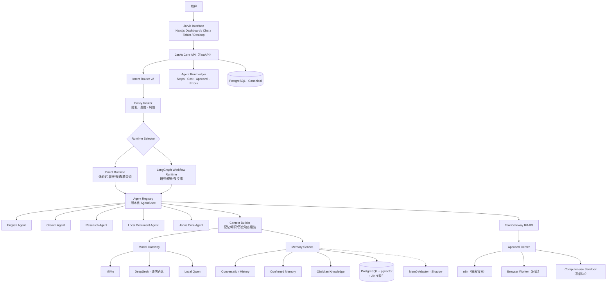
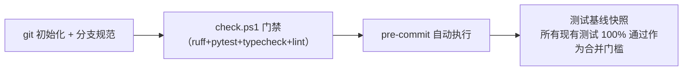

# JARVIS_TARGET_ARCHITECTURE.md — Jarvis OS 目标架构

- **文档类型**：Phase 2 目标架构设计（技术负责人产出）
- **日期**：2026-08-06
- **前置**：与 `docs/JARVIS_OS_V2_ARCHITECTURE_MIGRATION_PLAN.md` 完全一致，本文件是它在"多 Agent 并行开发"视角下的落地细化版
- **原则**：**Migration 不是 Rewrite**。保留现有 v1 生产路径安全运行，把已落地的 v2 影子代码逐步接入生产，全程 Feature Flag 灰度。

---

## 1. 目标架构总览



---

## 2. 与现状的差距清单（Gap Analysis）

| # | 目标组件 | 现状 | 差距 | 迁移动作 |
|---|---|---|---|---|
| G1 | Intent Router 接生产 | 影子模式（`shadow_only=True`），关键词分类 | 决策不参与执行 | P3：Router 输出接入 chat.py 真实路由，规则 + 模型双轨、可回滚 |
| G2 | Policy Router 强制 | `v2_policy_enforcement_enabled` 无读取点 | 策略不执行 | P3：Policy 决策写入 Agent Run，接 Tool Gateway 前置校验 |
| G3 | Agent Registry 全接入 | workflow 硬编码 `agent_id`，不经过 Registry | Registry 是摆设 | P3：workflow 启动从 Registry 解析 AgentSpec |
| G4 | Runtime 抽象完整 | `RuntimeRegistry` 空壳，register 从未调用 | Direct Runtime 无实现 | P3：注册 Direct/Workflow 双 Runtime |
| G5 | 契约层打通 | contracts.py 与 db/models 脱节 | 双 schema | P2：以 DB 为准统一状态枚举，contracts 作为 API 层 |
| G6 | Prompt 集中管理 | 10+ 处硬编码 | 不可追踪 | P3：prompt 目录 + 版本注册 + 评测挂接 |
| G7 | 事务边界清晰 | 25 个 service 裸 commit | 部分提交风险 | P2：Repository + UoW，检索类函数去副作用 |
| G8 | 前端共享类型 | 三处手写 | 契约漂移 | P4：OpenAPI 生成 TS 类型 + 契约测试 |
| G9 | 前端组件可维护 | 8 个巨型组件 | 不可并行 | P4：按领域拆分 + hooks 抽取 |
| G10 | 向量检索高效 | 无 ANN 索引 | 数据增长退化 | P5：迁移补 HNSW/IVFFlat |

---

## 3. 分阶段目标架构（每个阶段都可独立运行、验收、回滚）

### Stage A — 工程地基（本次升级的第一道闸门）



**产出**：`git` 仓库 + `main`/`dev`/`feature/` 分支 + CI 脚本接入 + 首次提交。

### Stage B — 后端治理（Migration 核心）

- 数据层：Repository/UoW 边界 → `db/repositories/` + `db/uow.py`；检索函数去 commit 副作用；
- Agent 基础设施：checkpointer 下沉 `db/checkpoint.py`；契约层统一状态枚举（DB CHECK 约束）；
- 后台调用统一路由（M2 债务）。

### Stage C — AI 落地

- Prompt 注册表（`services/prompts/` + 版本表）→ 全部硬编码 prompt 迁移；
- Intent/Policy Router 接生产（G1/G2）；
- Workflow 走 Registry（G3/G4）。

### Stage D — 前端演进

- api.ts 按领域拆分 `lib/api/*.ts`；
- 巨型组件拆分 + hooks；
- OpenAPI 类型生成（共享契约）。

### Stage E — Memory/工具深化

- pgvector ANN 索引迁移；
- PG 集成测试（JARVIS_TEST_POSTGRES_URL 自动化）；
- 后台模型调用统一路由。

### Stage F — 自动化扩展

- Computer-use 阶段 3（确认后沙箱修改，保持 R2）；
- 真实外部账号逐步开放（先测试账号）。

---

## 4. 核心架构原则（多 Agent 开发时的"宪法"）

以下原则写入 `docs/ADR/` 体系，任何 Agent 不得违反：

1. **PostgreSQL 是唯一业务事实源**；向量索引/Mem0 状态/缓存都是可重建派生数据。
2. **Jarvis Core 是唯一决策中心**；Agent 是模块化能力，不是失控常驻进程。
3. **Model Gateway 是唯一模型出口**；Agent/Service 不得绕过统一路由（消除 M2）。
4. **Tool Gateway 是唯一副作用仲裁者**；R2 必须预览-批准-执行；R3 永不自动化。
5. **DeepSeek 必须逐次确认**；English Coach 永不调用 DeepSeek。
6. **外部内容一律不可信**（网页/RSS/Obsidian/邮件 → Prompt Injection 风险）。
7. **后台任务不得静默调用 DeepSeek**；只能生成待确认请求。
8. **一切删除必须用户手动**；Agent 永不自动删除业务数据。
9. **每个 Agent Run 可审计**：Agent/版本/Router/Policy/Runtime/模型/工具/审批/来源。
10. **Feature Flag 灰度**：新能力默认关，影子验证 → 小范围开启 → 可一键回滚。

---

## 5. 模块边界契约（Agent 并行开发的"接口冻结"）

为了多 Agent 安全并行，以下边界在 Stage B 开始时冻结，任何改动必须通过 Tech Lead 审核：

### 5.1 服务间依赖方向（禁止反向依赖）

```text
api/routes/  ──>  services/*  ──>  db/repositories/  ──>  db/models/
                                      ↑
                    services 之间允许单向依赖，禁止循环
```

**冻结项**：`research_workflow.py:31` 从 `growth_workflow` import checkpointer → 必须下沉 `db/checkpoint.py`（H2）。

### 5.2 领域所有权（每个 service 只属于一个 Agent）

| 领域 | 服务模块 | 数据表 |
|---|---|---|
| Chat/Core | `chat.py`, `conversation_summary.py`, `context_engineering.py` | chat_* |
| Growth | `growth.py`, `growth_workflow.py`, `proactive.py` | goals/milestones/growth_* |
| English | `english.py` | english_* |
| Intelligence | `intelligence.py`, `monitoring.py` | news_*/monitor_* |
| Investment | `investment.py` | assets/portfolio_* |
| Memory | `memory.py`, `memory_engines.py`, `memory_shadow.py`, `semantic_index.py` | memories/semantic_* |
| Knowledge | `knowledge*.py` | knowledge_* |
| Tool | `tool_catalog.py`, `tool_gateway.py`, `n8n_provider.py`, `browser_provider.py`, `computer_use.py` | tool_* |
| Research | `research_workflow.py`, `career_matcher.py` | research_*/career_* |
| Agent Core | `agent_core/*` | agent_runs/agent_approvals |
| Notify | `notifications.py`, `personality.py` | notifications/* |

### 5.3 跨域共享只读工具（谁可以 import）

```text
model_gateway/      ← 任何服务可依赖（唯一模型出口）
db/repositories/    ← 任何服务可依赖（唯一数据出口）
utils/              ← 任何服务可依赖（URL/哈希/规范化 单一实现，消除 M2/M8）
```

**冻结项**：URL/指纹工具去重（`intelligence.py` vs `memory.py` 同名不同实现）→ 下沉 `utils/`。

---

## 6. 数据契约（Data Contract 冻结）

### 6.1 状态枚举统一（P2 必须完成）

```text
AgentApproval.status: pending → approved | rejected | consumed | expired   ← DB CHECK
Memory.status:        pending → active | rejected | deleted
ToolExecution.status: submitted → approved | rejected | executed | failed
AgentRun.status:      running → waiting | completed | failed | cancelled
```

现状：`status: Mapped[str]` 无约束（C3）。迁移：Alembic + DB CHECK + Pydantic Literal + TS union 四层统一。

### 6.2 事务所有权规则

```text
Route 层：只做参数校验 + 组装 + 响应；不直接操作 ORM
Service 层：业务逻辑；通过 Repository 拿数据；自身不 commit（由调用方 UoW 控制）
Repository 层：唯一直接操作 Session 的地方
UoW：组合多个 Repository 操作并统一 commit/rollback
```

例外（明确豁免）：后台 worker（`SessionFactory()` 自建会话）与纯内部批处理可自带事务，但必须在函数注释声明。

### 6.3 敏感数据红线

- 密码/API Key/验证码/证件号/银行卡号/私钥：**禁止**进入记忆、Agent State、Prompt、日志；
- 云端模型只能接收 `cloud_allowed=true` 的逐项授权内容；
- 外部内容注入系统前必须标记"不可信参考数据"。

---

## 7. 非目标（本阶段明确不做）

- 不引入多用户 SaaS；
- 不引入 Redis / Qdrant / Chroma / Neo4j；
- 不把 OpenHands 作为 Core 依赖；
- 不包装所有聊天为 LangGraph；
- 不把全部数据交给 Mem0；
- 不复制开源项目 UI/代码（仅参考交互）。

---

## 8. 技术栈目标清单（保持，不替换）

| 层 | 保持 | 新增（不替换现有） |
|---|---|---|
| 前端 | Next.js / TS / Tailwind / shadcn | OpenAPI 类型生成、领域 hooks、query 缓存（可选） |
| 后端 | FastAPI / SQLAlchemy async / Alembic | Repository/UoW、集中 Prompt 注册 |
| AI | LangGraph / Model Gateway / Tool Gateway | Prompt 版本表、Router 接生产 |
| 存储 | PostgreSQL + pgvector | ANN 索引迁移、PG 集成测试 |
| 自动化 | n8n / Browser Worker | Computer-use 阶段 3 |

> **结论**：目标架构不是新系统，而是把现有 v2 蓝图"点亮"。每一项都已有影子实现或明确设计，迁移风险被 Feature Flag 与备份体系双重托底。
