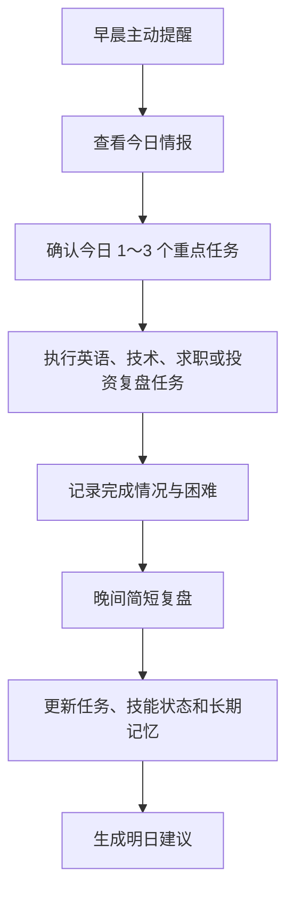
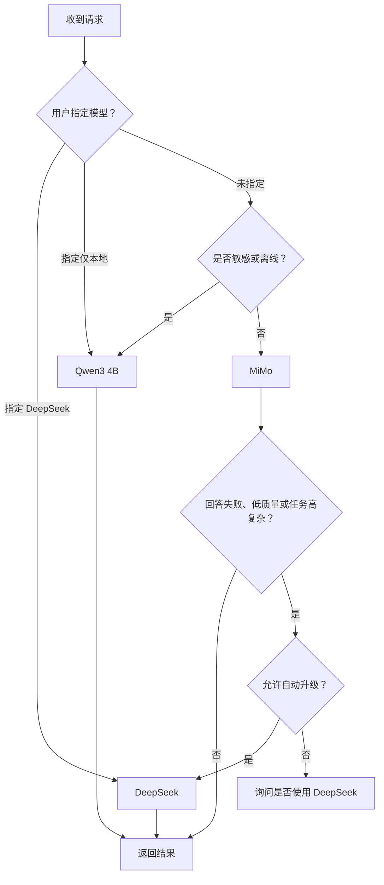
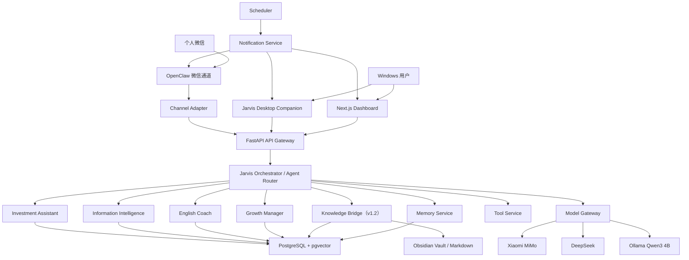

# Jarvis OS v1.1 产品需求文档（PRD）

> Personal AI Operating System  
> 面向个人长期使用的主动式 AI 成长操作系统

---

## 0. 文档信息

| 项目 | 内容 |
|---|---|
| 产品名称 | Jarvis OS |
| 文档版本 | v1.1 |
| 产品阶段 | 可开发需求基线 |
| 主要用户 | 产品所有者本人 |
| 首要目标 | 长期自用 |
| 次要目标 | AI 应用工程师个人作品集 |
| 首发平台 | Windows 电脑 |
| 后续平台 | 手机浏览器 / PWA |
| 计划周期 | 8～10 周 |
| 可投入时间 | 每天约 4 小时 |
| 文档日期 | 2026-07-28 |

### 0.1 已确认的关键决策

1. 产品以本人长期使用为第一优先级，不以演示效果取代真实可用性。
2. 电脑端优先，手机端在核心版本稳定后评估。
3. Jarvis 能够在电脑唤醒状态下自动语音播报提醒。
4. 个人微信通过 OpenClaw 微信通道接入私聊窗口。
5. 长期记忆默认自动保存，同时提供查看、修改、删除和禁止记忆能力。
6. 情报范围包含 AI、科技、求职、投资和国际动态。
7. 投资持仓和交易数据由用户手动录入。
8. Xiaomi MiMo 为默认主模型，DeepSeek 为复杂问题辅助模型。
9. 本地 Ollama Qwen3 4B 负责隐私、离线和轻量任务。
10. v1.1 不以 30 天为硬期限，优先追求完整度和稳定性。

### 0.2 当前设备与模型条件

| 项目 | 当前条件 |
|---|---|
| GPU | NVIDIA RTX 3050，4GB 显存 |
| 内存 | 16GB |
| 本地模型 | Ollama + Qwen3 4B |
| 主云端模型 | Xiaomi MiMo Token Plan，每月约 41 亿 Token |
| 辅助云端模型 | DeepSeek 按量付费 API |

---

## 1. 产品概述

### 1.1 产品定位

Jarvis OS 是一个本地优先、桌面优先、能够主动提醒和持续学习用户的个人 AI 操作系统。

它不是多个聊天机器人入口的集合，而是一套围绕用户长期目标运行的闭环系统：

```text
理解目标
  ↓
收集相关信息
  ↓
帮助制定行动
  ↓
提醒并监督执行
  ↓
记录真实结果
  ↓
复盘并更新计划
  ↓
持续优化对用户的理解
```

### 1.2 一句话价值主张

> Jarvis 每天帮助用户判断什么值得关注、今天应该做什么、执行得怎么样，以及下一步如何调整。

### 1.3 核心差异

传统 AI 助手通常采用：

```text
用户提问 → AI 回答 → 对话结束
```

Jarvis OS 采用：

```text
长期目标
  → 主动收集
  → 个性化判断
  → 生成计划
  → 主动提醒
  → 记录行动
  → 周期复盘
  → 更新记忆与策略
```

---

## 2. 背景与问题

### 2.1 用户当前状态

```yaml
education:
  level: 本科
  major: 数据科学与大数据技术

career_goal:
  primary:
    - AI 应用工程师
    - Agent 开发方向

current_skills:
  - Python
  - RAG 基础
  - n8n
  - LLM 应用

main_problems:
  - 英语学习难以长期坚持
  - 缺少可持续的长期规划
  - 信息获取效率低
  - 学习、求职、英语和投资信息彼此割裂
  - 计划制定后缺少提醒、执行记录和复盘
```

### 2.2 需要解决的核心问题

1. 信息很多，但无法快速判断哪些信息与个人目标真正相关。
2. 有长期目标，但没有稳定转化为今天的具体行动。
3. 制定计划后缺少持续提醒和执行反馈。
4. 英语学习中的高频错误无法形成个性化复习系统。
5. 不同 AI 对话之间缺少统一、可控的长期记忆。
6. 投资记录、投资理由和外部事件没有形成长期复盘链路。
7. 云端模型、本地模型和不同渠道之间缺少统一调度。

---

## 3. 产品目标与非目标

### 3.1 v1.1 产品目标

#### G1：建立每日成长闭环

用户每天能够在 5 分钟内完成：

- 查看今日重要情报；
- 确认今日任务；
- 启动任务；
- 在晚上记录完成情况；
- 获得下一步调整建议。

#### G2：建立可信、可控的长期记忆

Jarvis 能够自动识别值得长期保存的信息，并允许用户审查和纠正。

#### G3：实现真正的主动提醒

Jarvis 能够按时间和事件触发 Windows 通知、自动语音播报和微信私聊提醒。

#### G4：统一多个成长领域

英语、技术、职业、情报和投资不再是孤立模块，而是共同服务于用户的长期目标。

#### G5：合理使用多模型

大多数任务由 MiMo 完成；复杂、高价值问题升级至 DeepSeek；隐私、离线和轻量任务使用本地 Qwen3 4B。

#### G6：形成可展示的 AI 工程项目

项目应体现：

- Agent 编排；
- Tool Calling；
- 长短期记忆；
- 多模型路由；
- RAG / 检索；
- 主动任务调度；
- 多渠道消息；
- 可观测性；
- 安全边界；
- 完整产品闭环。

### 3.2 v1.1 非目标

以下内容不属于 v1.1 的交付范围：

- 自动证券交易；
- 代替专业投资、医疗或法律意见；
- 多用户 SaaS；
- 原生 Android 或 iOS App；
- 全天候语音唤醒词；
- 任意控制整台电脑；
- 自动删除、移动个人文件；
- 自动发送邮件、简历或外部消息而不经确认；
- 大规模、无边界网页爬虫；
- “CEO Agent 社会”等复杂多 Agent 组织；
- 在用户不知情的情况下保存密码、API Key 等敏感数据。

---

## 4. 产品原则

### 4.1 真实数据优先

周报、成长进度和投资复盘必须基于任务、会话、学习和交易记录，不允许由模型凭空编造。

### 4.2 行动优先

情报必须能够转化为行动；建议必须能够转化为任务；复盘必须能够影响下一周期计划。

### 4.3 主动但不打扰

主动提醒必须有频率限制、免打扰时段和延迟机制。

### 4.4 自动记忆但用户可控

系统可以自动保存记忆，但用户始终拥有查看、修改、删除和禁止保存的权利。

### 4.5 本地优先但不过度依赖本地模型

本地模型主要用于隐私、离线和轻量任务；复杂任务优先保证质量。

### 4.6 模型可替换

Agent 不直接依赖某个固定模型的专有接口。所有模型通过统一 Model Gateway 调用。

### 4.7 外部行动需确认

任何会影响外部系统或个人数据的高风险操作，必须在执行前向用户展示动作内容并获得确认。

---

## 5. 核心用户旅程

### 5.1 首次启动

首次进入 Jarvis 后，由对话式向导完成初始化。

需要收集：

1. 用户称呼和时区；
2. 职业目标与期望时间；
3. 当前技能和学习阶段；
4. 英语水平、薄弱点和学习偏好；
5. 每天可用时间及固定日程；
6. 起床、工作、休息和睡眠时间；
7. 信息兴趣、优先级和不感兴趣内容；
8. 投资目标、风险偏好和当前持仓；
9. 提醒渠道、语音音色和免打扰时间；
10. 自动记忆与云端模型隐私偏好；
11. MiMo、DeepSeek、本地模型连接状态；
12. OpenClaw 微信通道连接状态。

完成后生成：

- 个人档案；
- 第一版技能地图；
- 第一版长期目标；
- 本周行动建议；
- 默认每日提醒计划；
- 信息兴趣画像。

### 5.2 每日闭环



### 5.3 每周闭环

每周固定生成：

- 本周计划完成率；
- 实际投入时间；
- 英语学习连续性及高频错误；
- 技术技能进展；
- 求职行动；
- 信息消费和行动转化率；
- 投资操作和原始投资理由复盘；
- 未完成任务原因；
- 下周目标调整建议。

用户确认后，Jarvis 才能批量调整下周计划。

### 5.4 情报到行动

```text
抓取信息
  → 去重和来源检查
  → MiMo 摘要
  → 判断与用户的相关性
  → 说明“为什么重要”
  → 给出可选行动
  → 用户一键转为任务
  → Growth Manager 跟踪执行
```

### 5.5 投资复盘

```text
用户手动记录持仓或交易
  → 保存当时的投资理由
  → 关联后续新闻和国际事件
  → 定期检查原假设是否变化
  → 生成风险提示和复盘问题
  → 用户自行作出决策
```

---

## 6. 范围和优先级

### 6.1 P0：必须完整交付

- 首次启动引导；
- 个人档案和偏好；
- MiMo 主模型接入；
- DeepSeek 辅助模型接入；
- Qwen3 4B 本地模型接入；
- 统一 Model Gateway；
- 文字聊天和流式响应；
- 会话和长期记忆；
- 目标、里程碑、任务和完成记录；
- Dashboard；
- 每日计划和周复盘；
- Windows 后台常驻组件；
- 自动语音播报；
- Windows 桌面通知；
- OpenClaw 微信私聊接入；
- 手动投资持仓和交易记录；
- 数据导出、备份和恢复；
- 模型调用、通知和工具调用日志。

### 6.2 P1：v1.1 应尽量完成

- 英语文字对话；
- 英语语音输入；
- 实时或会话后纠错；
- 错误记忆和间隔复习；
- RSS 情报；
- 信息去重和个性化筛选；
- 每日情报；
- 情报一键转任务；
- 投资持仓与情报关联；
- 微信内常用快捷指令；
- 手机浏览器响应式访问。

### 6.3 P2：核心稳定后开发

- 普通网页抓取；
- 日历和邮件集成；
- 语音唤醒词；
- 更自然的本地语音合成；
- 自动读取券商或 Excel 持仓；
- 实时市场行情 API；
- 局域网外手机访问；
- 文件系统和电脑控制；
- LangGraph 重构；
- 多 Agent 社会。

---

## 7. 功能需求

### 7.1 首次启动与用户档案

#### 功能要求

- 使用分步骤对话完成信息收集；
- 支持跳过非必要问题；
- 随时保存进度；
- 完成前展示信息摘要；
- 用户确认后写入长期档案；
- 后续可在设置页面重新修改；
- 修改目标后提示相关计划可能需要重算。

#### 验收标准

- 新用户可以在 15 分钟内完成初始化；
- 中途关闭后再次打开可以继续；
- 初始化完成后 Dashboard 不为空；
- 所有生成的目标和偏好均可编辑；
- API Key 不得进入聊天记录或长期记忆。

---

### 7.2 Chat 与 Agent Router

#### Agent 类型

| Agent | 主要职责 |
|---|---|
| General Jarvis | 综合问答、跨模块协调 |
| Growth Manager | 目标、任务、执行和复盘 |
| English Coach | 英语对话、纠错和复习 |
| Information Intelligence | 情报筛选、解释和行动建议 |
| Investment Assistant | 持仓记录、投资理由和复盘 |

#### 路由规则

1. 用户可以手动指定 Agent。
2. 未指定时由 Router 自动判断。
3. 一个请求可以调用多个能力模块，但只能有一个主 Agent 负责最终回复。
4. 路由结果需要记录，方便后续调试。
5. Router 不得自行执行高风险工具。

#### 对话要求

- 支持流式输出；
- 支持停止生成；
- 显示本次使用的模型；
- 显示是否使用了长期记忆；
- 显示工具调用状态；
- 支持重新生成；
- 支持将回复转为任务、记忆或笔记；
- 支持对话历史搜索；
- 支持删除单次会话。

#### 验收标准

- 五类典型请求能够正确路由；
- 对话刷新页面后仍然存在；
- 同一会话能够保持上下文；
- 用户可以看到当前 Agent 和模型；
- 模型故障时给出明确降级提示，而不是无响应。

---

### 7.3 Memory Center

#### 记忆类型

| 类型 | 示例 |
|---|---|
| Profile | 用户的职业目标是 AI 应用工程师 |
| Preference | 用户更喜欢晚上复盘 |
| Episodic | 用户今天完成了 Agent 教程 |
| Skill | 用户已掌握 RAG 基础 |
| English | 用户经常混淆过去时 |
| Career | 用户计划投递 AI Agent 岗位 |
| Investment | 用户持有某资产的原始理由 |
| Conversation Summary | 一段长期有价值的对话摘要 |

#### 自动保存流程

```text
对话或事件
  → 提取候选记忆
  → 敏感信息过滤
  → 判断长期价值
  → 检查是否重复或冲突
  → 新增、合并或更新
  → 保存来源与置信度
  → 在记忆中心可见
```

#### 禁止自动保存

- 密码；
- API Key；
- 身份证、银行卡完整号码；
- 验证码；
- 私钥；
- 用户明确要求不要记住的内容；
- 与长期使用无关的临时闲聊。

#### 记忆字段

- 类型；
- 内容；
- 来源；
- 置信度；
- 重要性；
- 创建时间；
- 最近更新时间；
- 最后使用时间；
- 是否经用户确认；
- 是否可被云端模型使用；
- 过期时间；
- 状态：有效、被替代、已删除。

#### 验收标准

- 自动记忆不会把全部聊天原文当成长记忆；
- 重复信息能够合并；
- 冲突信息保留修改历史；
- 用户可以搜索、编辑、删除和禁用某类记忆；
- 删除后新的模型请求不得继续使用该记忆；
- 敏感字符串检测有自动化测试。

---

### 7.4 Growth Manager

#### 数据层级

```text
长期方向
  → 目标
  → 里程碑
  → 任务
  → 执行事件
  → 复盘
```

#### 核心功能

- 创建长期目标；
- AI 辅助拆解里程碑；
- 创建和编辑任务；
- 设置优先级、截止时间、预计时长；
- 标记开始、暂停、完成、取消；
- 记录实际投入时间；
- 记录阻塞原因；
- 将情报、英语错误和职业建议转成任务；
- 生成每日计划；
- 生成周复盘；
- 根据真实结果提出调整建议。

#### 成长进度计算

不得由模型直接生成一个没有依据的百分比。

进度应由以下数据构成：

- 已完成里程碑；
- 已完成任务；
- 实际投入时间；
- 练习或项目证据；
- 用户自评；
- Jarvis 评估，但必须展示评估依据。

#### 验收标准

- 一个长期目标能够拆成至少两级可执行结构；
- 每项进度都能追溯到数据；
- 未完成任务不会自动算作已掌握；
- 周复盘中的数字与任务记录一致；
- 用户确认前不得批量修改下周任务。

---

### 7.5 English Coach

#### 交互模式

- 文字对话；
- 按键录音；
- 主题对话；
- 自由对话；
- 面试英语；
- 技术英语。

#### 纠错模式

用户可选择：

1. 即时纠错：每次出现明显错误时立即纠正；
2. 温和纠错：优先保证对话流畅，只纠正关键错误；
3. 会话总结：结束后统一生成纠错报告。

#### 错误记忆字段

- 用户原句；
- 修正句；
- 错误类别；
- 解释；
- 对话上下文；
- CEFR 难度；
- 出现次数；
- 首次出现时间；
- 最近出现时间；
- 下次复习时间；
- 掌握状态。

#### 复习机制

- 高频错误优先；
- 最近重复出现的错误优先；
- 已掌握内容降低频率；
- 复习题必须使用用户自己的错误上下文；
- 允许用户标记“已掌握”或“解释不正确”。

#### 验收标准

- 能完成至少 10 轮连续英语对话；
- 纠错内容能够保存并再次检索；
- 会话结束后可生成总结；
- 同类错误能够聚合频次；
- 用户可选择纠错强度；
- 语音识别失败时可编辑转写文本。

---

### 7.6 Information Intelligence

#### 信息分类

| 类别 | 默认权重 |
|---|---:|
| AI / Agent / LLM | 高 |
| AI 求职与职业发展 | 高 |
| 科技 | 中高 |
| 英语学习 | 中 |
| 投资 | 中 |
| 国际动态 | 中 |

权重可以由用户修改，并根据点击、收藏、忽略和转任务行为逐步调整。

#### 第一阶段信息来源

- 白名单 RSS；
- 可信 API；
- 用户手动提交的链接；
- 后续再加入普通网页抓取。

#### 处理流程

1. 采集；
2. 标准化；
3. URL 与内容去重；
4. 时间检查；
5. 来源可信度标记；
6. MiMo 摘要；
7. 与用户目标、技能、持仓和任务匹配；
8. 生成“为什么与你有关”；
9. 生成可选行动；
10. 形成日报。

#### 每条情报必须包含

- 标题；
- 来源；
- 原文链接；
- 发布或事件时间；
- 摘要；
- 与用户相关的原因；
- 事实与 AI 分析的区分；
- 建议行动；
- 是否与持仓相关。

#### 验收标准

- 每份日报默认包含 3～5 条高价值信息；
- 每条信息都具有原始来源；
- 相同事件不会大量重复出现；
- 系统明确标记事实、推断和建议；
- 任何投资相关情报都不得直接触发交易；
- 用户可以将建议一键转为任务。

---

### 7.7 Investment Assistant

#### v1.1 数据输入

全部由用户手动录入。

#### 支持的数据

- 资产名称；
- 资产代码；
- 市场；
- 资产类型；
- 币种；
- 持仓数量；
- 平均成本；
- 用户手动输入的最新价格；
- 买入、卖出、分红记录；
- 手续费；
- 交易日期；
- 原始投资理由；
- 风险等级；
- 目标仓位；
- 关注事件；
- 复盘笔记。

#### 核心功能

- 新增、编辑和删除持仓；
- 记录交易；
- 根据交易记录计算持仓数量和成本；
- 记录交易发生时的理由；
- 将投资新闻与持仓关联；
- 周度、月度投资复盘；
- 检查原投资假设是否发生变化；
- 标记风险和需要进一步确认的问题。

#### 边界

- 不自动连接券商；
- 不自动交易；
- 不承诺收益；
- 不输出确定性的买卖指令；
- 云端分析前隐藏账户、身份等无关信息；
- 用户可以禁止任何投资数据发送至云端模型。

#### 验收标准

- 用户可以手动建立完整持仓；
- 买卖记录能够正确更新数量和成本；
- 删除或修改交易后能够重新计算；
- 复盘能引用原始投资理由；
- 没有最新价格时不展示虚假的实时收益；
- 所有 AI 分析均标明不构成专业投资建议。

---

### 7.8 Proactive Notification Engine

#### 触发方式

- 固定时间；
- 任务截止；
- 长时间无进度；
- 日报生成完成；
- 周复盘生成完成；
- 英语复习到期；
- 重要持仓相关情报；
- API 或数据源异常；
- 电脑从休眠恢复。

#### 通知渠道

1. Windows 桌面通知；
2. Windows 自动语音播报；
3. OpenClaw 微信私聊；
4. 页面内通知中心。

#### 默认节奏

| 时间 | 默认行为 |
|---|---|
| 早晨 | 今日情报 + 今日重点任务 |
| 下午 | 未开始或阻塞任务提醒 |
| 晚上 | 简短复盘 |
| 每周固定时间 | 周复盘 |
| 重要事件 | 受频率限制的即时提醒 |

#### 打扰控制

- 免打扰时段；
- 每类提醒独立开关；
- 每日最大次数；
- 同类提醒冷却时间；
- 延迟 10 / 30 / 60 分钟；
- 标记今天不再提醒；
- 全屏或会议模式暂停；
- 耳机和扬声器策略；
- 休眠期间只发送微信或恢复后补发。

#### 语音要求

- 电脑处于唤醒状态；
- Windows 后台组件随系统启动；
- 播报前播放可选提示音；
- 默认只朗读简短摘要；
- 敏感投资内容默认不在公共环境完整朗读；
- 支持暂停、重复和关闭；
- 语音失败不得影响文字通知。

#### 验收标准

- 关闭浏览器后，后台组件仍能按时提醒；
- 同一个提醒不会重复发送；
- 免打扰时段不会自动播报；
- 微信发送失败有重试和状态记录；
- 用户能够看到通知历史和失败原因；
- 电脑重启后提醒计划可以恢复。

---

### 7.9 OpenClaw 微信通道

#### 定位

OpenClaw 只承担微信消息接入和输出，Jarvis Core 是唯一业务和记忆来源。

#### 消息流

```text
个人微信私聊
  → OpenClaw 微信插件
  → Jarvis Channel Adapter
  → Agent Router
  → Model Gateway / Tools / Memory
  → Jarvis 回复
  → OpenClaw
  → 微信私聊窗口
```

#### 支持场景

- 在微信中询问问题；
- 查看今日计划；
- 查看今日情报；
- 创建或完成任务；
- 延迟提醒；
- 快速记录想法；
- 快速记录交易；
- 请求深度分析；
- 接收主动提醒。

#### 建议快捷指令

```text
今日计划
今日情报
开始任务 <任务名>
完成任务 <任务名>
提醒我 30 分钟后继续
记录持仓
记录交易
深度分析：<问题>
不要记住这条
```

#### 安全要求

- 仅允许白名单微信身份；
- v1.1 默认只启用私聊；
- 入站事件必须去重；
- 外部工具操作必须遵循确认规则；
- OpenClaw 不保存独立长期记忆；
- 通道密钥不得写入代码仓库；
- 连接断开时在 Dashboard 显示状态。

#### 验收标准

- 微信能够发送消息并获得 Jarvis 回复；
- 网页端和微信端能看到同一任务与记忆；
- 主动提醒能够发至微信；
- 重复回调不会创建重复任务；
- 非白名单用户无法访问私人数据；
- OpenClaw 离线不会阻塞桌面端使用。

参考：

- [OpenClaw Chat Channels](https://docs.openclaw.ai/channels)
- [OpenClaw 官方仓库](https://github.com/openclaw/openclaw)

---

## 8. 模型策略与 Model Gateway

### 8.1 模型角色

| 模型 | 默认角色 | 使用原则 |
|---|---|---|
| Xiaomi MiMo | 主模型 | 默认处理绝大多数对话和 Agent 任务 |
| DeepSeek | 深度辅助 | 复杂、高价值或 MiMo 失败的任务 |
| Qwen3 4B | 本地模型 | 隐私、离线、轻量后台任务和云端故障降级 |

### 8.2 默认任务分配

#### MiMo

- 普通聊天；
- 首次启动问答；
- 每日计划；
- 英语对话和常规纠错；
- 信息摘要；
- 相关性判断；
- 普通周复盘；
- 任务拆解；
- 记忆候选提取；
- 投资记录整理。

#### DeepSeek

- 用户明确要求“深度分析”；
- 复杂多步推理；
- 多个来源严重冲突；
- 复杂代码调试；
- 重大职业方案比较；
- MiMo 连续两次未解决；
- 重要投资复盘中的复杂推理；
- 需要审查 MiMo 结论的高影响问题。

#### Qwen3 4B

本地日常对话采用非 Thinking 标签 `qwen3:4b-instruct-2507-q4_K_M`，原 Thinking 标签保留给后续需要本地推理且不要求低延迟的场景。

- 敏感文本分类；
- 云端调用前脱敏；
- 简单标签和结构化提取；
- 离线状态下的基础聊天；
- 通知内容压缩；
- 云端模型不可用时的降级；
- 用户明确要求“仅本地处理”的任务。

### 8.3 路由流程



### 8.4 DeepSeek 成本控制

虽然当前没有明确月度预算上限，仍需实现：

- 调用次数统计；
- 输入和输出 Token 统计；
- 估算费用；
- 按 Agent 分类统计；
- 单次请求最多自动升级一次；
- 用户可关闭自动升级；
- 每次 DeepSeek 调用显示原因；
- 支持每日或每月费用提醒。

### 8.5 模型可观测性

每次调用至少记录：

- Provider；
- Model；
- Agent；
- 请求类型；
- 输入和输出 Token；
- 延迟；
- 是否成功；
- 重试次数；
- 是否从其他模型升级；
- 费用估算；
- 不记录明文 API Key。

### 8.6 验收标准

- 普通请求默认进入 MiMo；
- “深度分析”可以直接进入 DeepSeek；
- “仅本地处理”不会调用云端；
- MiMo 故障时系统能明确降级；
- 模型路由日志可以追溯；
- Agent 层不直接写死具体 Provider SDK。

---

## 9. 系统架构

### 9.1 总体架构



### 9.2 前端

```text
Next.js
Tailwind CSS
shadcn/ui
```

要求：

- 桌面端优先；
- 响应式布局；
- 支持深色模式；
- 支持流式聊天；
- 支持 PWA 作为后续手机访问基础；
- 不承担可靠后台调度。

### 9.3 Windows 后台组件

为了实现浏览器关闭后自动语音播报，需要独立的 Desktop Companion。

职责：

- Windows 开机自启；
- 与 FastAPI 保持本地连接；
- 接收通知事件；
- 调用 Windows 通知；
- 调用 TTS 自动播报；
- 显示托盘状态；
- 暂停或恢复提醒；
- 打开 Dashboard；
- 上报设备在线、锁屏和音频状态。

### 9.4 后端

```text
Python
FastAPI
Pydantic
SQLAlchemy
Alembic
```

职责：

- API；
- Agent 编排；
- 模型路由；
- 业务规则；
- 记忆；
- 定时任务；
- 通知；
- 数据持久化；
- 审计日志。

### 9.5 Agent 实现策略

v1.1 采用轻量自研 Agent Loop：

```text
输入
  → 上下文构建
  → Agent / 模型路由
  → 模型推理
  → 工具调用
  → 结果校验
  → 记忆候选
  → 输出
```

v1.1 不强制使用 LangGraph。只有当工作流分支、恢复和持久化复杂度明显增加时再迁移。

### 9.6 数据库

v1.1 使用：

```text
PostgreSQL
+ pgvector（需要语义检索时启用）
```

v1.1 暂不引入独立 Vector DB，也不强制使用 Redis。

短期对话上下文从 `messages` 表和摘要中构建。只有出现明确的性能或并发需求后再加入 Redis。

### 9.7 调度

个人本地版本优先采用单实例、可持久化的任务调度器。

要求：

- 调度记录持久化；
- 后端重启后恢复；
- 重复执行保护；
- 失败重试；
- 时区固定为 Asia/Shanghai；
- 能够记录每次执行结果。

---

## 10. 数据设计

### 10.1 核心表

#### 用户与设置

- `users`
- `user_profiles`
- `user_preferences`
- `provider_configs`
- `channel_configs`

#### 对话

- `conversations`
- `messages`
- `tool_calls`
- `model_calls`

#### 记忆

- `memories`
- `memory_revisions`
- `memory_links`

#### 成长

- `goals`
- `milestones`
- `tasks`
- `task_events`
- `daily_plans`
- `weekly_reviews`
- `skill_nodes`
- `skill_evidence`

#### 英语

- `english_sessions`
- `english_mistakes`
- `english_reviews`

#### 情报

- `news_sources`
- `news_items`
- `news_item_links`
- `daily_briefs`
- `interest_feedback`

#### 知识库（Sprint 12–16 已实现）

- `knowledge_vault_configs`
- `knowledge_documents`
- `knowledge_sync_logs`
- `knowledge_archive_records`
- `knowledge_retrieval_logs`
- `knowledge_capture_drafts`
- `knowledge_insight_candidates`

#### 投资

- `assets`
- `portfolio_positions`
- `investment_transactions`
- `investment_theses`
- `investment_reviews`

#### 通知和调度

- `scheduled_jobs`
- `notifications`
- `delivery_attempts`
- `device_status`

### 10.2 通用字段要求

主要业务表应按需包含：

- `id`；
- `user_id`；
- `created_at`；
- `updated_at`；
- `deleted_at`；
- `source`；
- `metadata`；
- 乐观锁或版本字段；
- 必要的唯一约束和外键。

### 10.3 软删除

任务、记忆、交易和重要业务数据默认采用软删除，以支持恢复和审计。

### 10.4 数据导出

用户可以导出：

- 个人档案；
- 目标和任务；
- 记忆；
- 英语错误；
- 情报收藏；
- 投资持仓和交易；
- 周复盘。

格式至少支持 JSON，适合表格的数据同时支持 CSV。

---

## 11. API 设计

统一前缀：

```text
/api/v1
```

### 11.1 Onboarding

```http
POST /api/v1/onboarding/sessions
PATCH /api/v1/onboarding/sessions/{id}
POST /api/v1/onboarding/sessions/{id}/complete
GET /api/v1/profile
PATCH /api/v1/profile
```

### 11.2 Chat

```http
POST /api/v1/chat/stream
GET /api/v1/conversations
GET /api/v1/conversations/{id}
DELETE /api/v1/conversations/{id}
POST /api/v1/messages/{id}/regenerate
```

请求示例：

```json
{
  "conversation_id": "uuid",
  "message": "帮我制定今天的计划",
  "agent": "growth",
  "model_mode": "standard",
  "channel": "web"
}
```

`model_mode`：

- `standard`：默认 MiMo；
- `deep`：DeepSeek；
- `local`：仅本地 Qwen3 4B；
- `auto`：由 Model Gateway 决定。

### 11.3 Memory

```http
GET /api/v1/memories
POST /api/v1/memories
PATCH /api/v1/memories/{id}
DELETE /api/v1/memories/{id}
GET /api/v1/memories/{id}/revisions
POST /api/v1/memories/preferences
```

### 11.4 Growth

```http
GET|POST /api/v1/goals
GET|PATCH|DELETE /api/v1/goals/{id}
GET|POST /api/v1/tasks
PATCH /api/v1/tasks/{id}
POST /api/v1/tasks/{id}/start
POST /api/v1/tasks/{id}/complete
GET /api/v1/plans/today
POST /api/v1/plans/today/generate
GET /api/v1/reviews/weekly
POST /api/v1/reviews/weekly/generate
```

### 11.5 English

```http
POST /api/v1/english/sessions
POST /api/v1/english/sessions/{id}/messages
POST /api/v1/english/sessions/{id}/complete
GET /api/v1/english/mistakes
GET /api/v1/english/reviews/due
POST /api/v1/english/reviews/{id}/result
```

### 11.6 Intelligence

```http
GET|POST /api/v1/news/sources
POST /api/v1/news/ingest
GET /api/v1/news/items
GET /api/v1/briefs/daily
POST /api/v1/briefs/daily/generate
POST /api/v1/news/items/{id}/convert-to-task
POST /api/v1/news/items/{id}/feedback
```

### 11.7 Investment

```http
GET|POST /api/v1/investment/assets
GET|POST /api/v1/investment/positions
GET|POST /api/v1/investment/transactions
PATCH|DELETE /api/v1/investment/transactions/{id}
GET|POST /api/v1/investment/theses
POST /api/v1/investment/reviews/generate
```

### 11.8 Notifications

```http
GET /api/v1/notifications
POST /api/v1/notifications/test
POST /api/v1/notifications/{id}/snooze
POST /api/v1/notifications/{id}/dismiss
GET|PATCH /api/v1/notification-preferences
```

### 11.9 OpenClaw Channel

```http
POST /api/v1/channels/openclaw/events
POST /api/v1/channels/openclaw/test
GET /api/v1/channels/openclaw/status
```

入站事件必须包含幂等键，防止重复回调导致重复创建任务或交易。

### 11.10 Models

```http
GET /api/v1/models/status
GET /api/v1/models/usage
POST /api/v1/models/test
PATCH /api/v1/models/routing-policy
```

---

## 12. 页面与信息架构

### 12.1 页面列表

1. 首次启动；
2. Dashboard；
3. Chat；
4. Growth；
5. English；
6. Intelligence；
7. Investment；
8. Memory Center；
9. Notification Center；
10. Settings。

### 12.2 Dashboard

首页优先展示行动，而不是复杂图表。

```text
Jarvis
早上好。

今日重点
1. 完成 Agent Tool Calling 练习
2. 英语技术对话 20 分钟
3. 复盘一条持仓逻辑

今日情报
- 3 条与你高度相关的信息

当前状态
- 本周任务完成情况
- 英语连续学习
- 技术里程碑
- 需要关注的持仓事件

快捷操作
[开始任务] [英语对话] [今日情报] [记录交易] [快速记录]
```

### 12.3 Chat

显示：

- 当前 Agent；
- 当前模型；
- 模型模式切换；
- Memory 是否启用；
- 工具调用状态；
- 消息来源渠道；
- 转任务、转记忆和深度分析操作。

### 12.4 Growth

显示：

- 长期目标；
- 里程碑；
- 今日任务；
- 本周统计；
- 技能地图；
- 完成证据；
- 周复盘。

### 12.5 English

显示：

- 文字 / 语音对话；
- 纠错模式；
- 本次高频问题；
- 待复习内容；
- 学习连续性；
- 历史会话报告。

### 12.6 Intelligence

显示：

- 今日情报；
- 分类筛选；
- 原文来源；
- 事实、分析和建议；
- 相关目标或持仓；
- 收藏、忽略和转任务。

### 12.7 Investment

显示：

- 持仓列表；
- 成本和手动最新价格；
- 交易记录；
- 投资理由；
- 关联情报；
- 风险和待确认问题；
- 周度 / 月度复盘。

### 12.8 Memory Center

显示：

- 记忆分类；
- 来源和更新时间；
- 最近被使用时间；
- 是否允许云端使用；
- 编辑、删除和禁用；
- 修改历史；
- 自动记忆规则。

### 12.9 Settings

至少包含：

- 模型 Provider；
- 模型路由；
- DeepSeek 自动升级；
- OpenClaw；
- 语音；
- 通知；
- 免打扰；
- 隐私；
- 记忆；
- 数据导出与恢复；
- 信息源；
- 设备状态。

---

## 13. 非功能需求

### 13.1 性能

- 页面操作应立即提供视觉反馈；
- 模型响应采用流式输出；
- Dashboard 本地数据应在 3 秒内可见；
- 后台任务不得阻塞聊天接口；
- 情报生成和周复盘显示进度；
- 4GB 显存条件下不得同时常驻多个大型本地模型。

### 13.2 可靠性

- 定时任务持久化；
- 失败任务自动重试；
- 通知幂等；
- API 故障明确显示；
- 模型自动降级；
- 数据库迁移可回滚；
- 每日自动备份；
- 支持手动导出。

### 13.3 隐私与安全

- API Key 不进入数据库明文字段、日志和代码仓库；
- 本地配置文件不得提交 Git；
- 云端调用前执行敏感信息检查；
- 投资数据可以设置为仅本地；
- OpenClaw 采用白名单；
- 工具权限遵循最小权限；
- 高风险动作要求用户确认；
- 所有外部动作保留审计日志。

### 13.4 可观测性

系统应能查看：

- 模型调用量、延迟和错误；
- Agent 路由结果；
- 工具调用；
- 定时任务执行；
- 通知发送结果；
- 情报采集状态；
- 记忆新增、合并和删除；
- OpenClaw 连接状态。

### 13.5 可维护性

- 模块边界清晰；
- Provider 可替换；
- Channel 可替换；
- 数据库使用迁移管理；
- 核心业务逻辑具有自动化测试；
- Prompt 具备版本号；
- 重要模型输出使用结构化 Schema 校验。

### 13.6 易用性

- 默认设置可直接使用；
- 错误提示使用普通语言；
- 关键行为可以撤销；
- 用户不需要理解 Agent、RAG 或 Token 才能使用产品；
- 专业调试信息放在高级设置。

---

## 14. 成功指标

### 14.1 功能验收指标

- 完成首次启动后自动生成个人档案和第一周计划；
- 能通过网页和微信访问同一套 Jarvis；
- 关闭浏览器后 Windows 仍可自动语音提醒；
- 能创建目标、任务并基于真实记录生成周复盘；
- 能完成英语对话、保存错误并生成复习；
- 每日情报包含来源、相关性和行动建议；
- 能手动录入持仓和交易并生成投资复盘；
- 自动记忆可查看、修改和删除；
- 普通请求使用 MiMo，复杂请求可升级 DeepSeek；
- 云端故障时能够降级至本地模型；
- 数据可导出并恢复。

### 14.2 长期使用指标

以下指标用于判断产品是否真正有价值：

- 连续 4 周，每周使用不少于 5 天；
- 每日计划确认时间不超过 5 分钟；
- 每周至少有一条情报被转化为行动；
- 周复盘中的关键数据能够追溯到记录；
- 提醒的忽略率逐步下降；
- 用户能够说出 Jarvis 帮助完成的具体成果；
- 产品没有因为维护成本过高而停止使用。

### 14.3 作品集指标

- 提供清晰 README；
- 提供系统架构图；
- 提供可复现的本地部署方式；
- 展示 MiMo / DeepSeek / Qwen3 路由；
- 展示自动记忆与冲突处理；
- 展示主动任务调度；
- 展示微信和 Windows 多渠道；
- 包含测试和错误处理；
- 提供隐私与权限设计说明；
- 可通过演示数据运行，不依赖展示真实投资信息。

---

## 15. 开发计划

以每周约 24～28 小时估算。

### Week 1：工程基础与首次启动

交付：

- 前后端工程；
- PostgreSQL 和迁移；
- 配置管理；
- 首次启动流程；
- 用户档案和偏好；
- 基础 Dashboard；
- 测试框架。

完成定义：

- 新用户可以完成初始化；
- 数据可以持久化；
- API Key 不进入代码仓库。

### Week 2：Chat、Model Gateway 与会话

交付：

- MiMo；
- DeepSeek；
- Ollama Qwen3 4B；
- Model Gateway；
- 流式 Chat；
- 会话持久化；
- 模型状态和调用日志。

完成定义：

- 三个 Provider 均可单独测试；
- 普通请求默认走 MiMo；
- 用户可以手动选择 DeepSeek 或本地模式。

### Week 3：记忆与成长管理

交付：

- 自动记忆；
- 记忆中心；
- 目标、里程碑和任务；
- 每日计划；
- 任务事件；
- 基础周复盘。

完成定义：

- 记忆可编辑删除；
- 周复盘数据来自真实任务；
- 目标能够拆成任务。

### Week 4：主动提醒与 Windows Companion

交付：

- 持久化调度；
- Windows 托盘程序；
- 桌面通知；
- 自动 TTS；
- 免打扰；
- 通知历史和重试。

完成定义：

- 浏览器关闭后仍能播报；
- 重启后提醒恢复；
- 不会重复通知。

### Week 5：English Coach

交付：

- 英语对话；
- 三种纠错模式；
- 错误记忆；
- 学习报告；
- 复习队列；
- 语音输入基础版。

完成定义：

- 完成 10 轮对话；
- 错误可以保存、聚合和复习；
- 语音失败可以回退到文字。

### Week 6：Information Intelligence

交付：

- RSS 管理；
- 采集和去重；
- MiMo 摘要；
- 兴趣匹配；
- 每日情报；
- 原文引用；
- 转任务。

完成定义：

- 生成 3～5 条日报；
- 所有内容包含来源；
- 同一事件不会明显重复。

### Week 7：Investment Assistant

交付：

- 资产、持仓和交易；
- 成本计算；
- 投资理由；
- 关联情报；
- 投资复盘；
- 本地隐私选项。

完成定义：

- 修改历史交易后结果能重算；
- 复盘引用原始投资理由；
- 不展示虚假实时行情。

### Week 8：OpenClaw 微信（主机安装延期）

> 当前不在主力 Windows 电脑安装。只有在虚拟机/低权限账户、无主机目录共享、
> 插件审计、身份白名单和回滚验证全部完成后，才恢复本阶段。

交付：

- 微信通道适配；
- 白名单；
- 入站事件幂等；
- 微信快捷指令；
- 主动微信提醒；
- 连接状态。

完成定义：

- 微信与网页共享同一任务和记忆；
- 能发送和接收消息；
- 非白名单无法访问。

### Week 9：跨模块协作与稳定性

> 已完成。OpenClaw 未进入主机；本阶段优先保证现有本地数据与核心闭环稳定。

交付：

- 情报转成长任务；
- 英语错误转复习任务；
- 投资情报关联持仓；
- 云端模型运行失败时降级本地 Ollama；
- DeepSeek 仍只允许用户明确选择并逐次确认，不作为自动故障降级；
- 异常处理；
- 自动备份、完整性校验与临时数据库恢复验证；
- 性能优化。

完成定义：

- 至少三条跨模块闭环通过端到端测试；
- 外部服务断开时核心功能仍可使用。

### Week 10：验收与作品集

> 已进入桌面版发布验收。根据用户明确决定，OpenClaw/微信不属于本次主机发布
> 范围；安全隔离未完成前不得用“P0 已通过”掩盖这一延期项。

交付：

- 完整测试；
- Prompt 评测集；
- 安全检查；
- 安装和启动说明；
- 演示数据；
- 架构图；
- README；
- 演示视频脚本。

完成定义：

- 新环境可以按文档启动；
- 不需要真实私人数据也能演示；
- 桌面版 P0 验收清单通过；
- 原始 P0 中的 OpenClaw/微信项明确标记延期，不计入主机发布；
- MiMo Token Plan 仅在所有者明确确认风险并启用专用开关后进入主路由。

---

## 16. 测试策略

### 16.1 单元测试

- 任务进度计算；
- 持仓成本计算；
- 路由规则；
- 记忆去重和冲突；
- 通知去重；
- 敏感数据过滤；
- 情报去重。

### 16.2 集成测试

- MiMo、DeepSeek、Ollama；
- PostgreSQL；
- OpenClaw；
- RSS；
- Windows 通知和 TTS；
- 调度重启恢复。

### 16.3 端到端测试

至少覆盖：

1. 首次启动 → 生成第一周计划；
2. 情报 → 转任务 → 完成 → 周复盘；
3. 英语对话 → 错误记忆 → 到期复习；
4. 微信创建任务 → 网页查看 → Windows 提醒（延期，未纳入桌面版）；
5. 记录交易 → 关联情报 → 投资复盘；
6. 用户明确选择 DeepSeek → 展示费用确认 → 取消时不产生调用；
7. 云端断网 → 本地降级；
8. 删除记忆 → 后续对话不再使用。

### 16.4 模型评测集

建立固定测试问题，评估：

- Agent 路由；
- MiMo 与 DeepSeek 升级；
- 记忆提取准确性；
- 英语纠错；
- 情报相关性；
- 投资分析边界；
- 是否产生虚构数据；
- 是否未经确认调用高风险工具。

---

## 17. 主要风险与应对

| 风险 | 影响 | 应对 |
|---|---|---|
| 功能范围过大 | 进度拖延、模块半成品 | 先完成 P0，每周使用真实闭环验收 |
| 4GB 显存限制 | 本地模型慢或上下文不足 | Qwen3 4B 只承担轻量任务，限制上下文和并发 |
| MiMo API 限流或故障 | 主模型不可用 | 重试、状态检查、DeepSeek或本地降级 |
| DeepSeek 费用不可控 | 钱包消耗 | 显示升级原因、调用统计、可关闭自动升级 |
| OpenClaw 断连 | 微信不可用 | 桌面端独立可用，显示连接状态和重连 |
| 自动记忆污染 | 错误信息长期影响回答 | 置信度、来源、冲突处理和记忆中心 |
| 过度提醒 | 用户关闭系统 | 频率上限、免打扰、忽略反馈和冷却 |
| 情报幻觉 | 错误判断 | 原文链接、事实与分析分离、多来源验证 |
| 投资数据敏感 | 隐私风险 | 本地保存、可禁止云端、脱敏、日志保护 |
| 数据丢失 | 长期使用价值受损 | 自动备份、导出和恢复测试 |
| Windows 后台不稳定 | 无法自动语音提醒 | 独立 Companion、开机启动、心跳和重启恢复 |

---

## 18. P0 发布验收清单

> 2026-07-29 桌面版验收口径：OpenClaw/微信因主机安全风险延期；MiMo 仍是
> 默认逻辑路线。所有者在知晓小米套餐规则与密钥封禁风险后，明确要求通过
> 专用 Token Plan 地址、鉴权格式和显式开关启用 `tp-` 主路由；运行失败时
> 降级本地 Qwen，不自动调用 DeepSeek。以下不做虚假勾选。

### 产品闭环

- [x] 首次启动能够建立个人档案；
- [x] 初始化完成后幂等生成第一周目标和 3 个首周任务；
- [x] 能创建、开始和完成任务；
- [x] 能基于真实数据生成周复盘；
- [x] 能自动保存并管理长期记忆。

### 模型

- [x] MiMo 是默认逻辑路线，缺少合规应用密钥时明确降级本地；
- [x] DeepSeek 可手动选择，自动模式只提出升级并要求逐次确认；
- [x] Qwen3 4B 可离线使用；
- [x] 模型调用可以追溯；
- [x] Provider 运行故障可降级本地 Ollama。

### 主动提醒

- [x] Windows 后台组件可开机启动；
- [x] 浏览器关闭后仍能通知和播报；
- [x] 支持免打扰和延迟；
- [x] 不重复发送；
- [x] 通知历史可查看。

### 微信（明确延期）

- [ ] OpenClaw 微信私聊接入；
- [ ] 白名单生效；
- [ ] 微信与网页共用数据；
- [ ] 可接收主动提醒；
- [x] 未安装 OpenClaw 时不影响桌面端核心能力。

### 投资

- [x] 可手动录入持仓；
- [x] 可手动录入交易；
- [x] 成本计算正确；
- [x] 可保存投资理由；
- [x] 数据可设置为仅本地；
- [x] 不支持自动交易。

### 数据与安全

- [x] API Key 未写入项目源码；
- [x] 敏感信息不会进入长期记忆；
- [x] 支持 JSON 数据导出、自动备份和受控恢复；
- [x] 重要数据使用软删除；
- [x] 已上线的高风险动作需要确认，未开放任意外部工具执行。

---

## 19. 后续路线

### v1.2

- 手机 PWA；
- 更完整语音输入；
- 日历和邮件；
- Obsidian 本地知识库连接、受限搜索、受控归档、权限检索、对话沉淀与
  本地知识提炼（五阶段已完成）；
- Automation Gateway 与可选 n8n Provider；
- 市场行情 API；
- Excel 持仓导入；
- 更多微信交互；
- 更成熟的模型评测。

n8n 仅用于日历、邮件、网盘和表格等外部服务的确定性流程，不承担
Jarvis 的长期记忆、核心调度、模型路由、投资交易、提醒或微信通道。
Jarvis Core 始终保存工作流执行状态、权限确认和审计记录；n8n 离线时
核心能力必须继续可用。

### v2.0

- “Hey Jarvis”语音唤醒；
- 多设备同步；
- 更自然的实时语音；
- 电脑能力的受控调用；
- 更强的主动规划。

### v3.0

- 文件和 IDE 协作；
- 自动化工作流；
- 更细的权限沙箱；
- LangGraph 或等价的持久化工作流。

### v4.0

- 多 Agent 协作；
- 学习、职业、财务等专业 Agent 团队；
- 多 Agent 间的任务分配、评审和冲突解决。

---

## 20. 最终定义

Jarvis OS v1.1 的成功，不是拥有最多的 Agent 或最复杂的架构。

成功意味着：

> 用户愿意每天打开或通过微信使用它；它知道用户真正关心什么，能够在合适的时间主动提醒，把信息变成行动，并根据真实执行结果帮助用户持续成长。
