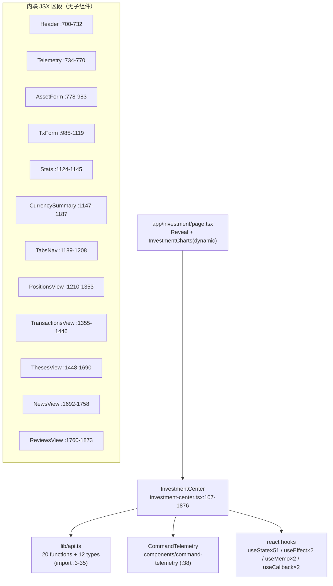

分析完成，所有证据已核验。以下是完整的交接说明（未改动任何产品文件、未执行 git 操作，等待 Tech Lead 归档至 docs/）。

---

# Sprint 2 预研交接说明 — 巨型组件拆分（Frontend Evolution Agent）

**日期**：2026-08-06 ｜ **归属**：Frontend Evolution Agent → Tech Lead 归档
**红线遵守**：未修改任何代码；未新增依赖；未触碰 `lib/api.ts`、`types/**`、`apps/api/**`、`apps/desktop/**`、`docs/**`；未执行 git 操作。
**必读文档**：已读 `CURRENT_PROJECT_AUDIT.md`（§5 C4/H10）、`JARVIS_TARGET_ARCHITECTURE.md`（G8/G9）、`MULTI_AGENT_TEAM_PLAN.md`（§2.5）、`FILE_OWNERSHIP.md`（api.ts 边界）、`MIGRATION_ROADMAP.md`（Sprint 4）。
**实测行数**（与审计 C4 一致）：investment-center 1876、english-coach 1457、chat-workspace 1389、growth-center 1182。四个文件均为 `apps/web/src/components/` 下单体组件，且是全仓组件行数前四。

---

## 0. 四文件共同模式（拆分时统一考虑）

| 模式 | 证据 | 拆分解法 |
|---|---|---|
| 挂载即 `setTimeout(0)` + AbortController + `Promise.all` 全量拉取 | investment:177-231；english:206-275；growth:119-160；chat:239-270 | 统一抽 `useXxxData` hook，返回 `refresh` 与 abort 清理 |
| 全局 `busy`/`loading` 贯穿所有按钮 | investment:116-117；english:171-172；growth:96-97；chat:197-198 | 表单/列表各取所需，避免全局 disable 语义漂移 |
| 编辑交互大量 `window.confirm/prompt` | investment:391/504/610/649；english:358/563；growth:274/298/325；chat:365/440/835 | 拆分时**逐字保留**这些交互，属行为红线 |
| 弹层/表单面板内联在 JSX 中，无子组件 | 四文件均为单一 `export function` | 按 JSX 区段提取（见下文各文件拆分方案） |
| 每个文件只 import 本领域 api.ts 导出 | 见各文件数据流 | 与 Frontend API Layer 的"签名冻结"解耦，组件拆分零 API 改动 |

---

## 1. investment-center.tsx（1876 行）深度分析

### 1.1 组件依赖图

外部依赖仅 3 个（api.ts、CommandTelemetry、react hooks），文件内零内部组件——1876 行全是单体组件体。

### 1.2 状态边界（51 个 useState，行号证据）

| 边界 | 状态（行号） | 归属 |
|---|---|---|
| 导航/反馈 | `tab`(108)、`loading`(116)、`busy`(117)、`error`(118)、`notice`(119) | 顶层壳 |
| 领域集合 | `overview`(109)、`assets`(110)、`transactions`(111)、`theses`(112)、`reviews`(113)、`news`(114)、`newsAssetId`(115) | `useInvestmentData` |
| 资产表单（18 个） | `showAssetForm`(121)、`editingAssetId`(122)、字段 123-137 | `useInvestmentAssetForm` |
| 交易表单（12 个） | `showTransactionForm`(139)、`editingTransactionId`(140-142)、字段 143-151 | `useInvestmentTransactionForm` |
| 理由表单（10 个） | `showThesisForm`(153)、字段 154-162 | `useInvestmentThesisForm` |
| 复盘（2 个） | `reviewAssetId`(164)、`reviewType`(165-166) | `useInvestmentReviews` |
| 派生 | `positions`(168)、`positionByAsset`(169-172)、`unpositionedAssets`(173-175) | 顶层 `useMemo` |

副作用仅 2 处：挂载加载（219-231，含日期默认值设置 222-224）；`tab==="news"` 时按资产刷新情报（247-264）。注意 `loadNews`（233-245）与第二个 effect 存在**双写路径**（toggle 后 `Promise.all([load(), loadNews()])` :617，与 effect 各拉一次），拆分时建议收敛为一个来源。

### 1.3 数据流（api.ts 20 个导出，全部使用）

| 用途 | 调用（行号） |
|---|---|
| 初始并行加载 | getInvestmentOverview(182) / listInvestmentAssets(183) / listInvestmentTransactions(184) / listInvestmentTheses(185) / listInvestmentReviews(186) |
| 情报 | listAssetNews(239,250) / linkAssetNews(614) / unlinkAssetNews(606) |
| 资产+持仓 | createInvestmentAsset(346) / updateInvestmentAsset(326) / deleteInvestmentAsset(400) / createInitialPosition(360) / updatePortfolioPosition(337) |
| 交易 | createInvestmentTransaction(479) / updateInvestmentTransaction(476) / deleteInvestmentTransaction(513) |
| 理由 | createInvestmentThesis(543) / updateInvestmentThesis(583,587) |
| 复盘 | generateInvestmentReview(632) / updateInvestmentReview(671) |

对应 api.ts 领域块：investment 集中在 ~4058-4560（如 getInvestmentOverview :4058、listInvestmentAssets :4208、updatePortfolioPosition :4300、generateInvestmentReview :4470、listAssetNews :4513）。**拆分不改变任何调用路径**——全部保持 `@/lib/api` 具名导入。

### 1.4 拆分方案

**子组件划分**（全部由 JSX 区段原样搬出，props = 该区段用到的 state + 回调）：

| 建议组件 | 行号区间 | 依赖要点 |
|---|---|---|
| `InvestmentHeader` | 700-732 | 复用 asset/tx 表单打开逻辑（708-730 按钮） |
| `InvestmentTelemetry` | 734-770 | `tab`、`overview` |
| `InvestmentAssetForm` | 778-983 | 18 个表单状态 + `positionByAsset`(836 禁用币种) + `saveAsset`/`resetAssetForm`/`editPosition` |
| `InvestmentTransactionForm` | 985-1119 | 12 个表单状态 + `assets` + `saveTransaction` |
| `InvestmentStats` | 1124-1145 | `overview` |
| `InvestmentCurrencySummary` | 1147-1187 | `overview.totals_by_currency` |
| `InvestmentPositions` | 1210-1353 | `positions`、`unpositionedAssets`、`editPosition`、`removeAsset`、`busy` |
| `InvestmentTransactions` | 1355-1446 | `transactions`、`editTransaction`、`removeTransaction`、`busy` |
| `InvestmentTheses` | 1448-1690 | `theses`、`assets`、表单内联(1463-1576)、`changeThesis`、`busy` |
| `InvestmentNews` | 1692-1758 | `assets`、`news`、`newsAssetId`、`toggleNews` |
| `InvestmentReviews` | 1760-1873 | `reviews`、`assets`、`createReview`、`confirmReview`、`busy` |

**hooks 抽取**：

1. `useInvestmentData` — 集合状态(108-115)+`load`(177-217)+`loadNews`(233-245)+两个 effect(219-231,247-264)
2. `useInvestmentAssetForm` — 状态 121-137 + `resetAssetForm`(271-288)+`editPosition`(290-315)+`saveAsset`(317-387)
3. `useInvestmentTransactionForm` — 状态 139-151 + `resetTransactionForm`(412-422)+`editTransaction`(424-450)+`saveTransaction`(452-500)
4. `useInvestmentThesisForm` — 状态 153-162 + `resetThesisForm`(525-534)+`saveThesis`(536-565)
5. `useInvestmentReviews` — 状态 164-166 + `createReview`(627-645)+`confirmReview`(647-685)
6. 顶层保留：`tab`、`busy`、`error`、`notice`、`clearFeedback`(266-269)、`changeThesis`(567-598)、`toggleNews`(600-625)——这些跨多个子视图

**工具函数下沉 `lib/utils.ts`**：`numeric`(76)、`amount`(80)、`compactNumber`(89)、`splitLines`(95)、`dateLabel`(102)、`today`(42)；常量表 `assetTypeOptions`(44)、`riskLabels`(54)、`transactionLabels`(61)、`assessmentLabels`(68) 建议随领域常量文件一并下沉。

**视觉回归截图清单**（Sprint 4 验收基线，每项一张，前后 diff 必须为 0）：

1. 加载屏（687-696）
2. 无资产空态（1219-1231）
3. 持仓卡片：正/负浮动、缺价提示、目标仓位（1233-1313）
4. 未建仓资产卡（1317-1348）
5. 资产表单-新建含初始持仓区（778-983）
6. 资产表单-编辑（币种禁用 836）
7. 交易表单-买入/分红字段切换（1035-1069）
8. 交易流水表-有数据/空态（1370-1444）
9. 理由表单（1463-1576）
10. 理由列表：当前版/历史版、云端徽标、失效/关闭按钮（1577-1688）
11. 情报页：候选/已关联、关联说明（1692-1758）
12. 复盘页：空态/草稿/已确认（1760-1873）
13. 错误与提示条（1121-1122）
14. 币种汇总多币种 + 缺价警告（1147-1187）
15. CommandTelemetry 状态栏（734-770）
16. 五个 Tab 的切换态（1189-1208）

**风险点**：`busy` 全局互斥（拆分后须保持"任一操作进行中禁用全部相关按钮"）；`editPosition` 内含 `setTab`+`scrollTo`（290-315）；表单保存后统一 `await load()` 全量重拉（381/494/557）——拆分后保持"保存→刷新"链路不变。

---

## 2. english-coach.tsx（1457 行）— 一页结论

**结构**：单组件，26 处 useState 声明（29 个状态，5 个跨行）、2 useEffect、2 useMemo、1 useCallback、3 useRef。三 Tab：practice(722-1121)、mistakes(1123-1328)、review(1330-1454)。外部依赖仅 `SpecialistHeader`(:45) 与 api.ts 18 个导出（全部使用，含 getEnglishOverview:215、sendEnglishMessage:380、submitEnglishReview:582 等）。语音识别为本地封装（toggleSpeech 418-460，`recognition` ref :190）。

**建议拆分**：
- `EnglishSessionRail`(724-781)、`EnglishSessionSetup`(785-902)、`EnglishConversation`(904-1118，含 Composer 1070-1116)、`EnglishMistakeBook`(1123-1328)、`EnglishReviewView`(1330-1454)、`EnglishMistakeCard`/`EnglishReviewCard`
- hooks：`useEnglishCollections`(206-275，含 `refreshCollections`)、`useEnglishSpeech`(418-460 + 状态 185-191)、`useEnglishMistakeBook`(过滤 286-300 + 动作 511-571)、`useEnglishReviews`(573-602 + 状态 203-204)
- 工具下沉：`providerLabel`(129-136)、`formatDateTime`(138-146)、`mergeMistakes`(148-159)、`emptyOverview`(69-77)、`sessionTitle`(120)/`correctionModeLabel`(125) 可留领域内

**特别注意**：`busy` 是 `string | null` 按操作 key 互斥（302-318 `runAction`）；会话内消息乐观更新（384-408）与转写编辑（483-504）状态机较复杂，抽取 `useEnglishConversation` 时需保留消息合并语义。

---

## 3. chat-workspace.tsx（1389 行）— 一页结论

**结构**：26 个 useState、5 useEffect、2 useMemo、4 useRef。外部依赖最多：`AgentSelector`/`AIStatus`/`JarvisOrb`/`Message` 四个子组件 + motion + lucide + api.ts 12 个导出（全部使用）。SSE 流式是核心复杂度：`streamChatMessage`(476)/`streamRegenerateMessage`(694) 的 onMeta/onDelta/onDone 乐观更新，`stopGeneration`(598-609) 双通道（cancelChatStream + abort）。

**建议拆分**：
- `SessionDrawer`(935-1030)、`WorkspaceHeader`(1033-1125)、`MessageFlow`(1128-1187，Message 已外部化)、`ComposerRegion`(1189-1331)、`WorkspaceInspector`(1334-1384)
- hooks：`useConversationList`（列表/搜索/建档/归档，187-189 + 239-299 + 321-387）、`useChatStream`（submitMessage 420-596 + regenerateMessage 632-796 + stop 598-609 + refs 213-215）、`useDictation`(865-922 + 210-211 + 216)
- 工具下沉：`SpeechResultEvent/SpeechRecognitionLike/SpeechRecognitionConstructor`(77-94)、`temporaryUserMessage/temporaryAssistantMessage/temporaryRegenerationId`(96-125)、`formatConversationTime`(64-75)、`displayAgentId`(127-133)、`savedAgentRouting`(135-148)

**特别注意**：`deepSeekConfirmationText`(150-168) 与付费确认流程（438-442/655-659）是**安全红线**，拆分时必须原样保留；`createGrowthTask`(847) 是 chat→growth 的跨域耦合，建议拆分时记录为显式依赖，供架构评审（不属本轮改动）。

---

## 4. growth-center.tsx（1182 行）— 一页结论

**结构**：27 个 useState、1 useEffect、3 useMemo、1 useCallback。三 Tab：today(652-792)、goals(794-1054)、review(1056-1179)。外部依赖 `SpecialistHeader`(:33)、`GrowthWorkflowPlanner`(:34，`onApplied={refresh}` :506)、api.ts 20 个导出（全部使用）。`renderTask`(364-454) 已是文件内独立渲染函数，是天然的 `GrowthTaskCard` 抽取点。

**建议拆分**：
- `GrowthTaskForm`(527-645)、`GrowthTodayView`(652-792)、`GrowthGoalsView`(794-1054)、`GrowthReviewView`(1056-1179)、`GrowthTaskCard`(364-454)、`GrowthGoalCard`(866-1043)、`GrowthMilestoneRow`(895-975)
- hooks：`useGrowthData`(119-160 + 状态 83-95)、`useTaskForm`(100-112 + addTask 209-233)、`useGoalForm`(114-117 + addGoal 235-253)；`runAction`(188-207) 模式同 english-coach，可下沉共享（但两文件独立，建议先各自抽取再统一）
- 工具下沉：`localDateString`(54-60)、`formatMinutes`(66-71)、`formatDate`(73-79)、`areaLabel`(62-64)、`areaOptions`(38-44)、`taskStatusLabels`(46-52)

**注意**：页面层 `app/growth/page.tsx` 还有 dynamic 的 `GrowthCharts`（与 growth-center 并列），视觉回归需同屏截图。

---

## 5. 重复工具函数与死路由清单（Sprint 4 下沉/清理）

### 5.1 `providerLabel` 族（9 处，语义各不同，下沉前需统一契约）

| 位置 | 行号 | 签名/语义 |
|---|---|---|
| components/chat/Message.tsx | 21-26 | provider 字符串 → 大写（"LOCAL · QWEN"/"DEEPSEEK"/"MIMO"/"JARVIS"） |
| components/tablet-terminal.tsx | 63-68 | **与 Message.tsx 逐字重复** |
| components/dashboard.tsx | 123-128 | provider 字符串 → 标题大小写 + "Jarvis Router" 兜底 |
| components/english-coach.tsx | 129-136 | EnglishMessage → 中文 + 降级原因 |
| components/intelligence-center.tsx | 81-87 | NewsItem → 中文 + fallback_reason |
| components/app-header.tsx | 19 / 57-60 | `PROVIDER_LABEL` Record + 常量查找 |
| components/context-engineering.tsx | 33-37 | `providerLabels` Record（mimo/deepseek/ollama） |
| components/cost-center.tsx | 28-32 | **与 context-engineering 逐字重复** |
| components/evaluation-center.tsx | 17-21 | 类型化 Record（EvaluationProvider） |

> 建议：下沉为 `lib/utils.ts` 中 `providerLabel(provider, opts?)` + 各领域专用包装（如 `englishProviderLabel(message)` 留在领域 hook），避免一次拉平破坏 9 处既有文案。

### 5.2 其他重复工具

| 函数 | 重复位置（行号） |
|---|---|
| `SpeechResultEvent`/`SpeechRecognitionLike`/`SpeechRecognitionConstructor` | chat-workspace:77-94、english-coach:49-67、tablet-terminal:28-46（**3 份逐字重复**） |
| `temporaryUserMessage`/`temporaryAssistantMessage` | chat-workspace:96-121 vs tablet-terminal:70（`temporaryMessage`） |
| `formatDate` | dashboard:106、data-protection:13、growth-center:73、knowledge-center:72（4 份，实现略有差异） |
| `formatDateTime` | english-coach:138、intelligence-center:71 |
| `formatNumber` | cost-center:34、context-engineering:49 |
| `splitLines` | investment-center:95、research-workflow-planner:70 |
| `today`/`localDateString` | investment-center:42、growth-center:54、chat-workspace:66（局部 const） |
| `formatMinutes` / `areaLabel` | growth-center:66 / 62（仪表盘等可能复刻，待全仓核对） |

### 5.3 `[module]` 死路由

- `apps/web/src/app/[module]/` 是**空目录**：无 page.tsx、无任何文件（含隐藏文件）、无 layout；全仓代码中无对它的路由引用（唯一 `[module]` 文本匹配是某页 JS 表达式 `modules[module]`，非路由）。
- 其余 22 个 app 目录均有 page.tsx，`[module]` 是唯一空目录——确认是 Sprint 2-7 遗留。
- 清理动作（Sprint 4，属 Frontend Evolution 的 `app/**` 权限）：删除空目录即可，无代码影响；删除后复跑 `check.ps1` 确认无路由变化。

### 5.4 附带发现（供 Tech Lead 决策，非本轮改动）

- `lib/utils.ts` 目前只导出 `cn`（utils.ts:4），是工具下沉的空白靶位。
- 12 个组件超过 600 行（审计说 8 个；实测超 600 行的共 12 个，前四即本次四文件，其后为 intelligence-center 1020 / knowledge-center 905 / tablet-terminal 835 / notification-center 785 / research-workflow-planner 707 / growth-workflow-planner 667 / memory-center 666 / agent-observatory 616）——Sprint 4 拆分完后建议把 600+ 清单作为后续 backlog。
- 跨域耦合一例：chat-workspace.tsx:847 `createGrowthTask`（chat→growth），拆分 chat 时需显式保留该导入并知会架构评审。

---

## 6. 交接要点（给各 Agent）

1. **Tech Lead**：将本说明归档 docs/；Sprint 4 给 Frontend Evolution 的任务卡建议按"investment 先行（hooks 先行→子组件→截图基线）、english/chat/growth 跟进、utils 下沉与 [module] 清理可并行"排序。
2. **Frontend API Layer**：四文件仅依赖 `@/lib/api` 具名导出，api.ts 领域块已分区（chat ~2264-2600、growth ~3085-3460、english ~3541-3900、investment ~4058-4560）；拆分期间**导出签名冻结即可**，组件侧零改动。
3. **QA & Reliability**：视觉回归基线建议先于拆分拍摄（本说明第 1.4 节 16 项截图清单可直接作为 investment 的验收矩阵；english/chat/growth 各按 Tab+空态+表单态补拍）。
4. **风险总览**：拆分最大风险是全局 `busy` 互斥、`window.confirm/prompt` 交互、表单保存后全量 `load()` 链路、chat 的 SSE 乐观更新——全部已有行号锚点，逐项对照回归即可。

以上为完整预研输出，等待 Tech Lead 归档；本 Agent 未写入任何产品文件。