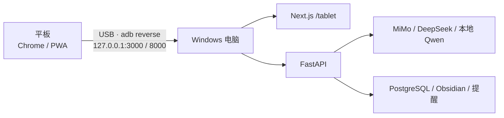

# Sprint 21：Tablet Companion

## 目标

让平板 12.4 成为 Jarvis 的专用对话终端。模型、数据库、长期记忆、
API Key 和后台任务仍只运行在电脑，平板只负责显示、触控输入和可选语音转写。

## 连接架构

平板访问自己的 `127.0.0.1`，Android Debug Bridge 只把指定的 3000 和 8000
端口反向转发到电脑。Jarvis Core 继续监听电脑的 `127.0.0.1`，不开放
`0.0.0.0`，也不新增 Windows 防火墙入站规则。

## 已完成

- 新增 `/tablet` 专用全屏界面，不显示桌面侧边栏；
- 针对 1280×800 横屏视口设计三栏 Command Terminal；
- 接入真实会话列表、新建会话、流式回答和停止生成；
- 所有消息继续由电脑后端自动保存；
- 支持标准 MiMo、本地 Qwen 和经确认后的 DeepSeek；
- 支持知识增强和隐私模式；
- 展示 Jarvis Core、模型、双语声音、PC 托管记忆和 USB 链路状态；
- 支持全屏和 Screen Wake Lock 屏幕常亮；
- 支持中文或英语浏览器语音转写，并在首次使用前显示隐私确认；
- 新增 PWA Manifest，安装后默认横屏并直接进入 `/tablet`；
- 新增 Android Platform Tools 安装、USB 连接和断开脚本；
- 安装脚本必须显式确认已阅读 Android SDK 许可，并验证 `adb.exe` 的 Google
  数字签名；
- 连接脚本只调用 `adb devices`、`adb reverse` 和 `adb shell am start`；
- 不安装 APK、不解锁 Bootloader、不取得 Root、不读取或写入平板文件。

## 用户操作

1. 阅读 Google Android SDK 许可；
2. 明确执行 `scripts\install-tablet-tools.ps1 -AcceptAndroidSdkLicense`；
3. 在平板开启开发者选项和 USB 调试；
4. 使用可传输数据的 USB 线连接电脑；
5. 仅在平板上信任自己的这台电脑；
6. 双击 `连接 Jarvis 平板.cmd`；
7. 不再使用时双击 `断开 Jarvis 平板.cmd`，并可关闭 USB 调试。

## 安全边界

- USB 调试本身是较高权限能力，只应授权自己的电脑；
- Jarvis 不自动安装 Android Platform Tools，许可必须由用户明确接受；
- ADB 工具保存在 `.tools/android/`，不加入源码版本控制；
- 断开 USB 或删除反向转发后，平板不能继续访问电脑上的 Jarvis；
- 平板不保存 API Key、模型或数据库；
- 浏览器语音转写可能使用浏览器或系统在线服务，不应用于密码、API Key 或其他
  敏感口述；
- 当前没有启用 Wi‑Fi ADB、局域网访问或公网访问。

## 验收状态

- 前端 TypeScript 和 ESLint：通过；
- PowerShell 三个脚本语法检查：通过；
- 1280×800 横屏视觉检查：通过；
- 真实聊天 API、模型状态和双语声音状态：已接入；
- 真机 USB 验收：通过（2026-08-02）；
- 设备：平板 `22081281AC`，ADB 产品标识 `dagu`；
- USB 调试 RSA 授权：通过，仅连接到用户自己的 Windows 电脑；
- `tcp:3000` 与 `tcp:8000` ADB Reverse：建立并复核通过；
- 平板浏览器 `/tablet` 前台启动：通过；
- 设备实际 1280×754 横屏布局：通过；
- 浏览器全屏与 Screen Wake Lock：真机确认通过；
- 中文语音转写、浏览器麦克风授权与本地 Qwen 回复：真机确认通过；
- 测试消息与回答自动保存、电脑端读取同一会话：通过；
- 模型审计记录为 `ollama`，未产生 MiMo 或 DeepSeek 调用：通过；
- 一键断开、映射清除、无刷新重新连接与屏幕常亮恢复：通过；
- Jarvis Core、MiMo、DeepSeek、本地 Qwen、双语声音与 PC 托管记忆状态：在线。

## 真机验收结论

Sprint 21 Tablet Companion 已完成。连接方案没有安装 APK、没有使用
`fastboot`、没有解锁或 Root，也没有开放局域网或公网端口。平板断开 USB
或执行 `断开 Jarvis 平板.cmd` 后，两个回环映射会被移除，平板不能继续访问
电脑上的 Jarvis。
