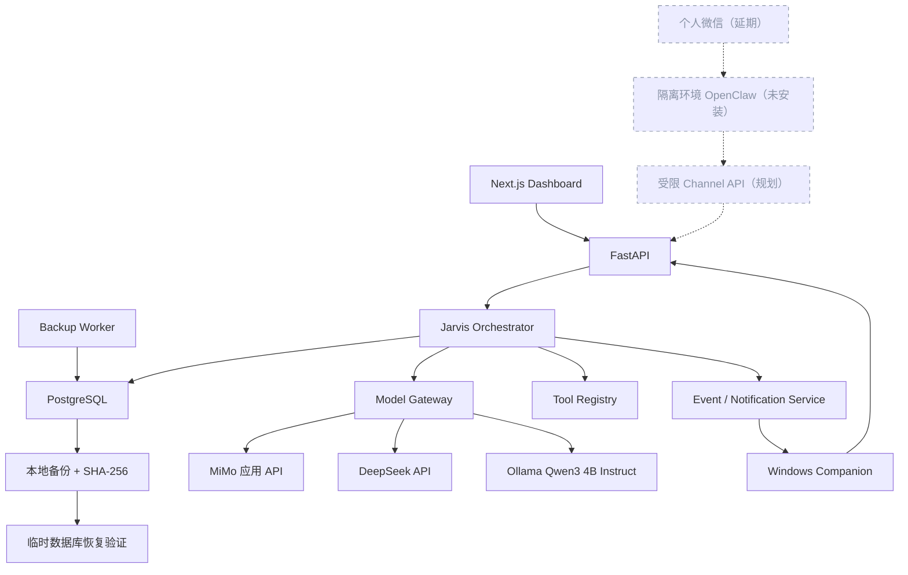

# Jarvis OS v1.1 技术设计

## 1. 目标

本设计将 PRD 转换为可渐进交付的工程结构，优先满足：

- Windows 本地长期运行；
- 电脑、网页和微信共享同一数据源；
- MiMo、DeepSeek 与本地 Qwen 可替换、可追踪；
- 自动记忆和主动提醒不会失控；
- 每个 Sprint 都有可运行的纵向结果；
- 16GB 内存、RTX 3050 4GB 显存条件下保持可用。

## 2. 当前工程结构

```text
E:\贾维斯
├─ apps
│  ├─ api
│  │  ├─ app
│  │  │  ├─ api              HTTP 路由
│  │  │  ├─ core             配置和基础能力
│  │  │  ├─ db               SQLAlchemy 模型与会话
│  │  │  ├─ schemas          API Schema
│  │  │  └─ services         模型、记忆、通知等服务
│  │  ├─ migrations          Alembic
│  │  └─ tests
│  ├─ web                    Next.js 16 App Router
│  └─ desktop                Windows Companion
├─ docs
├─ infra
└─ scripts
```

## 3. 运行时架构



### 数据所有权

- FastAPI + PostgreSQL 是唯一业务数据源；
- OpenClaw 当前未安装；未来也只能通过受限 Channel API 负责微信消息收发；
- Next.js 不保存独立业务状态；
- Windows Companion 只缓存待播报事件和设备状态；
- Backup Worker 只创建和验证数据库恢复点，不执行业务决策；
- 模型 Provider 不拥有用户长期记忆。

## 4. 技术选择

### 4.1 前端

| 选择 | 原因 |
|---|---|
| Next.js 16 App Router | 桌面 Dashboard、后续 PWA、组件化和路由支持 |
| React 19 | 与当前 Next.js App Router 配套 |
| TypeScript | 降低前后端契约错误 |
| Tailwind CSS 4 + 自定义 CSS | 快速构建统一 UI，同时保留设计控制 |

Node.js 22.14 满足 Next.js 16 要求。

### 4.2 后端

| 选择 | 原因 |
|---|---|
| Python 3.13 | 当前本机环境，适合 AI 与后台任务 |
| FastAPI | 异步 API、Schema 和自动文档 |
| Pydantic v2 | 配置和输入输出校验 |
| SQLAlchemy 2 | 显式数据模型和异步访问 |
| Alembic | 数据库迁移 |
| httpx | 模型与外部服务调用 |

### 4.3 数据库

Sprint 1 使用 PostgreSQL 17。

后续引入语义记忆时，在 PostgreSQL 内增加 pgvector，暂不增加独立 Vector DB。

### 4.4 Windows Companion

它是实现“自动开口”的必要组件。

网页在关闭、休眠或浏览器限制后台执行时无法保证可靠播报，因此语音和桌面通知不能只依赖 Next.js。

Sprint 4 再引入：

- Windows 托盘；
- TTS；
- Toast；
- 开机启动；
- 设备状态；
- 本地 WebSocket 或事件轮询。

## 5. 模型设计

### 5.1 Model Gateway 接口

Agent 只提交：

- 消息；
- 模型模式；
- 隐私级别；
- 复杂度；
- 可用工具；
- 输出 Schema。

Agent 不直接知道 API Key、Base URL 或 Provider SDK。

### 5.2 路由优先级

```text
用户明确指定
  > 隐私 / 离线规则
  > 失败与复杂度升级
  > 默认 MiMo
```

### 5.3 模式

| 模式 | 行为 |
|---|---|
| `standard` | MiMo |
| `deep` | DeepSeek |
| `local` | Ollama `qwen3:4b-instruct-2507-q4_K_M` |
| `auto` | 根据隐私、复杂度和失败次数决定 |

### 5.4 MiMo 凭证与显式风险开关

MiMo Provider 同时兼容按量 API 与 Token Plan 的 OpenAI 兼容协议：

- `sk-` 密钥使用普通 API 地址和 `Authorization: Bearer`；
- `tp-` 密钥使用订阅管理页提供的 `token-plan-*` 专用地址和 `api-key`；
- Token Plan 使用 `max_completion_tokens`，普通兼容接口使用 `max_tokens`；
- `tp-` 只有在 `MIMO_TOKEN_PLAN_ENABLED=true` 时才进入正式路由；
- 专用地址不匹配、开关关闭或请求失败时，MiMo 降级到本地 Qwen；
- DeepSeek 仍然必须由用户逐次确认，不作为 MiMo 故障的自动付费兜底。

小米当前套餐说明禁止明显的非编程自定义应用后端。当前电脑所有者已明确要求
在知晓暂停服务或封禁密钥风险后启用；运行状态接口持续暴露风险提示，但不记录
或返回密钥。

### 5.5 DeepSeek 升级

初始策略：

- 用户明确选择“深度”并逐次确认后使用；
- 自动模式复杂度大于等于 8 时提出升级；
- MiMo 连续失败两次时提出升级；
- 任何实际使用 DeepSeek 的调用都要求逐次确认；
- 单请求最多自动升级一次；
- 记录升级原因与 `user_confirmed` 审计标记。

### 5.6 Runtime 降级与审计

- `standard` 请求 MiMo；未配置应用 API Key 时降级到 Ollama；
- `deep` 请求 DeepSeek；未配置 Key 时降级到 Ollama；
- `local` 和隐私请求始终使用 Ollama；
- MiMo 或 DeepSeek 在连接、超时或服务端执行阶段失败时，最多重试一次本地 Ollama；
- 流式云端调用只有在尚未输出正文时才允许切换本地，避免把两个模型的半段回答拼接；
- 运行时降级不会自动改用 DeepSeek，任何付费调用仍由用户明确选择并逐次确认；
- 降级不静默进行，API 和 Chat 界面同时显示原因；
- 每次调用记录请求模式、目标 Provider、实际 Provider、模型、耗时、Token 和错误类型；
- 模型密钥、完整请求头和隐藏推理过程不写入日志；
- 本地日常对话使用非 Thinking 的 Qwen3 4B Instruct，避免短问题耗尽推理 Token。

### 5.7 受控长期记忆

- 对话中的稳定偏好、目标、技能、职业和投资信息可自动提取为候选记忆；
- 自动候选默认是 `pending`，在用户确认前绝不进入模型上下文；
- 用户可以手动添加、搜索、确认、忽略、编辑、停用、重新启用和软删除；
- 本地模型可使用已确认的活跃记忆；
- MiMo 与 DeepSeek 只能接收同时满足“已确认”和“允许云端”的记忆；
- 密码、API Key、验证码、完整证件号、银行卡号和私钥在保存前被拦截；
- 内容编辑写入 `memory_revisions`，被停用、拒绝、删除或过期的记忆不参与回答。

### 5.8 Growth Manager

成长数据链固定为：

```text
目标 → 里程碑 → 任务 → 任务事件 → 每日计划 / 周复盘
```

- 任务事件记录开始、暂停、完成、取消、计时和状态变化；
- 目标进度由已完成里程碑与已完成任务共同计算，并显示计算依据；
- 每日计划按进行中状态、优先级和截止时间选择最多 3 项；
- 每日计划先保存为草稿，用户确认后才批量设置 `planned_date`；
- 今日计划可以经确认后安全重置，未完成任务回到待安排状态；
- 周复盘的计划数、完成数、完成率和实际分钟数来自数据库记录；
- 用户确认前不自动批量修改下一周期任务；
- 对话内容可以显式转换为任务，来源标记为 `conversation`。

### 5.9 English Coach

英语学习链固定为：

```text
英语会话 → 模型或规则纠错 → 用户确认 → 错题聚合 → 间隔复习 → 主动提醒
```

- 训练场景包括自由、主题、面试和技术英语；
- 纠错节奏包括即时、温和和结束总结；
- 标准路线请求 MiMo，当前应用密钥不可用时明确降级到本地 Qwen；
- 页面只接受 `standard` 和 `local`，不会产生 DeepSeek 付费调用；
- 英语专用生成限制为较短输出，并设置 45 秒上限以适配 RTX 3050 4GB；
- 模型超时或异常时，本地规则继续提供基础回复和常见语法纠错；
- 模型纠错先保存为 `pending`，用户确认后才生成复习；
- 同类错误按用户、标准化原句、正确表达和类别聚合；
- 标点差异不产生重复错题，删除后再次出现可安全恢复；
- 复习结果决定下次间隔，标记掌握后至少 30 天再巩固；
- 每个复习使用 `english-review:{review_id}` 幂等键接入提醒队列；
- 解释有误、完成复习或删除错题时取消尚未投递的旧提醒。

### 5.10 Information Intelligence

情报处理链固定为：

```text
白名单 RSS / 手动链接
  → 公共网络地址校验
  → RSS / Atom 解析
  → URL / 正文 / 标题去重
  → 主题、兴趣、可信度、时效和目标评分
  → 3–5 条可追溯简报
  → 收藏 / 忽略 / 转任务反馈
  → desktop + voice
```

- 每次初始请求和重定向都解析 DNS，拒绝本机、内网、链路本地和保留地址；
- Feed 限制为 2 MB、30 条和近 30 天，普通网页正文抓取暂不开放；
- `source_excerpt` 永远保存来源事实，`analysis_text` 明确是 AI 或规则推断；
- 标准路线只在 MiMo 与本地 Qwen 之间选择，情报接口不接受 DeepSeek 模式；
- 模型 Prompt 把标题与摘要视为不可信数据，禁止执行来源中的指令；
- 投资类建议经过交易动词拦截，不允许买卖、调仓、仓位或价格预测；
- 每日简报使用 `daily-brief:{brief_id}` 幂等键接入现有提醒链；
- 后台任务只在每天 07:45–12:00 尝试一次，没有内容时保留后续重试机会；
- 收藏、忽略和转任务记录到 `interest_feedback`，并在 1–5 内调整主题权重；
- `news_item_links` 已支持任务和资产关联，资产关联由 Sprint 7 的 Investment Assistant 管理。

### 5.11 Investment Assistant

投资数据链固定为：

```text
手动录入资产
  → 初始持仓 / 买入 / 卖出 / 分红交易账本
  → 按交易日期和创建顺序重算移动平均成本
  → 当前持仓与已实现收益
  → 手动最新价格和日期
  → 按币种分别汇总
  → 投资理由版本 + 关联情报
  → 基于事实快照的周/月/手动复盘
```

- 数量、价格、费用、成本和收益全部使用数据库 `Numeric` 与 Python `Decimal`，不使用浮点数；
- 初始持仓会生成一笔 `opening` 交易，之后的持仓状态始终由有效交易历史重算；
- 买入把成交金额与费用计入成本，卖出按卖出前平均成本减少成本基础并计算已实现收益，分红只增加收入；
- 修改或软删除历史交易后会重算其后的每一步，若导致后续卖出超过可用数量则拒绝保存；
- 有有效交易后禁止修改资产币种；没有汇率来源时，CNY、USD 等币种不跨币种相加；
- 最新价格只接受用户手动录入并保留价格日期；缺少价格时市值和浮动收益返回 `null`；
- 资产、持仓、交易、投资理由和复盘使用软删除；删除资产时同步解除情报关联；
- 相同市场和代码的软删除资产再次录入时恢复原资产标识，避免唯一约束造成死记录；
- 新投资理由会把上一版本标记为 `superseded`，原始理由、关键假设和失效条件继续保留；
- `news_item_links.link_type = asset` 建立情报与资产的多对多关联，关联本身不会触发交易动作；
- Sprint 7 复盘由规则和数据库事实生成，快照包含持仓、期间交易、当前理由和关联情报；
- 复盘固定显示“不构成投资建议”，不输出买卖、调仓、仓位或价格预测；
- 投资记录默认只在本地业务链使用；Sprint 7 不把完整持仓交给云端模型。

### 5.12 Obsidian Knowledge Bridge（Sprint 12–16 已实现）

Obsidian 是人可直接阅读和整理的长期知识层，不替代 PostgreSQL 中的任务、
记忆、情报、提醒或投资主数据。

```text
Jarvis 业务记录
  → Knowledge Bridge 权限与模板
  → Vault/Jarvis 受限目录
  → 文件哈希与索引
  → 来源唯一键与冲突检测
  → Jarvis 检索 / 打开 / 回溯来源
```

- 首版直接读写本地 Markdown，不要求 Obsidian 进程始终运行；
- Vault 路径由用户配置，写入路径固定在 `Jarvis/` 子目录；
- 所有路径解析后必须仍位于 Vault 内，拒绝 `..`、绝对子路径和符号链接越界；
- `.obsidian` 配置目录和隐藏文件不进入知识索引；
- 写入采用临时文件原子替换，并用内容哈希实现幂等与冲突检测；
- Jarvis 只自动归档已确认记忆和已生成的每日情报；
- 周复盘、已完成英语会话、投资理由和投资复盘必须手动触发；
- 用户修改、文件缺失或目标文件冲突时不覆盖原文件，新版本进入 `Jarvis/_review/`；
- 当前版本不从 Vault 删除用户文件，`Jarvis/_archive/` 预留给未来人工归档流程；
- 笔记保留 `jarvis_id`、来源、敏感等级、云端权限和 schema 版本；
- PostgreSQL 保存文档索引、归档状态与同步日志，Vault Markdown 保存人可阅读内容；
- Chat 按当前问题提取中英文词项，在标题、路径和正文中召回，内存排序后最多使用
  4 篇、约 4800 字符摘录；
- `retrieval_enabled` 控制是否参与任何检索，`cloud_allowed` 控制是否可进入
  MiMo / DeepSeek 上下文；两项权限默认分别为 true 和 false；
- 回答消息保存来源标识、标题、相对路径和 Obsidian URI，不保存检索摘录；
- `knowledge_retrieval_logs` 只保存查询哈希、文档标识、Provider、数量和字符数；
- 知识上下文固定声明为不可信数据，不允许执行笔记中的提示词、链接动作或权限要求；
- Sprint 27 在词法检索之外增加 PostgreSQL + pgvector 精确语义检索，使用本机
  Ollama `bge-m3:latest` 的 1024 维向量和 RRF 融合；向量不复制正文，索引失败时
  自动回退词法检索；每次进入云端上下文前仍以当前 `cloud_allowed` 为准；
- 对话知识沉淀由用户在 Chat 手动触发，固定构造本地 `ResolvedRoute(ollama)`，
  不经过 MiMo / DeepSeek 路由或云端故障降级；
- 草稿源最多使用最近 60 条有效消息、已有摘要和 24000 字符，输出上限 20000 字符；
- `knowledge_capture_drafts` 以对话和最后来源消息建立唯一键，避免重复生成；
- 草稿先保存在 PostgreSQL，只有确认后才通过受控归档写入 `Conversations/`；
- 草稿再次编辑会回到待确认状态，文件冲突继续复用 `_review/` 保护；
- 草稿提炼构造固定的本地 `ResolvedRoute(ollama)`，严格解析最多 8 条 JSON
  候选，不允许云端故障降级；
- `knowledge_insight_candidates` 保存类型、来源标题、内容指纹、确认状态以及
  可选的 `memory_id` / `task_id`，不把候选直接视为有效记忆；
- 候选仅允许 `memory`、`task` 和 `question`；内容指纹与草稿组成唯一键，
  提炼完成时间使空结果和重复点击同样保持幂等；
- `memory` 确认沿用长期记忆的敏感信息检查、指纹去重和云端默认关闭规则；
  `task` 创建普通成长任务，`question` 创建带“核验：”前缀的成长任务；
- 草稿编辑时删除未接受候选并重置提炼状态；已接受候选及其来源关联永久保留；
- 已归档但未提炼的草稿仍会在待处理区出现，提炼完成后退出待处理列表；
- 提炼调用写入 `model_call_logs`；解析或模型失败时保存失败审计，但不写入候选，
  也不设置 `insights_extracted_at`；
- Local REST API / MCP 是可选增强，不是首版运行依赖。

### 5.13 Future Automation Gateway（v1.2 规划）

n8n 计划在 v1.2 作为 `Automation Gateway` 的可选 Provider，用于日历、
邮件、网盘、表格和第三方 Webhook。Jarvis 只允许调用白名单工作流，
并为每次执行保存 `correlation_id`、`idempotency_key`、状态和确认记录。
核心调度、长期记忆、情报处理、模型路由、投资记录、提醒和 OpenClaw
不得迁移到 n8n。

### 5.14 Data Protection 与恢复边界

数据保护链固定为：

```text
每小时检查
  → 约每 20 小时生成 PostgreSQL custom-format dump
  → pg_restore 清单校验
  → 原子写入 backups/
  → SHA-256 + 数据结构版本清单
  → 独立临时数据库恢复验证
  → 最多保留 30 份
```

- 备份 Worker 随 Jarvis 启动和停止，不依赖网页保持打开；
- 设置页可以查看、立即创建和验证恢复点，不能直接覆盖当前数据库；
- 恢复脚本要求 API 已停止、完整确认文字、校验通过，并先创建当前数据库安全备份；
- 正式恢复先进入临时数据库，成功后再交换数据库名称，原数据库继续保留；
- 备份目录和恢复目标都必须解析到预期项目路径，不接受任意删除或通配目标；
- 本地同盘备份防止误删、迁移失败和逻辑损坏，但不能抵御整块硬盘损坏；
- OpenClaw 主机安装继续延期；未来只能通过隔离环境和受限 Channel API 接入，不能直接获得 Jarvis 数据库、项目目录或 Docker 权限。

## 6. 配置与密钥

### 配置层级

```text
代码默认值
  < 根目录 .env
  < 进程环境变量
```

规则：

- `.env.example` 可以提交；
- `.env` 永不提交；
- API 不返回密钥；
- 日志自动屏蔽 Authorization、API Key 和 Cookie；
- 后续生产版本使用 Windows 凭据管理器或等价安全存储。

## 7. 数据访问

### 单用户与多用户字段

产品 v1.1 是单用户，但所有核心表保留 `user_id`：

- 防止后续手机、微信和桌面会话混淆；
- 支持数据隔离测试；
- 不代表当前需要登录系统。

### 迁移策略

- `AUTO_CREATE_SCHEMA=false`，所有真实数据库结构统一由 Alembic 管理；
- 从第一个真实数据版本开始，以 Alembic 迁移为准；
- 所有迁移必须提供 downgrade；
- 持仓、交易、记忆等重要表使用软删除。

## 8. API 约定

- 统一前缀 `/api/v1`；
- UUID 作为公开 ID；
- 时间存 UTC，显示使用 `Asia/Shanghai`；
- Pydantic Schema 与 ORM Model 分离；
- 错误使用明确的 HTTP 状态码；
- 外部回调必须带幂等键；
- 流式聊天使用 SSE；
- 高风险操作采用“提议 → 确认 → 执行”三阶段。

Sprint 2 已实现的 Chat 端点：

```text
GET  /api/v1/chat/conversations
POST /api/v1/chat/conversations
GET  /api/v1/chat/conversations/{conversation_id}
POST /api/v1/chat/conversations/{conversation_id}/messages
POST /api/v1/chat/conversations/{conversation_id}/archive
GET  /api/v1/chat/model-calls
```

## 9. 事件与主动提醒

Sprint 4 已实现的持久化链路：

```text
任务或独立提醒
  → scheduled_jobs（幂等调度）
  → notifications（可领取投递）
  → Windows Companion
  → desktop / voice 独立执行
  → delivery_attempts（逐渠道结果）
```

核心约束：

- 任务提醒使用 `task:{task_id}:reminder` 幂等键，同一任务不会重复建提醒；
- Companion 领取后通知进入 `claimed`，5 分钟未确认才允许重新领取；
- 桌面与语音分别记录，语音失败不影响已经成功的文字通知；
- 全部失败时 1 分钟后重试，最多 3 次，之后进入失败历史；
- 默认免打扰为 22:30–08:00，免打扰时只抑制语音；
- 敏感提醒默认禁止自动朗读；
- 默认每天最多 12 条、每小时最多 3 条语音；
- 完成、取消或删除任务会取消尚未投递的关联提醒；
- Companion 每 10 秒心跳，API 以 35 秒内最后心跳判断在线。

Windows Companion 使用系统 Toast 和 SAPI 语音。它会逐个尝试已安装的声音，跳过损坏的语音引擎，并把最终错误写入投递历史。托盘提供打开 Jarvis、暂停 1 小时、恢复和退出。

Sprint 4 已实现的提醒端点：

```text
GET    /api/v1/notifications/preferences
PATCH  /api/v1/notifications/preferences
GET    /api/v1/notifications
POST   /api/v1/notifications
POST   /api/v1/notifications/claim
POST   /api/v1/notifications/{id}/ack
POST   /api/v1/notifications/{id}/snooze
POST   /api/v1/notifications/{id}/dismiss
POST   /api/v1/notifications/{id}/retry
DELETE /api/v1/notifications/{id}
GET    /api/v1/notifications/devices/status
```

Sprint 5 的英语复习直接复用同一通知链路，默认首次安排在次日 19:00，并请求 `desktop` 与 `voice` 两个渠道。免打扰、频率上限、暂停和 Companion 投递规则不变。

Sprint 6 的每日情报同样复用通知链路。自动晨报默认上海时间 07:45 生成，语音只播报数量与首要标题，完整来源和分析留在情报中心查看。

## 10. 安全边界

### 默认拒绝

- 微信直接执行文件删除；
- 模型直接修改投资交易；
- 未确认发送外部消息；
- 把完整持仓、身份和密钥发送至云端；
- 非白名单微信身份访问。

### 需要确认

- 使用 DeepSeek 产生付费调用；
- 批量修改任务；
- 删除记忆；
- 修改历史交易；
- 外部工具写操作。

## 11. 可观测性

最小日志字段：

- `request_id`；
- `user_id`；
- `channel`；
- `agent`；
- `provider`；
- `model`；
- `latency_ms`；
- `token_usage`；
- `tool_name`；
- `result_status`。

不得记录：

- API Key；
- 完整 Authorization Header；
- 密码；
- 完整私密投资内容；
- 模型隐藏推理过程。

## 12. 参考

- [Jarvis OS v1.1 PRD](Jarvis_OS_v1.1_PRD.md)
- [Next.js 安装文档](https://nextjs.org/docs/app/getting-started/installation)
- [MiMo OpenAI API 兼容文档](https://mimo.mi.com/docs/api/chat/openai-api)
- [MiMo Token Plan 使用说明](https://mimo.mi.com/docs/tokenplan/subscription)
- [DeepSeek Chat Completions](https://api-docs.deepseek.com/api/create-chat-completion)
- [OpenClaw 渠道文档](https://docs.openclaw.ai/channels)
- [Microsoft SAPI SpVoice](https://learn.microsoft.com/en-us/previous-versions/windows/desktop/ms720149%28v%3Dvs.85%29)
- [Microsoft SAPI SpFileStream](https://learn.microsoft.com/en-us/previous-versions/windows/desktop/ms722562%28v%3Dvs.85%29)
